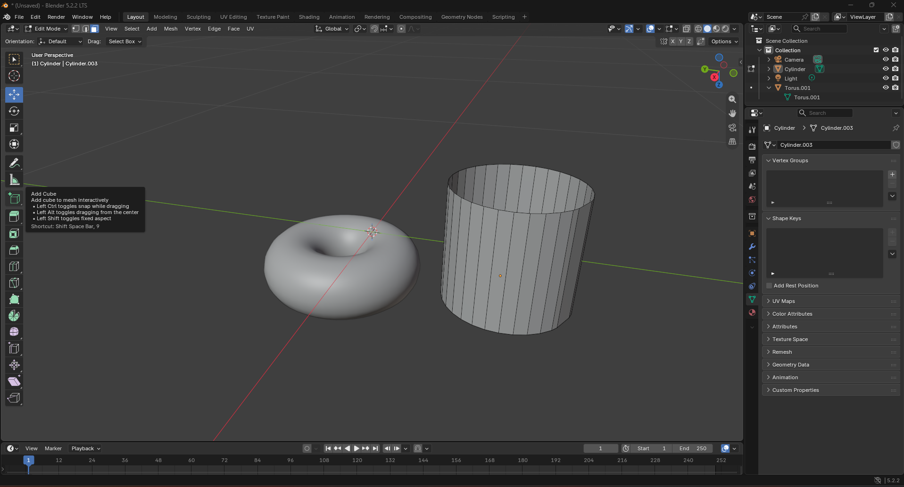

# Blender notes

`the-noise-next-door` · CSYE 7270 · Assignment 3 · Blender 5.2.2 LTS

What the main parts of Blender's window are and what each one does. They come from my first session looking round Blender before building anything (the assignment's "Learn the window" step). The page also covers what my hand edit in Blender taught me.

**Who wrote what.**
- **Me:** the notes under the headings, kept as I typed them.
- **Claude Code:** it arranged them under these headings, wrote the screenshot's caption, and added the two sections marked as Claude's: the corrections and the triangle counts.

**Status (13 Oct 2026).**
- My first session was on the evening of 13 Oct. I followed a beginner's tutorial and made a donut and a cup. The screenshot is from 21:38, and the practice file was saved at 21:45.
- Done: the 3D viewport.
- Not written yet: the toolbar, Outliner, Properties editor, sidebar and mode selector.
- My hand edit happens during the build, on one of the three assets.

**Reference:** the Blender manual's [interface chapter](https://docs.blender.org/manual/en/latest/interface/index.html) and [3D Viewport pages](https://docs.blender.org/manual/en/latest/editors/3dview/index.html).

Blender's Tutorial : https://www.youtube.com/watch?v=z-Xl9tGqH14

## The six parts

### 3D viewport

- Orbit : Always thought the middle mouse click should do something and now i know, just kinding but now i know how to move around for my shapes across dimension of x-y-z
- Zoom : Using the general mouse scroll
- Coming back the shape : After starting work and generally draging around and the shape in different views. I felt lost and to just back to the exact shape in the correct postition : Numpads - Del(.)
- Delete (X) : To delete stuff ofc gonna be removing and editing a lot of things
- Mesh (Shift + A) : To add the closest shape we are trying to create
- Add torus (F9) : For the definations and size of the shape

> **Corrections (Claude Code, 13 Oct).**
> - **F9** reopens the **Adjust Last Operation** panel for whatever was just done. It isn't a torus command. After adding a torus, the panel shows the torus's settings. After adding a cylinder, it's where its **Vertices** can be lowered to save triangles.
> - **Numpad `.`** is **View Selected**: it zooms to whatever is selected. **Home** frames the whole scene.

### Toolbar

### Outliner

### Properties editor

### Sidebar (N)

### Mode selector: Object Mode and Edit Mode

## My screenshot

*My own session, 13 Oct 2026, 21:38: a donut (a torus) and a cup (a cylinder), with the cup selected in Edit Mode.* Visible:
- the 3D viewport, in the middle;
- the toolbar down the left, with its "Add Cube" tooltip showing;
- the Outliner, top right;
- the Properties editor below it, on its Object Data tab;
- the mode selector, showing "Edit Mode", top left.

The sidebar (N) isn't open.

### Triangle counts in my practice file (measured by Claude Code)

Counted from the saved `donot-and-cup-v1.blend` with modifiers included. They still need checking with Blender's own Scene Statistics.

| Object | Modifiers | Triangles | Against one asset's limit of 500 |
|---|---|---|---|
| Cup | Solidify, Subdivision Surface | 491,520 | about 980 times over |
| Donut | none | 1,728 | about 3.5 times over |

## My hand edit
