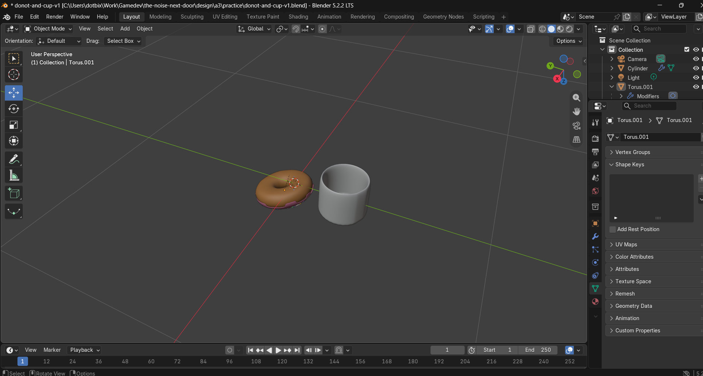
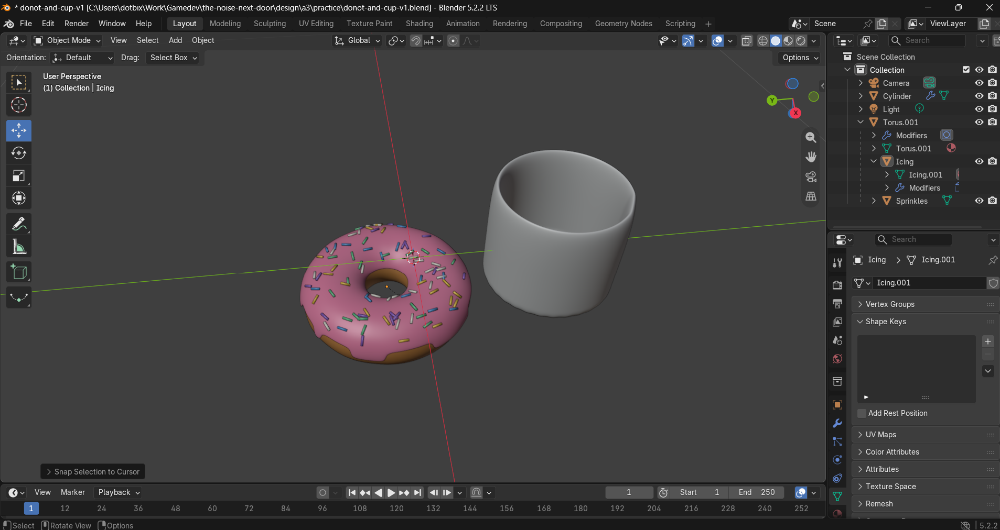
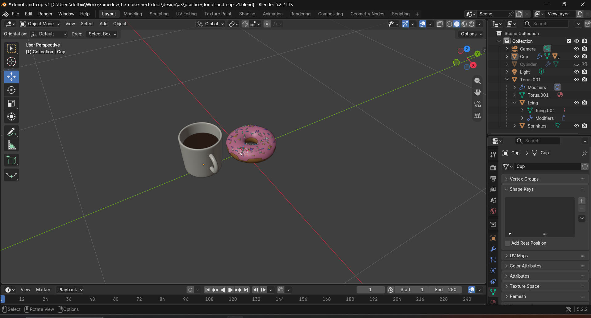
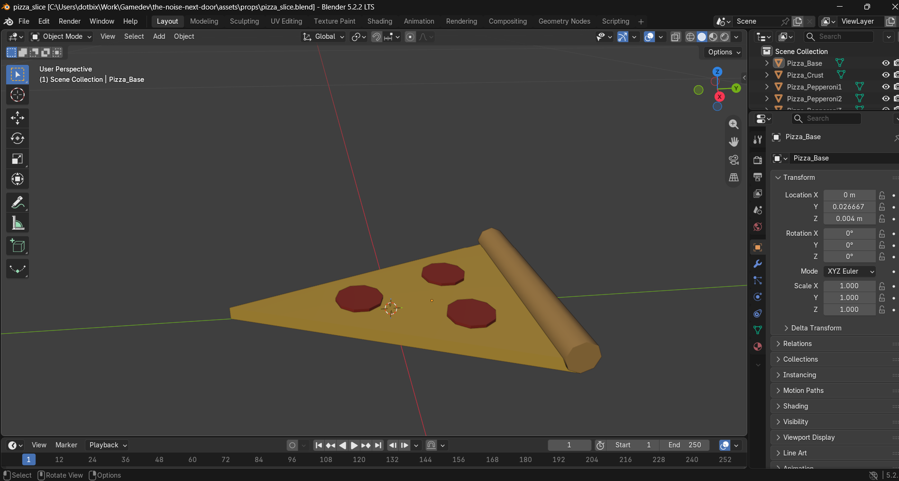
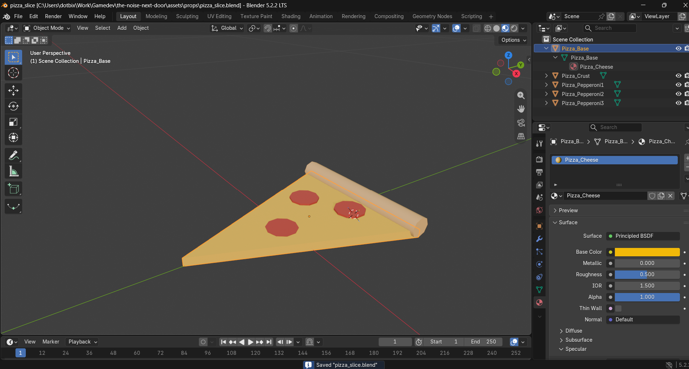

# Blender notes

`the-noise-next-door` · CSYE 7270 · Assignment 3 · Blender 5.2.2 LTS

What the main parts of Blender's window are and what each one does. They come from my first session looking round Blender before building anything (the assignment's "Learn the window" step). The page also covers what my hand edit in Blender taught me.

**Who wrote what.**
- **Me:** the notes under the headings, kept as I typed them.
- **Claude Code:** it arranged them under these headings, wrote the screenshots' captions, and added the two sections marked as Claude's: the corrections and the triangle counts.

**Files:** the practice file and my screenshots are in [design/a3/practice/](design/a3/practice/). The screenshots are in its `screenshots/` folder, named by date and time.

**Status (13 Oct 2026).**
- My first session was on the evening of 13 Oct. I followed a the mentioned Blender's Tutorial : https://www.youtube.com/watch?v=z-Xl9tGqH14 and made a donut and a cup. The screenshot is from 21:38, and the practice file was saved at 21:45.
- Done: the 3D viewport.
- Not written yet: the toolbar, Outliner, Properties editor, sidebar and mode selector.
- My hand edit happens during the build, on one of the three assets.

**Reference:** the Blender manual's [interface chapter](https://docs.blender.org/manual/en/latest/interface/index.html) and [3D Viewport pages](https://docs.blender.org/manual/en/latest/editors/3dview/index.html).

Blender's Tutorial : https://www.youtube.com/watch?v=z-Xl9tGqH14

## The six parts

### 3D viewport

- Orbit : Always thought the middle mouse click should do something and now i know, just kinding but now i know how to move around for my shapes across dimension of x-y-z
- Zoom : Using the general mouse scroll
- Coming back the shape : After starting work and generally draging around and the shape in different views. I felt lost and to just back to the exact shape in the correct postition : Numpads - Del(.)
- Delete (X) : To delete stuff ofc gonna be removing and editing a lot of things
- Mesh (Shift + A) : To add the closest shape we are trying to create
- Add torus (F9) : For the definations and size of the shape
> - **F9 reopens the **Adjust Last Operation** panel for whatever was just done. It isn't a torus command. After adding a torus, the panel shows the torus's settings. After adding a cylinder, it's where its **Vertices** can be lowered to save triangles.
> - **Numpad `.`** is **View Selected**: it zooms to whatever is selected. **Home** frames the whole scene.

### Toolbar
The column of tool icons down the left edge of the 3D viewport; T shows or hides it.
the tools for selecting, moving, rotating and scaling
Added Cube, and also the cone, cylinder and sphere versions.

In Edit Mode: it adds the mesh-editing tools, such as Extrude, Inset, Bevel, Loop Cut and Knife.
A small triangle on an icon means it holds related tools. Press and hold it to see them.

### Outliner
The outliner panel has the details on every asset as they are added in the project helping to track and understand what element of the object we are working on.

Along the left edge of the 3D viewport there is a column of tool icons the (T) key is used to show or hide them.

### Properties editor
Below the Outliner there is a tall panel which contains the settings for the selected object and the scene, with the different options arranged in tabs down its left side. The tabs that are used in this assignment are:

Object (orange square): location, rotation, and scale.
For the modifiers (wrench): at my cup's Solidify and Subdivision Surface.
The object data (indicated by the green triangle) is what my screenshot displays, namely the mesh's vertex groups, shape keys and UV maps.
For the material (red sphere): the colours of an object; the flat colours associated with the three assets are established here.

### Sidebar (N)
It has tabs add-ons add their own, like MCP for Blender, where the MCP server is started.

### Mode selector: Object Mode and Edit Mode

The mode selector is the drop-down at the top left of the 3D viewport. It sets what your clicks and keys work on: whole objects, or the inside of one object's mesh. Tab switches between the two modes used here.
- **Object Mode** works on whole objects:
  - you select them, move them (G), rotate them (R), scale them (S), and add new ones with Shift + A;
  - an object's materials and modifiers, and its Location, Rotation and Scale in the N sidebar, all belong to the whole object;
  - the pizza's pepperoni were moved, and their heights typed in, in this mode.
- **Edit Mode** works on the selected object's own vertices, edges and faces:
  - keys 1, 2 and 3 choose which of the three you select;
  - the toolbar adds the mesh tools, such as Extrude, Inset, Bevel and Loop Cut;
  - the cup's inset top and the ring of edges round its side were made in this mode, and it's the mode in the screenshot below;
  - it also draws the mesh's edges as dark lines, which is why the cup showed black lines until it went back to Object Mode.
- **Other modes:** the drop-down has more, such as Sculpt Mode. This assignment doesn't use them, because its assets are basic shapes with no sculpting.

## My screenshot

*My own session, 13 Oct 2026, 21:38: a donut (a torus) and a cup (a cylinder), with the cup selected in Edit Mode.* Visible:
- the 3D viewport, in the middle;
- the toolbar down the left, with its "Add Cube" tooltip showing;
- the Outliner, top right;
- the Properties editor below it, on its Object Data tab;
- the mode selector, showing "Edit Mode", top left.

The sidebar (N) isn't open.

### Triangle counts in my practice file (measured by Claude Code)

Counted from the saved `donot-and-cup-v1.blend` with modifiers included. They still need checking with Blender's own Scene Statistics.

| Object | Modifiers | Triangles | Against one asset's limit of 500 |
|---|---|---|---|
| Cup | Solidify, Subdivision Surface | 491,520 | about 980 times over |
| Donut | none | 1,728 | about 3.5 times over |

## My hand edit

#### What it taught me
- The making of the donut and the cup was done via watching and following the reference youtube demo. All the elements and understanding of blender has been collected from the same.
- For the pizza slice the colour didn’t seem to change at first. The view was in Solid mode, which shows each material’s Viewport Display colour, not its Base Color. Additional made the colur a bit darker shade of yellow
- Replaced the cheese material instead of adding a second slot. The crust material was shared by two objects, so changing it changed both.
- Moving the pepperoni with G in a tilted view also moved them up and down: one sank 1.7 mm and one floated 3.1 mm. Fixed them by typing Location Z 0.009 in the N sidebar. Shift+Z keeps the height while moving.

### Practice: the donut and the cup (13 & 14 Oct, by hand)

*Compiled by Claude Code from my screenshot and my saved files. It describes what the files show, not every step I took. I did all of this myself in Blender's window, following the tutorial.*

**The donut (`Torus.001`)**
- Added a torus with Shift + A, then set it in the Adjust Last Operation panel (F9):
  - a major radius of 0.10 m and a minor radius of 0.06 m, where the defaults are 1 m and 0.25 m;
  - 48 major segments, and 18 minor segments instead of the default 12.
- Shaded it smooth.
- Moved it up to sit on the floor. Its centre is 0.061 m up, so its underside is about 2 mm above the floor.

**The cup (`Cylinder`)**
- Added a cylinder and sized it to about 0.31 m across and 0.24 m tall. That's 0.26 m across once Subdivision Surface rounds it.
- In Edit Mode:
  - its bottom was left open, with no bottom face;
  - one ring of edges was added partway up the side;
  - the top got an inner ring, 0.129 m from the centre, with a single 32-sided face inside it. That's the shape Inset Faces makes.
- Added two modifiers: Solidify (0.02 m thick, inward) and Subdivision Surface (level 5 in the viewport, 2 for renders).
- Its open bottom sits 0.12 m below the floor grid.

**On 14 Oct, by 00:04.**
- I rotated the donut about 180° on X, so its icing now faces the floor.
- I also spun it round and moved it about 2.6 cm along X.
- The last operation in my 00:04 screenshot is "Snap Selection to Cursor", with the icing selected.

What I wrote down while doing it is under the 3D viewport, above.

**My screenshots of the practice**

*13 Oct, 23:44, Object Mode, donut selected, just after added the icing and sprinkles.* The view is from **below the floor**: the axis gizmo's Z points down. So the dough's underside is what's on top in the picture, the icing only shows at its edge, and the cup's open bottom looks like an open top.

*14 Oct, 00:04, Object Mode, icing selected, after I rotated the donut.* The view is still from below the floor. At about 00:06, Claude Code measured the viewport's eye at 0.74 m under it, looking up. So the iced side now faces this view and the floor. The cup still has its open end at the bottom.

*14 Oct, 14:20, Object Mode, with the new Cup selected.* This time the view is from **above** the floor: the gizmo's Z points up.
- The donut is the right way up again, icing and sprinkles on top.
- The mug stands on the floor, open at the top, with its handle and coffee.
- In the Outliner my original cup, `Cylinder`, is greyed out because it's hidden.

### My hand edit for the assignment: the pizza slice (14 Oct)

- Pizza's colour and the topings arrangement seemed a bit incorrect updated the same also only a slice of pizza was initally added as the plan to implement but it felt wrong like that so I updated the model and asked the pizza to be updated with individual slices.  

*Before, 16:17: the slice as Claude built it, in Solid view.*

*After, 16:34:55: my golden cheese (`#F2B908`) in Material Preview, with two pepperoni moved, just after saving.* (Captions by Claude Code.) Claude measured what changed: the cheese's Base Color went from `#F2C14E` to `#F2B908`. Moving the two pepperoni with G also changed their heights: one sank 1.7 mm into the cheese and one floated 3.1 mm above it, which doesn't show from above. I set both back to Location Z 0.009 (saved 17:25 and 17:27). The details and my first, mixed-up try are in ASSET-PLAN.md and FRICTIONAL.md.

### Changed afterwards by Claude Code

- **22:17:** it moved the practice file to `design/a3/practice/`, with a Save As in my Blender.
- **23:37–23:38:** after I asked about the black lines on the cup, it switched my Blender to Object Mode, which hides them, and shaded the cup smooth. I saved that at 23:39.
