# Game Design Document: The Noise Next Door

`the-noise-next-door` · CSYE 7270 · Version 1.0, 19 Oct 2026 · [Change log](GDD-CHANGELOG.md)

## 1. Name of the game

**The Noise Next Door**

*A raccoon just wants a quiet night in his tree. Then a party starts right underneath it.*

## 2. Concept

### What the game is

The Noise Next Door is a story-driven slapstick comedy puzzle game. You play a raccoon who is forced to deal with the humans around him and complete specific tasks in a human world that is alien to him.

The world is semi-open. It isn't a completely open world, but the player can move freely across it and interact with the things around him. The game isn't too serious: it mixes realism with slapstick comedy.

### Theme

The story is about the disturbance humans cause in a raccoon's life. It is centred on him, and on how the humans around him affect him. They don't mean any harm, but just by being there they change life for the wildlife around them. That is the essence of the story.

### At a glance

| | |
|---|---|
| **Genre** | Slapstick comedy puzzle game, story-driven |
| **World** | Semi-open: free movement and interaction. The areas are connected into one world, but not all of it is open to the player at once |
| **Tone** | A mix of realism and slapstick comedy |
| **Inspirations** | Overcooked, Stray, Cuphead, Untitled Goose Game |
| **Target player** | Casual PC gamers |
| **Platform** | PC. Keyboard for now; controller support on PC is planned |

## 3. Game flow

1. **Title screen and main menu.**
2. **Intro.** The party's bass shakes the raccoon awake in his tree, and he peeks out at the party below.
3. **Level 1, the campsite.** He works through the campsite's tasks.
4. **The chase to the city.** Finishing the tasks gets the partiers fed up, and they go after him. Wearing the red beanie, he runs frantically through the forest toward the city, past a busy highway. Once he's past it there's no going back: the campsite closes behind him, and the only way to go is straight ahead into the city. The chase and the highway play as a cutscene.
5. **Level 2, the city.** Control comes back when he arrives lost in the suburbs, at the start of the city, and a new set of tasks begins. When the dogs' barking brings the animal-control van, he moves on into the block. The city stays open from here on.
6. **Level 3, the block.** The last set of tasks, in the second part of the city.
7. **Ending.** He's caught, the camper drives him home, and the epilogue starts the next party.

**Saving.** The game has save states. The player can't select a stage: the levels are played in order.

## 4. Game elements and assets

*Drafted by Claude Code at my request, from what's already in the repo.*

Each element is marked **Made** (it exists and can be used), **In progress**, or **Planned**. [STORYBOARD.md](STORYBOARD.md) lists the asset IDs each scene needs (CHAR-, NPC-, PROP-, ENV-, UI-, SFX- and MUS-).

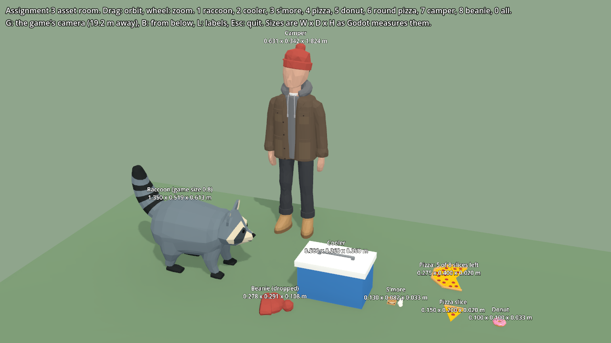

*The 3D assets made so far, at game size, in the asset room from Assignment 3.*

### Characters

| Element | Status | Where it comes from |
|---|---|---|
| **The raccoon:** a rigged 3D model with seven animations (idle, walk, run, sneak, bored, sleep, climb) | Made, in the prototype | [assets/characters/raccoon_v2.glb](assets/characters/raccoon_v2.glb), built in Blender |
| The raccoon's generated poses (idle, running, sneak, bored, asleep) | Made; the prototype's fallback sprites | [assets/characters/raccoon/](assets/characters/raccoon/), cut out of my Gemini images |
| **The camper** | In progress: a static model, not rigged, and his look isn't final | [assets/characters/camper.glb](assets/characters/camper.glb), built in Blender |
| The three town dogs | Planned | Reference images in [design/reference/](design/reference/) |
| The animal-control officer, the partiers, the neighbours | Planned | — |

### Props

| Level | Made | Planned |
|---|---|---|
| **1, the campsite** | The cooler, s'more and the dropped red beanie (Blender, Assignment 3); a tree stump (Gemini cut-out, in the prototype); a donut (my Blender practice) | The backpack, marshmallows, thermos, sock, speaker and plug, tent, campfire, grill, string lights and the teal station wagon |
| **2, the city** | The pizza slice for "Steal a slice" (Blender, Assignment 3) | The diner dumpster and trash bags, the raccoon-proof bin and its bungee cords, the porch's motion-sensor light, traffic, the storm drain, the diner's outdoor table, fences, the poster, phones and the animal-control van |
| **3, the block** | — | The block-party grill, sausages and burgers, the snack table, bunting, the carrier and the marshmallow trap |

The prototype also has a trash bin, its lid, cans and a garden gnome, built in code for its own forest to-do list.

### Environments

| Environment | Status |
|---|---|
| **The forest and campsite:** pines, round broadleaf trees and birches, bushes, rocks, mushrooms, fallen leaves, a dirt path, a stream with a plank bridge, a log cabin, a bench, and the home pine with its hollow | Made. Built in code ([scripts/forest.gd](scripts/forest.gd)) to match my reference image the-forest.jpg. The party set-up is planned. |
| **The city:** the suburbs, the diner and its back alley, streets and backyards | Planned |
| **The block:** the block-party street, with its houses and bunting | Planned |

### UI

| Element | Status |
|---|---|
| Title screen and main menu | Planned |
| To-do list | Made. The prototype shows its own forest tasks. |
| Controls hint along the bottom of the screen | Made |
| Pause (Esc), and music and effects mutes (M, N) | Made |
| Save states | Planned |
| Camera panel (Tab) | Made. A development tool for setting the camera, not part of the game. |

**Audio:** see section 9.

## 5. Main character

The raccoon is the only main character. Everyone else is an NPC, and the camper is one of the main NPCs.

### The raccoon (the player character)

- **Name:** none. He's just a raccoon.
- **Personality:**
  - He lives alone in a hole in an old tree by the campsite, and he loves three things: quiet, naps and snacks.
  - He's curious, sneaky and greedy, but never mean.
  - Around humans he's scared and curious at the same time. When he's caught he's more embarrassed than scared, and a minute later he's back at it.
- **Look:** a low-poly, blue-grey raccoon with a dark mask, a cream face and a ringed tail, following [design/reference/the-raccon.jpg](design/reference/the-raccon.jpg).
- **Home:** a hollow high in a big pine at the edge of the campsite, where he sleeps curled on a nest of leaves.
- **The red beanie:** he swipes it from the camper at the end of level 1 and wears it for the rest of the game.

### The NPCs

| NPC | Where | What they do in the story |
|---|---|---|
| **The camper** (main NPC) | Level 1 and the ending | Wears the red beanie and catches the raccoon at the party. At the end he's the one who drives him home. His look is still being worked out in Blender; the red beanie is fixed. |
| **The partiers** | Level 1 | Dance, roast marshmallows and react to the pranks, then chase him out of the forest. |
| **The neighbours** | Levels 2 and 3 | Snap photos of the masked bandit in the beanie from their windows. |
| **The three town dogs** | Level 2 | A sausage dog, a big shaggy dog and a tiny apricot dog. They chase him, never bite, and get fooled by his false trail. |
| **The animal-control officer** | Levels 2 and 3 | Turns up because of the dogs' barking, watches him, and springs the marshmallow trap at the block party. |

## 6. Story

The story follows the storyboard ([STORYBOARD.md](STORYBOARD.md), draft v6). There's no dialogue: every beat comes across through what the player does and how people react.

- **Opening: woken up.** Bass from a party shakes the raccoon awake in his tree hole. He peeks out: the party is in full swing right under his tree, and the grill smells amazing.
- **Level 1: the campsite party.** He slides down into the campsite and a to-do list of optional pranks appears. Cutting the music works, but in the quiet the party hears him, and the camper catches him with the marshmallows. He bolts, the partiers chase him out of the forest, and he swipes the camper's red beanie on the way. He runs frantically through the forest and past a busy highway, and from there there's no going back.
- **Level 2: the city (the back alley).** He comes out lost in the suburbs at the edge of town. It's even louder than the party, but there's trash everywhere. He raids the diner's dumpster and its raccoon-proof bins while the neighbours start snapping photos of the masked bandit in the beanie. Three dogs chase him; he leaves them barking up the wrong tree, but the barking brings animal control.
- **Level 3: the block (the block party).** His biggest heist is the block party barbecue. Animal control has been watching, and a trail of marshmallows finally catches him.
- **Ending: the ride home.** The camper recognises his own beanie in the photos going round. He's the only one who knows where the raccoon lives, so he drives him home and lets him keep the beanie. The forest is quiet at last.
- **Epilogue: here we go again.** A new party starts up below his tree. He pulls on the beanie and rubs his paws together. The End?

## 7. Gameplay

### 7.1 Goal

The player moves forward through the game by completing a set of tasks in each stage of the world. Each stage has its own defined tasks, and they update in the game depending on how the raccoon interacts with the world. (For now, tasks that update are a rough idea to implement, without a worked example yet.)

In the city he's lost, and all he wants is: first survival,food second,curiosity third and underneath it all, to get home.

### 7.2 Game mechanics

**What the player does**

| Action | Keyboard | What it does |
|---|---|---|
| Move | WASD or the arrow keys | Walks him around the world. |
| Run | Shift | Faster than walking. |
| Sneak | Ctrl or C | Slower and lower. |
| Climb | Walk into a tree | Climbs any tree. W and S go up and down, A and D go round the trunk, and E lets go. |
| Grab, carry, drop | E or a click | Picks things up in his mouth, carries them and drops them. |
| Hold to interact | Hold E | Slow jobs that take a held press, like unzipping a backpack tooth by tooth. |
| Drag | Hold E on something heavy, then walk | Pulls things along behind him, like the speaker's cord. |
| Chitter | Space | His laugh. |
| Nap | Sneak into the den and stay still | He curls up and sleeps in his tree. |
| Zoom | Mouse wheel | Zooms the camera in and out. |

E is the one action key, to keep the game from getting complicated with too many actions: it grabs, drops, interacts, drags and lets go of a tree. Freezing in place when someone looks his way is not part of the game.

**How the NPCs notice him**

It's a combination of coming into an NPC's sight and making noise, which triggers a search stage. If they find him, the people try to shoo him away and the dogs chase him away (see 7.5).

In the city, whenever a neighbour sees him, they snap a photo. It's a consequence of being seen, not a task, and it builds his fame as the masked bandit in the beanie. That fame is how the camper finds him at the end.

### 7.3 Abilities and power-ups

There are no power-ups. He has the same abilities from start to finish (see 7.2), and the red beanie is part of the story, not a power-up.

### 7.4 Levels and challenges

The game has three levels. The world is interconnected: it isn't all open at once, but the game connects the areas for the player. The city is divided into two parts, the city and the block.

Completing a level's defined tasks unlocks the world to the next stage, and the change in how the NPCs behave in that stage triggers it:
- **Campsite to city:** finishing the tasks gets the partiers fed up, and their chase is what opens the way to the city. It plays as a cutscene: he runs through the forest and past a busy highway. Once he's past it, the campsite is closed and the only way is straight ahead.
- **City to block:** the dogs' barking brings the animal-control van, and that sends him on into the block. The city stays open.

| Level | Area | What it's for |
|---|---|---|
| **1** | The campsite | The intro level. Here the player learns the game and its mechanics, and meets its theme. The raccoon drives everything: we get into the head of a curious little raccoon and give him specific tasks. He has to deal with the humans, scared but curious. The campsite offers him easy food, and he's disturbed by, and curious about, the other things he sees around it, like a cooler and a music system. |
| **2** | The city | It starts in the suburbs, at the start of the city, where he arrives lost. It builds on the first level, with more complicated puzzles and tasks in a new environment. There are more NPCs who get in the player's way, a new level of puzzle complexity, and new characters who live in the city. It also moves the story on. |
| **3** | The block | The second part of the city. |

**Level 1 tasks: the campsite**

| Task | What the player does |
|---|---|
| Steal the marshmallows | Unzips the backpack tooth by tooth (hold E) while the camper roasts marshmallows with his back turned. |
| Spill the cocoa | Loosens the thermos lid so the camper spills his cocoa at cocoa time. |
| A sock for a marshmallow | Swaps a marshmallow for a sock before it's roasted. |
| Music off | Pulls the speaker's plug out in his teeth and drags the cord away (hold E). |
| Collapse the tent | Brings the tent down at bedtime. |
| Raid the cooler | Gets into the cooler and takes what's inside. |

**Level 2 tasks: the city**

Some of these are required to unlock the block, and the rest are optional. **Shake off the dogs** is required, because the dogs' barking is what brings the van.

| Task | What the player does |
|---|---|
| Cross the road | Times the gaps in traffic, or finds the storm drain that runs under the street. |
| Dinner from the diner dumpster | The cook takes the trash out on a routine. He climbs in while the lid is up, digs through it (hold E), and gets out before the next bag lands. If the lid bangs, the cook comes to look. |
| Beat the raccoon-proof bin | Unhooks the bungee cords one by one (hold E) while staying out of the porch's motion-sensor light. |
| Steal a slice | Takes a pizza slice off the diner's outdoor table while a customer is looking at their phone. |
| Shake off the dogs | Three dogs chase him. He lays a false trail round one tree, climbs another, and leaves them barking up the wrong one. |

### 7.5 Losing or restarting

There's no losing, and there's no energy, health or lives. When the NPCs catch him, they just try to shoo him away, and the dogs chase him away.

What getting caught costs him:
- **What he's carrying:** the humans take it back.
- **The job he was on:** the puzzle resets, and the task has to be done again.

Nothing reloads. Only the puzzle or task the player failed on is reset.

### 7.6 Player skills

A good player is good at:
- **solving puzzles;**
- **understanding the environment:** the things around them, and how to interact with them.

## 8. Graphics and styling

The look comes from the reference images and the prototype game below.

- **Low-poly and flat-shaded:** chunky faceted shapes with flat colours, no textures or outlines. The raccoon switched to this look on 6 Oct 2026, in my words: "the switch was a decision based on the astetics of the game and how the prototype looked".
- **The camera:** a high, fixed three-quarter view that follows the raccoon and reads like a tabletop diorama. My chosen numbers, set in the prototype's camera panel: it looks down 27°, turned 14°, through a narrow 15° lens from 19.2 m away. The player can zoom but not turn it.
- **The red beanie** is the story's thread, from the camper's head to the raccoon's.

### The raccoon

| The look | With the red beanie |
|---|---|
| 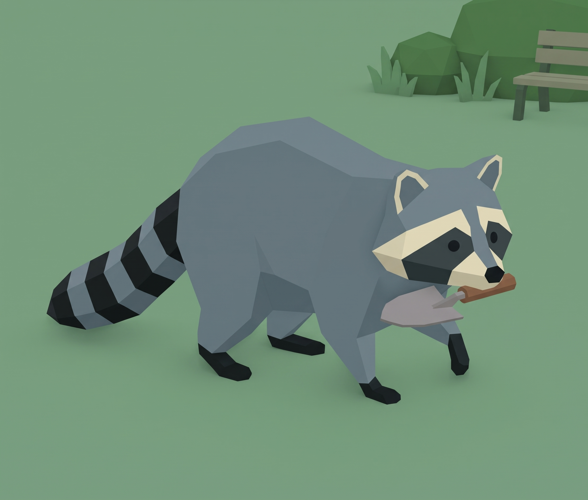 | 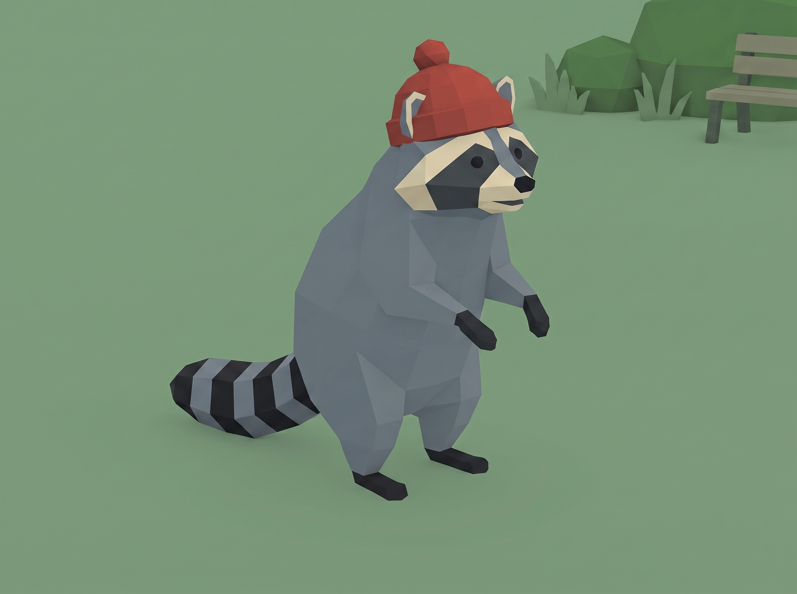 |
| Blue-grey faceted fur, a dark mask, a cream face and ear rims, and a black-ringed tail. | From the end of level 1 on, he wears the camper's red beanie. |

### The world

| The forest and the campsite | His home |
|---|---|
| 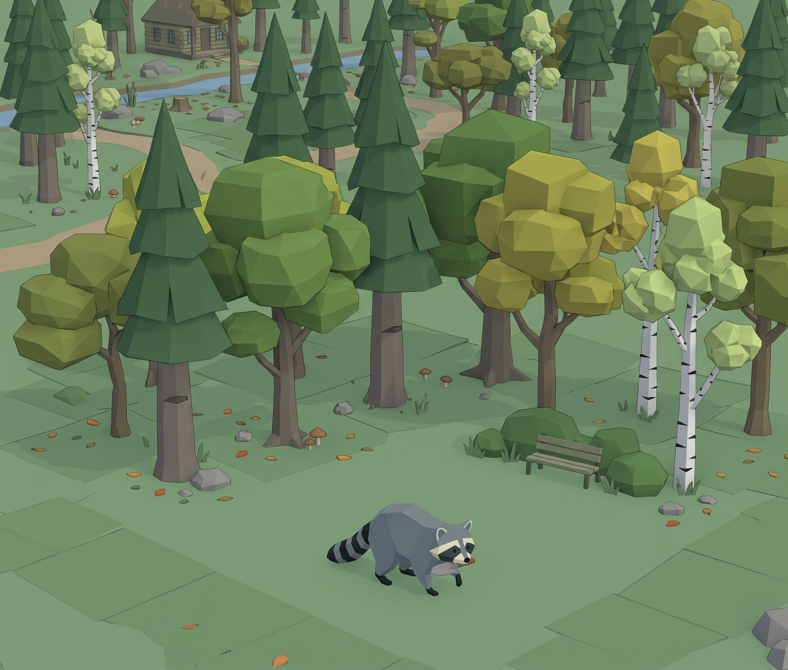 | 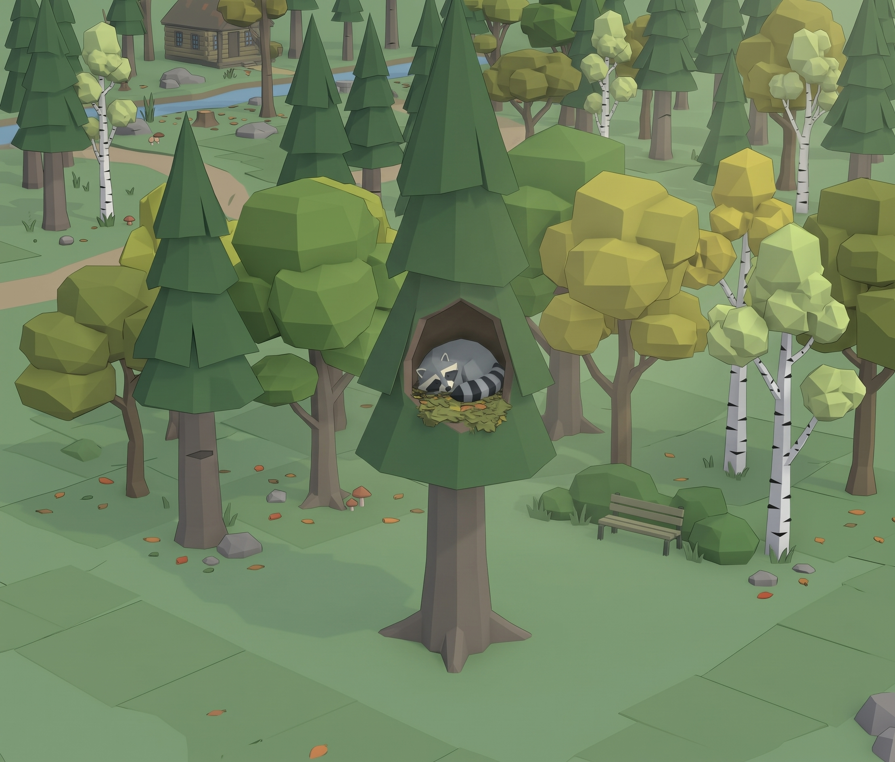 |
| Pines, round broadleaf trees in greens, olives and golds, and birches, with a stream, a dirt path and a log cabin. | A big pine with a hollow, where he sleeps curled on a nest of leaves. |

### The NPCs

| The camper | The town dogs |
|---|---|
| 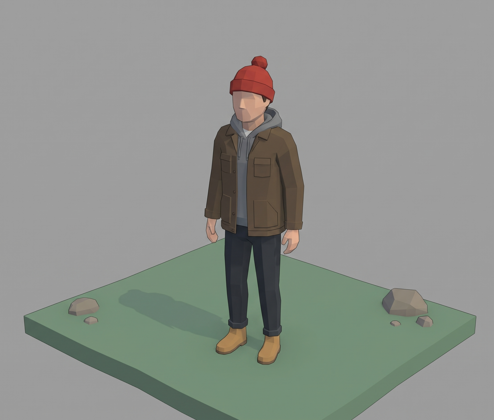 | 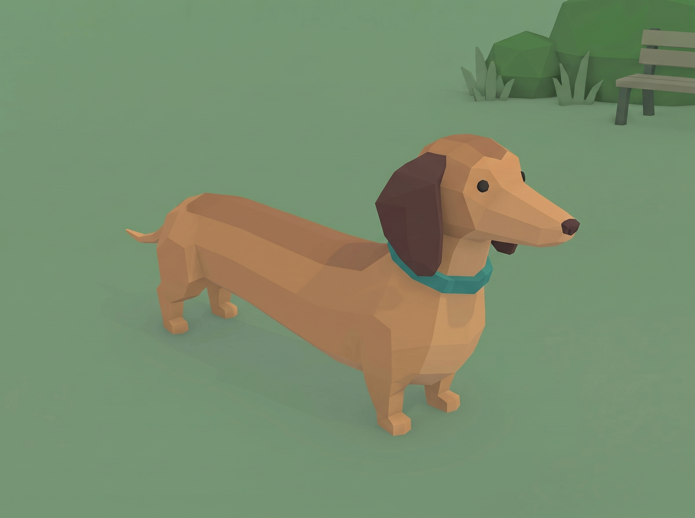 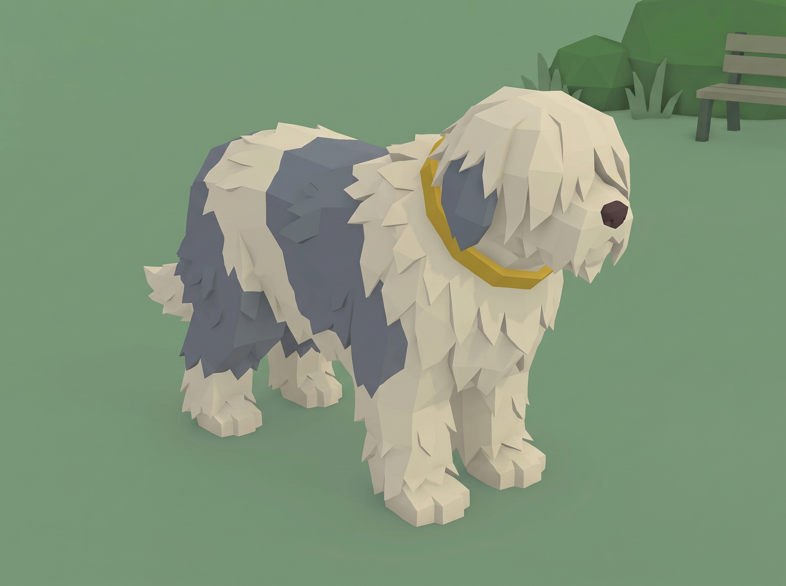 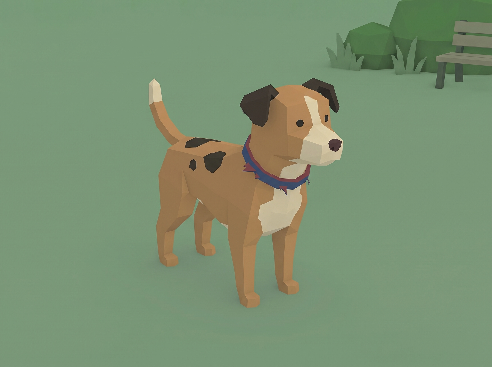 |
| The camper's reference. His final look is still being worked out in Blender. | The sausage dog, the big shaggy dog and the tiny dog. |

### The prototype game

| The game camera | His den in the home pine |
|---|---|
| 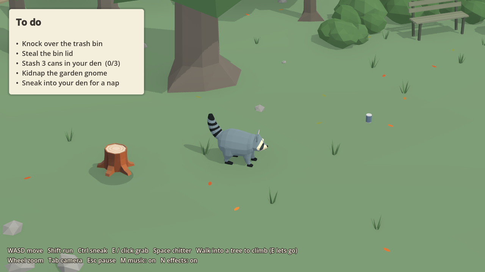 | 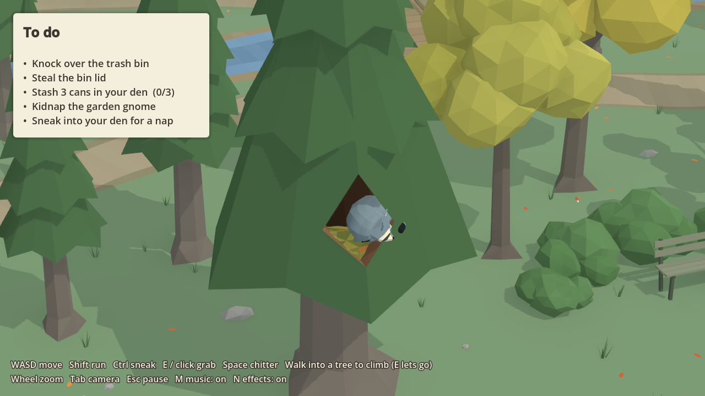 |
| The raccoon at the start of the prototype's forest level, with the to-do list and the controls on screen. The list is the prototype's own tasks, not the level 1 tasks planned in 7.4. | Napping in the hollow, with the forest, the path and the stream behind. |

### The storyboard

The whole story in 15 panels, from [STORYBOARD.md](STORYBOARD.md). These are planning thumbnails, drawn for an earlier camera angle.

## 9. Music and sound effects

More music and sound effects will be added as development goes on and the stages progress. All the music so far is solo piano.

**Music** (made with Suno)

| Track | Where it plays | File | In the prototype? |
|---|---|---|---|
| Lullaby | The title screen, his naps in the den, and the quiet ending | [assets/audio/music/lullaby-loop.wav](assets/audio/music/lullaby-loop.wav), a loop cut from `design/music/raccoon-sleeping.wav` | Yes, as the nap music: it fades in over the forest loop when he curls up in the hollow, and out when he wakes |
| Forest loop | Level 1, the campsite | [assets/audio/music/forest-loop.wav](assets/audio/music/forest-loop.wav), a 16-bar loop cut from `start-quest-forest-campsite.wav` | Yes |
| Town theme, "a bit scary and curious" | Level 2, the city | `design/music/cities-unknown-roads.wav` | Not yet |
| Dogs' chase | Shake off the dogs | `design/music/cities-dogs-chase-trouble.wav` | Not yet |

**Sound effects** (made with ElevenLabs)

| Sound | When it plays | File |
|---|---|---|
| Running | Loops while he runs | [assets/audio/sfx/run-loop.wav](assets/audio/sfx/run-loop.wav) |
| Climbing | Loops while he moves on a tree trunk | [assets/audio/sfx/climb-loop.wav](assets/audio/sfx/climb-loop.wav) |
| His chitter | Space | [assets/audio/sfx/chitter.wav](assets/audio/sfx/chitter.wav) |
| Task laugh | A task is ticked off | [assets/audio/sfx/task-laugh.wav](assets/audio/sfx/task-laugh.wav) |

**In the prototype:** music and effects have separate volume buses. Esc pauses and muffles the music, M turns the music on and off, and N does the same for the effects. The music dips under the task laugh and fades out when the list is done.

The storyboard lists the other sounds each scene will need, such as the zipper, the plug popping out and the dogs barking. The full prompts and processing for every track are in [SOURCES.md](SOURCES.md).

## 10. Technical description

*Drafted by Claude Code at my request, from what's already in the repo.*

### Platform and engine

| | |
|---|---|
| **Engine** | Godot 4.7.2 stable, with the Forward+ renderer (Vulkan) |
| **Code** | GDScript, about 4,000 lines in [scripts/](scripts/), plus one shader that makes trees see-through when they hide the raccoon |
| **Platform** | A Windows PC. The window is 1280 × 720. |
| **Input** | Keyboard and mouse. The game sets up its input actions in code when it starts. Controller support is planned: Godot's input map can take gamepad buttons alongside the keys. |
| **Development machine** | A Windows 11 laptop with an RTX 4050 Laptop GPU (6 GB) and 16 GB of RAM |

### How it's built

- **3D models:** low-poly, flat-coloured models made in Blender 5.2 and exported to Godot as `.glb` files. The raccoon is rigged, and Godot blends between his seven animations by what he's doing and how fast he's moving.
- **The forest:** generated in code at start-up ([scripts/forest.gd](scripts/forest.gd), with the mesh tools in [scripts/lowpoly.gd](scripts/lowpoly.gd)). Repeated scenery like trees and rocks is batched into MultiMeshes so it draws quickly.
- **The camera:** a fixed three-quarter follow camera (27° down, turned 14°, a 15° lens, 19.2 m away). The mouse wheel zooms it between 0.5× and 1.6×.
- **Audio:** separate Music and SFX buses. The music and the loops are WAV files compressed with Godot's QOA, and the music loops were cut on the beat so they repeat seamlessly.
- **Checks:** a headless sound check ([scripts/sound_test.gd](scripts/sound_test.gd)) confirms every sound plays at the right moment, and [tests/a3_asset_check.gd](tests/a3_asset_check.gd) checks the 3D props' sizes, facing and floor contact.

### Systems still to build

The prototype is a single forest level with a to-do list and no humans. These systems from this GDD are still to come:
- the task system for each stage, with tasks that reset when he's caught;
- NPCs that notice him by sight and noise and start a search;
- stages that unlock in order, with the campsite closing behind him;
- cutscenes (the intro, the chase to the city, the ending);
- the title screen, main menu and save states;
- controller support.

### Tools

| Tool | Used for |
|---|---|
| Godot 4.7.2 | The game |
| Blender 5.2, with the Blender MCP | The 3D models |
| Gemini | Reference images and the raccoon's poses |
| Suno | Music |
| ElevenLabs | Sound effects |
| Claude Code | Code, the Blender builds, and drafting docs, at my direction |
| Git and GitHub | Version control |

---

## Provenance

- **My words** (spelling and grammar tidied by Claude Code, meaning unchanged): the concept, the theme, the tone and the platform, from my answers on 18 Oct 2026.
- **My choices on 18 Oct 2026:** the story follows storyboard v6; the town is two levels (back alley, block party), from options Claude offered; the raccoon is the only main character and everyone else is an NPC, with the camper as one of the main NPCs (my words); the camper's look is still in progress in Blender.
- **My answers on 19 Oct 2026:**
  - My words, tidied: the raccoon having no name, the inspirations, the target player, and the three levels in 7.4.
  - The connected world is my idea, and the World row now says so.
  - At my request, his personality is borrowed from CHARACTER-SHEET.md and the tagline from the README. Claude wrote their wording in those docs, and I approved it for the GDD. The line "scared and curious at the same time" comes from my level 1 answer.
- **My answers on 19 Oct 2026, round 2:**
  - My words, tidied: the goal (7.1), how a level ends and unlocks the next (3 and 7.4), how the NPCs notice him (7.2), and which areas stay open.
  - My choices from Claude's options: every prototype action stays; travel between areas is on foot.
  - Holding to interact and dragging are added, and freezing in place is out. Those three came from the storyboard.
  - The controls in 7.2 are the ones the prototype already has.
  - Claude assembled 3 Game flow from these answers and the story in 6.
- **My answers on 19 Oct 2026, round 3:** the title screen, menu and save states, with no stage select; E as the one action key; my yes to "the partiers' chase opens the way to the city"; and that tasks which update are a rough idea for now. Holding E for slow jobs and for dragging was Claude's suggestion, and I chose to keep E as the only action key.
- **My idea on 19 Oct 2026, the move to the city:** the frantic run through the forest with the beanie, past a busy highway as the point of no return, and arriving lost in the suburbs at the start of the city. These are my words, tidied, in 3, 6 and 7.4.
- **My choices on 19 Oct 2026, the task lists (from Claude's options):**
  - **Level 1:** the storyboard's five pranks plus raiding the cooler.
  - **Level 2:** five of Claude's six task ideas, for now; I removed "find a bed for the night". Some city tasks are required and the rest optional.
  - **The rest:** in the city he wants both food and home; the chase and the highway are a cutscene.
  - I later rewrote 7.1's city line myself (at 18:17): survival first, food second, curiosity third, and home underneath it all.
  - **Claude's ideas I accepted:** the dogs' barking as the trigger for the block, and the neighbours' photos.
  - The task descriptions are Claude's wording, drawn from the storyboard and CONCEPT.md.
- **My answer on 19 Oct 2026, losing:** 7.5 and the end of 7.2's search stage are my words, tidied.
- **My answers on 19 Oct 2026, what getting caught costs:**
  - I confirmed both costs Claude asked about: the humans take back what he's carrying, and the puzzle resets.
  - There are no power-ups (7.3).
  - I agreed with Claude's suggestion that "Shake off the dogs" is the required city task.
- **My answers on 19 Oct 2026, the rest of gameplay, graphics and sound:**
  - My words, tidied: nothing reloads, only the failed task resets (7.5); the player skills (7.6); that the look comes from the reference images and the prototype (8); and that music and sound will grow with development (9).
- **The material in 8 and 9:**
  - **Reference images:** made by me with Gemini (logged in SOURCES.md).
  - **Low-poly look:** my decision of 6 Oct. The finish is described as in CHARACTER-SHEET.md.
  - **Camera:** my spec and numbers from 6 Oct.
  - **Music and sound effects:** made by me with Suno and ElevenLabs, from prompts Claude wrote (SOURCES.md). Claude cut the loops.
  - **Prototype screenshots:** taken by Claude Code from the current prototype on 19 Oct (design/gdd/).
  - **Storyboard thumbnails:** drawn in code by Claude.
  - **Captions and tables:** Claude's.
- **Sections 4 and 10, drafted by Claude Code at my request on 19 Oct 2026 ("do that for me"):** they list what's already in the repo and the systems this GDD plans. I didn't write their wording or answer questions for them.
- **Earlier work this draws on:** the story's shape is mine (see STORYBOARD.md and CONCEPT.md for who suggested what). The dogs' looks are Claude's suggestions that I accepted in CHARACTER-SHEET.md.
- **Claude Code's part:** the layout, the headings and the at-a-glance table, built from my answers; the story summary and the NPC table, condensed from STORYBOARD.md v6 and CHARACTER-SHEET.md.
