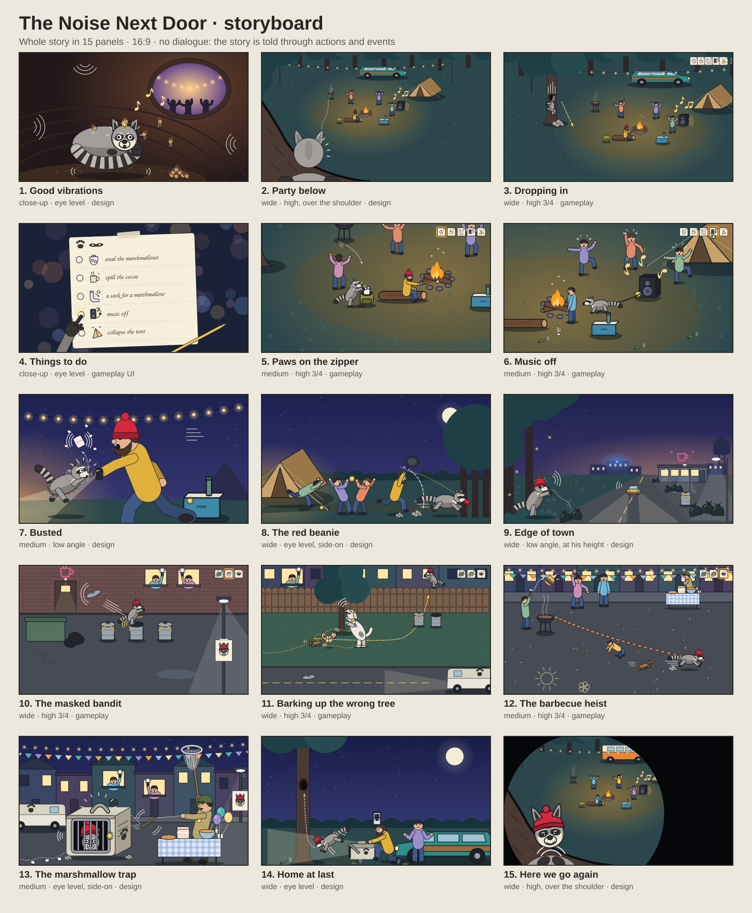

# The Noise Next Door

A raccoon just wants a quiet night in his tree. Then a party starts right underneath it.

He sneaks down to prank the partiers, gets chased into town wearing a camper's red beanie, becomes the neighbourhood's masked bandit, and is finally driven home by that same camper, just in time for the next party. It's slapstick with no dialogue: the story is told through what the player does and how people react.

Made for CSYE 7270 (Fall 2026), Assignment 2: Generate Art, Sound, and Music for Your Game.

## Assignment 3 (in progress)

*Your First 3D Game Assets with Claude, the Blender MCP, and Blender*, on the branch `assignment-3`. The Assignment 2 submission is tagged `a2`.

**To see the assets and their sizes in Godot,** go to [For the grader](#for-the-grader-the-assets-in-godot-with-their-sizes) below.

- **The three assets:** a s'more, a pizza slice and a cooler, for the raccoon to steal and raid at the campsite. Each is built in Blender through the Blender MCP, exported as a `.glb`, and shown in a small Godot 3D scene beside the raccoon.
- **Versions:** Godot 4.7.2 stable, Blender 5.2.2 LTS, the mcp-for-blender server 2.1.9 with the MCP for Blender add-on 1.8, on Windows 11.
- **The docs:** each of these has an Assignment 3 section at the end:
  - the plan: [CHANGE-BRIEF.md](CHANGE-BRIEF.md);
  - the log: [FRICTIONAL.md](FRICTIONAL.md);
  - the checks: [TEST-REPORT.md](TEST-REPORT.md);
  - the tools: [SOURCES.md](SOURCES.md).

  [BLENDER-NOTES.md](BLENDER-NOTES.md) is new, and the Blender build scripts go in [tools/blender/](tools/blender/).

### For the grader: the assets in Godot, with their sizes

The asset room, `asset_room/asset_room.tscn`, shows every asset at game size on a floor under the forest level's light, beside the raccoon for scale. Each has a label with its size as Godot measures it: W × D × H in metres, where H is the height (Godot's Y is up).

**You need Godot 4.7.2 stable**, the standard build (not .NET), from the [Godot download archive](https://godotengine.org/download/archive/). You don't need Blender: Godot loads the exported `.glb` files, and the `.blend` sources are marked for Godot to skip.

**Open it:**
- **Windows:** double-click `Look at the A3 assets.bat`. It looks for Godot in this order:
  - the `GODOT` variable;
  - a `Godot` folder beside this repo (`..\Godot\`);
  - `%LOCALAPPDATA%\Programs\Godot\`;
  - the Downloads folder (the unzipped `Godot_v4.7.2-stable_win64.exe` folder).

  If yours is somewhere else, set `GODOT` to the path of its `.exe`.
- **macOS or Linux:** run `sh look_at_a3_assets.sh`. It looks for Godot in the `GODOT` variable, then `godot` or `godot4` on the PATH, then `/Applications/Godot.app`.
- **By hand, on any system,** from this folder:

  ```
  godot --headless --path . --import
  godot --path . res://asset_room/asset_room.tscn
  ```

  `godot --path .` on its own starts the game, not the asset room.
- **In the editor:** open `project.godot` in Godot 4.7.2, then open `asset_room/asset_room.tscn` and press F6 (Run Current Scene).

**Importing:** both launchers import the models first, because a scene started from the command line doesn't import anything itself. On a fresh copy of this folder, with no `.godot` cache, the import took 8 s here; after that it takes about 4 s.

**Controls:**
- Drag to orbit and use the wheel to zoom.
- **1** raccoon, **2** cooler, **3** s'more, **4** pizza slice, **5** donut, **6** round pizza, **7** camper, **8** his dropped beanie, **0** all of them.
- **G** shows the game's own camera, **B** looks from below, **L** turns the labels on and off, and **Esc** quits.

**What the labels should read:**

| Key | Asset | Label: W × D × H (m) | Against |
|---|---|---|---|
| 3 | S'more | 0.130 × 0.082 × 0.033 | the brief: 0.13 × 0.085 × 0.035, 420 triangles. It has 402. |
| 4 | Pizza slice | 0.150 × 0.200 × 0.020 | the brief: 0.15 × 0.20 × 0.02, 200 triangles. It has 144. |
| 2 | Cooler | 0.580 × 0.360 × 0.360 | the brief: 0.58 × 0.36 × 0.36, 150 triangles. It has 76. |
| 1 | Raccoon (game size 0.8) | 1.350 × 0.519 × 0.613 | Scale only: the game's own raccoon at the game's own size |
| 6 | Pizza: 5 of 8 slices left | 0.275 × 0.400 × 0.020 | 5 copies of the one pizza-slice asset, 45° apart |
| 5 | Donut | 0.100 × 0.100 × 0.033 | My practice from the Blender tutorial, life-size |
| 7 | Camper | 0.631 × 0.342 × 1.824 | To the top of his pompom |
| 8 | Beanie (dropped) | 0.278 × 0.291 × 0.108 | It's turned in the room, so W and D are its turned footprint. |

- The labels measure each model's vertices where it stands in the room, to the millimetre.
- The s'more, the pizza slice and the cooler are the three assets this assignment asks for. The rest are extras.
- If Godot won't run, Claude's pictures of the room are in [design/a3/build/godot/](design/a3/build/godot/). [01_all_by-claude.png](design/a3/build/godot/01_all_by-claude.png) shows every label.

**Check the sizes without looking:** run these headless, from this folder.

```
godot --headless --path . --import
timeout 120 godot --headless --path . --script res://tests/a3_asset_check.gd --fixed-fps 60
timeout 120 godot --headless --path . --script res://tests/a3_asset_check.gd --fixed-fps 60 -- --mutate
```

- **On Windows:**
  - `godot` here means the console build, `Godot_v4.7.2-stable_win64_console.exe`, so the results print in the terminal.
  - `timeout` comes with Git Bash. In PowerShell or cmd, leave out `timeout 120`.
- **What each command does:**
  - The first imports.
  - The second checks the three assets against the brief: the size, the height axis, the floor, the scale, the triangles, the resting parts and the facing. It should end `PASS: 0 check(s) failed`.
  - The third breaks each asset in memory to prove the check can fail. It should end `PASS: 7 of 7 breaks caught`.
- What the check doesn't show is in [TEST-REPORT.md](TEST-REPORT.md).

**Rebuilding an asset in Blender:** `tools/blender/build_<asset>.py` holds every piece of code Claude ran, in order. **Don't run one directly:** each saves over its own `assets/props/<asset>.blend`. To test that one rebuilds the asset, run a copy that saves somewhere else.



## The film

[Watch the explainer film](https://northeastern-my.sharepoint.com/:v:/g/personal/gangurde_a_northeastern_edu/IQDAxd9bCxK_S6b1LqkoG0c7AeyrrSNWzPpb9ba5uei4V4Q?e=itjuN3&nav=eyJyZWZlcnJhbEluZm8iOnsicmVmZXJyYWxBcHAiOiJTdHJlYW1XZWJBcHAiLCJyZWZlcnJhbFZpZXciOiJTaGFyZURpYWxvZy1MaW5rIiwicmVmZXJyYWxBcHBQbGF0Zm9ybSI6IldlYiIsInJlZmVycmFsTW9kZSI6InZpZXcifX0%3D) (on Northeastern's SharePoint).

## What's here

| Path | What it is |
|---|---|
| [CONCEPT.md](CONCEPT.md) | The one-page concept: story, core loop, pillars, art and audio direction |
| [STORYBOARD.md](STORYBOARD.md) | The whole story in 15 panels, with each panel's shot, sounds and assets |
| [CHARACTER-SHEET.md](CHARACTER-SHEET.md) | The cast: the raccoon and the camper (the two main characters) and the town's dogs, with looks, palettes, poses and the Gemini prompts |
| [CHANGE-BRIEF.md](CHANGE-BRIEF.md) | The plan for the asset slice: its assets, which sound plays on which event, the music's behaviour, and predicted failures |
| [SOURCES.md](SOURCES.md) | The generative models used, and the asset log |
| [TEST-REPORT.md](TEST-REPORT.md) | How the slice was tested and what happened: the fresh-copy run, the character sheet and storyboard against the game, the sounds, music and muted play, the author's playtest and the automated check |
| [FRICTIONAL.md](FRICTIONAL.md) | The dated design log: what was asked for, what came back and what was decided, starting with the storyboard |
| [design/storyboard/](design/storyboard/) | The storyboard thumbnails, and `make_thumbnails.py`, which draws them |
| [design/test-report/](design/test-report/) | The test report's screenshots and comparison sheets |
| [design/character/](design/character/) | The character sheet's images: the silhouette test, the labelled pose sheet, the collision overlay and the cut-out poses, made from the generated poses by `make_character_sheet.gd` |
| [design/reference/](design/reference/) | The generated reference images: the raccoon's style target and poses, the camper, the dogs, the forest, the den, the rejected ground texture and the stump |
| [assets/characters/](assets/characters/) | The raccoon model: `raccoon.blend`, the `raccoon.glb` the game loads, and `export_raccoon.py`, which makes the .glb from the .blend. For Assignment 3, also the camper (`camper.blend` and `camper.glb`) |
| [assets/props/](assets/props/) | Assignment 3's props: the s'more, the pizza slice and the cooler, and the camper's dropped beanie. Each has its `.blend` source and the `.glb` Godot loads. |
| [asset_room/](asset_room/), `Look at the A3 assets.bat`, `look_at_a3_assets.sh` | Assignment 3's asset room, with every asset at game size and its measured size, and the launchers for Windows and for macOS or Linux. See [For the grader](#for-the-grader-the-assets-in-godot-with-their-sizes). |
| [tests/a3_asset_check.gd](tests/a3_asset_check.gd) | Assignment 3's headless check of the three assets against the brief |
| `project.godot`, `main.tscn`, `raccoon_model.tscn`, `scripts/` | The Godot project |

## What the slice demonstrates

The slice is the prototype's forest clearing, with its five-task to-do list, dressed with the generated assets:
- **The raccoon, drawn with his generated poses:** idle, running, sneaking, bored (after 5 s of standing still), asleep in the hollow, and climbing. He's mirrored when he faces left.
- **A generated tree stump** (ENV-STUMP), placed in the clearing, with collision.
- **Four generated sound effects, each tied to an event:** running (a loop while Shift-running), climbing (a loop while moving on a trunk), his chitter (Space) and a laugh when a task is ticked off.
- **A seamless generated music loop:** it's muffled and quieter while paused, dips under the task laugh, and fades out when every task is done. M and N mute the music and the effects.

[TEST-REPORT.md](TEST-REPORT.md) shows each of these in the game, and [SOURCES.md](SOURCES.md) logs how each asset was made.

## Run it

You need Godot 4.7.2. The project uses the Forward+ renderer.

- **Windows:** double-click `Play The Noise Next Door.bat`, or `Edit in Godot.bat` to open the editor. They look for Godot in the `GODOT` environment variable, then in `%LOCALAPPDATA%\Programs\Godot`, then in your Downloads folder. The first run takes a few seconds longer while Godot imports the raccoon model.
- **Anywhere:** run `godot --path .` from this folder. On a fresh clone, first run `godot --headless --path . --import` once (or open the project in the editor), so the raccoon model is imported.

**Controls:** WASD or the arrow keys to move, Shift to run, Ctrl or C to sneak, E or a click to grab or drop, Space to chitter, and the mouse wheel to zoom. Walk into a tree to climb it. Then W and S climb up and down, A and D go round the trunk, and E lets go. Climb to the top of the home pine to get into the hollow. Esc pauses. M turns the music on and off, and N does the same for the sound effects. Tab opens a panel for trying out camera views live; its "Copy numbers" button copies the settings.

**The automated sound check:** run `godot --headless --path . -- --sound-test`. It plays a scripted input sequence, counts how often each sound effect starts, and checks the music's pause, mute, loop and end behaviour. It prints a table, and its exit code is 0 only if every check passes (`scripts/sound_test.gd`).

To redraw the storyboard after editing it, run `python design/storyboard/make_thumbnails.py`. To remake the character-sheet images and the raccoon's cut-outs, run `godot --path . --script res://design/character/make_character_sheet.gd`, then copy the five cut-outs the slice uses into `assets/characters/raccoon/`. For the stump, run `godot --headless --path . --script res://design/environment/make_props.gd`. For the sound loops, run `python design/sfx/make_sfx_loops.py`. To update the game's raccoon after editing `raccoon.blend`, run `blender -b assets/characters/raccoon.blend --python assets/characters/export_raccoon.py`.

## Known limitations

- **Static images:** each state is one picture, so his changes of state snap. The author found the animation "a bit blovcky".
- **No back views:** walking away from the camera still shows his front.
- **Climbing** reuses the sneak pose, turned upright.
- **No humans, so no failure state:** the slice doesn't cover being caught, and only 4 of the storyboard's 15 panels are partly covered.
- **The chitter and the task laugh** are two takes of the same laugh.
- **Contrast:** his grey fur is close to the grass in brightness (1.3 to 2.0:1), so his charcoal markings carry his shape.
- **Muted play** was only partly readable, and which moments were lost wasn't noted. The sound levels raised after the playtest haven't been re-checked by ear.
- **Large files on GitHub:** four of the original music tracks in `design/music/` are over 25 MB, and two laugh originals there are MP3s. The course keeps these out of GitHub. The game doesn't load any of them, and the source ZIP leaves them out.

[TEST-REPORT.md](TEST-REPORT.md) has the details and the next steps.

## Started from

This project started from **Raccoon Mischief**, the first prototype of this game, and it keeps building on it.

The prototype is a raccoon in a fenced garden with a five-task to-do list. Everything in it is built in GDScript when the game runs: the raccoon is a procedural low-poly model, and there are no image or sound files. It doesn't play the storyboard's story yet.

Two changes were made with Claude Code on 4 Oct 2026, before this repo existed:
- The launchers find Godot on any machine.
- The raccoon can be smoothed, using `smooth_loft()` in `scripts/lowpoly.gd` and the `smooth` setting in `scripts/raccoon_model.gd`. Turning `smooth` off brings back the original faceted look.

## Who made what

- **The author:** the prototype, the story, and the design decisions. The provenance notes at the end of CONCEPT.md and STORYBOARD.md list them.
- **Claude Code:** drafts and wording for the docs, the storyboard thumbnails (drawn in code), the two prototype changes above, the raccoon model in `assets/characters/` (built in Blender with Python) and the code that puts it in the game, tree climbing, the camera code and its Tab panel (the camera view itself is the author's pick), the character-sheet images and pose cut-outs (`design/character/make_character_sheet.gd`), the music and sound-effect loop cuts (`design/sfx/make_sfx_loops.py`), drawing the raccoon with the generated images (`scripts/raccoon_sprite.gd`), placing the stump, wiring up the sounds, mute and pause, the automated sound check (`scripts/sound_test.gd`), and this README.
- **Generative models, run by the author:**
  - Google Gemini for every image: the raccoon's style target (made before any design doc was committed), his pose images, the other character and scene references, and the ground texture;
  - Suno for the five music tracks, and ElevenLabs for all the sound effects.

  [SOURCES.md](SOURCES.md) logs every generation. Claude Code generated none of them: it cut out the poses and cut the loops.
