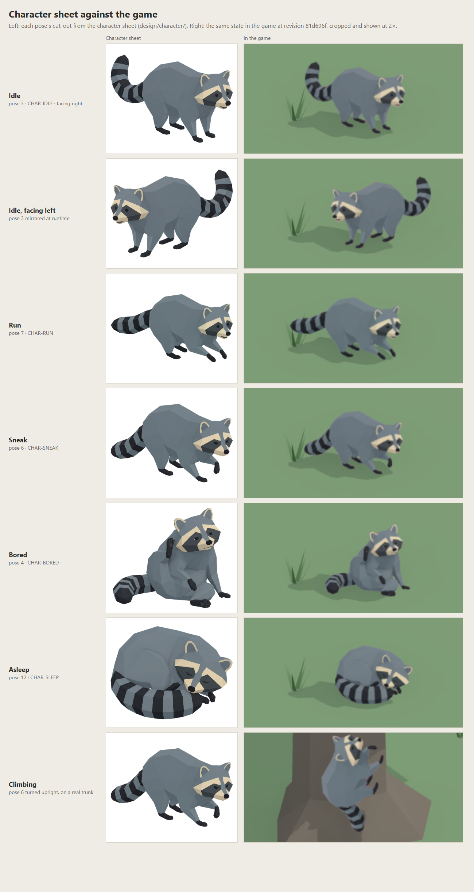
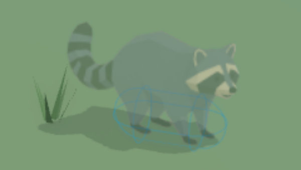
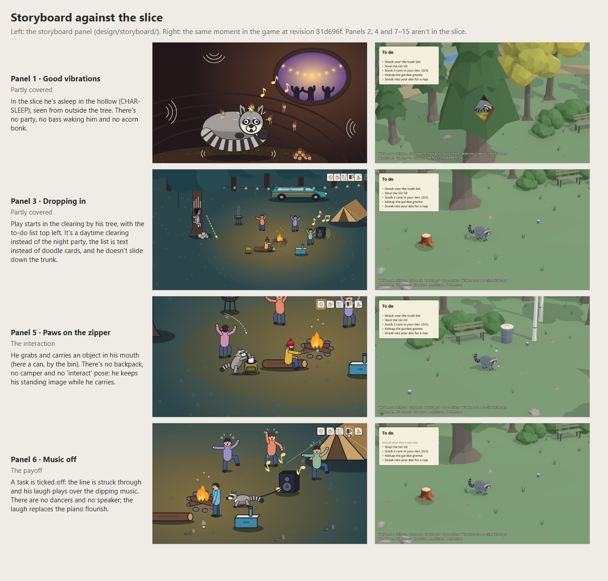

# Test report: The Noise Next Door

`the-noise-next-door` · CSYE 7270

What each assignment's work was tested for, how, and what actually happened. Each assignment's report is its own section.

| Section | Tested | Submitted as |
|---|---|---|
| [Assignment 2: the asset slice](#assignment-2-the-asset-slice) | 6 Oct 2026, at `81d696f` | tag `a2` |
| [Assignment 3: the three Blender assets](#assignment-3-the-three-blender-assets) | 14 Oct 2026 | tag `a3` |
| [Assignment 5: shaders and materials](#assignment-5-shaders-and-materials) | 25 Oct 2026 on | branch `assignment-5`, not tagged yet |

---

## Assignment 2: the asset slice

`the-noise-next-door` · CSYE 7270 · Assignment 2 · 6 Oct 2026

What the slice was tested for, how, and what actually happened.

**What was tested**

| | |
|---|---|
| Source revision | `81d696f`. This report and its screenshots were committed after it and don't change the game. |
| Engine | Godot 4.7.2 stable, official build `ed1daf0bf`, Forward+ renderer, Vulkan 1.4 |
| Machine | Windows 11 Home (10.0.26300), NVIDIA GeForce RTX 4050 Laptop GPU, 16 GB RAM |
| Who tested | The author played the slice; that's the human playtest, in section 7. Claude Code ran the automated check, the fresh-copy run and the screenshots. No one else played or listened. |

### Summary

| Check | Result | Evidence |
|---|---|---|
| Startup from a fresh copy | Pass | A clone of `81d696f` imports with no errors, passes the sound check and runs (section 1) |
| Controls and state changes | Pass | Every state, shown in the game (section 2); the author played with the normal controls (section 7) |
| Character against the sheet | Matches, with the differences listed | [character-vs-sheet.png](design/test-report/character-vs-sheet.png), [collision-zoom.png](design/test-report/collision-zoom.png) |
| Storyboard against the slice | 4 panels partly covered, 11 not | [storyboard-vs-slice.png](design/test-report/storyboard-vs-slice.png) |
| Sound events, once per occurrence | Pass, automated and by ear | Section 4 |
| Music loop, pause and end | Pass, automated and by ear | Section 5 |
| Muted play | Partly readable | Section 6 |
| Automated check | 17 of 17 pass, and it fails when a rule is broken | Section 8 |

### 1. Startup and controls

**From a fresh copy.** `git clone` of `81d696f` into an empty folder, with no `.godot` import cache:
- `godot --headless --path . --import` finished with no errors in 8.7 s.
- The automated sound check then passed 17 of 17 (exit code 0).
- The game started and rendered: [fresh-copy.png](design/test-report/fresh-copy.png).
- On Windows, `Play The Noise Next Door.bat` runs the import itself the first time (README).

**Controls and states:**

| State | Input | Shown in |
|---|---|---|
| Idle | No input | [state-idle.png](design/test-report/state-idle.png) |
| Run | Shift while moving | [state-run.png](design/test-report/state-run.png); the sound check runs him with simulated keys |
| Sneak | Ctrl or C | [state-sneak.png](design/test-report/state-sneak.png) |
| Bored | 5 seconds with no input | [state-bored.png](design/test-report/state-bored.png) |
| Asleep | Sneak and keep still in the den; he hops up into the hollow | [rest.png](design/test-report/rest.png), from the real nap |
| Climbing | Walk into a trunk; W and S climb, A and D go round, E lets go | [state-climb.png](design/test-report/state-climb.png), from a real climb; the sound check climbs too |
| Facing left | Moving left on screen | [state-idle-left.png](design/test-report/state-idle-left.png) |
| Grab and carry | E or a click | [grab.png](design/test-report/grab.png) |
| Pause, mute | Esc; M for music, N for effects | The sound check (section 8) |

The idle, run, sneak, bored and asleep screenshots show the state itself, with `--pose=<state>`. The nap, the climb, the grab and the ticked-off task use the real game code, driven by `--rest-test`, `--climb-test`, `--grab-test` and `--tick-test` (see `scripts/main.gd`).

### 2. Character against the sheet



**What matches.** The game draws the character sheet's own cut-outs, so in every state the pose, proportions, palette and markings are the sheet's. All the states are scaled from one face size, so he doesn't change size when his state changes. Mirroring for the left works (row 2).

**Differences:**
- **Climbing** shows the sneak pose turned upright, because no climbing pose was generated. This is CHANGE-BRIEF.md's planned fallback.
- **There are no back views.** Walking away from the camera still shows his front, as CHANGE-BRIEF.md planned.
- **Carrying.** He keeps his current image, and the carried object sits at the hidden 3D model's mouth. Facing right it lines up with his mouth (grab.png). Walking toward or away from the camera wasn't checked.
- **Size.** The idle image covers the same screen area as the earlier 3D raccoon: 139 × 99 px at the default zoom in a 1280 × 720 window.

**Collision, in the game.** Here he's drawn half see-through, with Godot's collision shapes shown (`--debug-collisions` and `--see-collision`). `--see-collision` is a debug option added just after `81d696f` and committed with this report. It changes only how he's drawn for this screenshot.



The capsule (cyan) covers his legs and lower body. His head, back and most of his tail reach past it, as the character sheet's overlay shows ([design/character/collision.png](design/character/collision.png)). That's fair, because nothing in the slice hits those parts: he never jumps or ducks.

### 3. Storyboard against the slice



| Panel | In the slice | Differences |
|---|---|---|
| 1 Good vibrations | Partly | He's asleep in the hollow, seen from outside the tree. There's no party, no bass waking him and no acorn bonk. |
| 3 Dropping in | Partly | Play starts in the clearing by his tree, with the to-do list. It's a daytime clearing instead of the night party, the list is text instead of doodle cards, and he doesn't slide down the trunk. |
| 5 Paws on the zipper | The interaction | He grabs and carries things in his mouth. There's no backpack, no camper and no interact pose. |
| 6 Music off | The payoff | A ticked-off task is struck through, and his laugh plays over the dipping music. There are no dancers and no speaker, and the laugh replaces the piano flourish (CHANGE-BRIEF.md v2). |
| 2, 4, 7–15 | No | They need the party, humans, the beanie or the town. |

The storyboard's gameplay thumbnails were drawn for a camera about 50° down. The game uses the 27° camera the author picked; see the storyboard's legend, v6.

### 4. Sound events

| Sound | Event | Automated: scripted input | Expected | Counted |
|---|---|---|---|---|
| SFX-CHITTER | Space | 5 quick presses, then 1 press held with 8 key repeats | 6 | 6 |
| SFX-RUN | Running | 2 runs, with Shift tapped off and on 10 times during the first | 2 | 2 |
| SFX-CLIMB | Moving on a trunk | 2 climbs, clinging still between them | 2 | 2 |
| SFX-TASK-LAUGH | A task ticked off | 5 tasks over 4 frames, 2 of them in the same frame | 4 | 4 |

**By ear,** in the author's playtest at 22:59 on 6 Oct, asked whether each sound played once per action: "Yes, all fine".

**Sound never decides what happens.** Every sound plays after the game's state has already changed, and muting touches only the audio buses (`toggle_mute()` in `scripts/main.gd`). The automated check mutes and unmutes both buses mid-run, and the game carries on.

### 5. Music

| Behaviour | Planned (CHANGE-BRIEF.md) | Result |
|---|---|---|
| Seamless loop | No click or gap at the wrap | **By ear,** the author: "Yes, all fine". **Automated:** the loop marker covers the whole file, for the music and both effect loops. The cut is described in SOURCES.md (MUS-PIANO-LOOP). |
| Pause (Esc) | Muffled and about 8 dB quieter; the effects pause | **Automated:** while paused, the low-pass filter is on and the music bus is at −8 dB. After unpausing, the filter is off and the bus is back at 0 dB. |
| A task ticked off | The music dips about 4 dB under the laugh | Built as planned in `_play_task_laugh()`. Not measured by the automated check. |
| End: all tasks done | The music fades out over 3 s and stops | **Automated:** after the last task, the music has stopped. |
| Failure | Not in this slice | There are no humans, so no failure state. |

### 6. Muted play

With both buses muted (M and N), the author found the slice **partly** readable (22:59, 6 Oct). Which moments got lost wasn't noted.

Each sound has a visual partner in the slice:
- running: his run image;
- climbing: his climbing image, moving on the trunk;
- the chitter: a quick squash and hop;
- a ticked-off task: the struck-through line;
- the end: the "Mischief managed!" banner.

### 7. The author's playtest

The author played the slice on 6 Oct 2026, with sound on and then muted. These are their notes, quoted as they typed them (22:57):
> "need to make the animations smother and the gameplay feels a bit blovcky need to work on the same"
>
> "gameplay wise i need to update the game system such that i feels rewarding for the tasks to complete for the user to pursue the tasks more"
>
> "need to think abt the AI of the other NPC charaters of how pusnishing it should be to interact with them for loss"

Their answers to Claude's follow-up questions (22:59):

| Question | Answer |
|---|---|
| With sound on, did the music loop repeat without a click or gap, and did each sound play once per action? | "Yes, all fine" |
| With everything muted, could you still follow what was happening? | "Partly" |
| How loud were the sound effects against the music? | "Effects too quiet" |
| Should Claude smooth the animation now, as the documented fix? | "No, record it as a next step" |

### 8. The automated check

```bash
godot --headless --path . -- --sound-test
```

`scripts/sound_test.gd` plays a scripted input sequence:
- quick and held Space presses;
- running, with Shift tapped off and on;
- climbing, then clinging still;
- tasks ticked off, two in the same frame.

It counts how often each sound effect starts, and checks the pause, mute, loop and end behaviour. It prints a table, and its exit code is 0 only if every check passes. On `81d696f` it passed all 17 checks, both in the working copy and in the fresh clone:

```text
pass  Paused: the game stops                               expected true   got true
pass  Paused: the music is muffled                         expected true   got true
pass  Paused: the music is 8 dB quieter                    expected -8.0   got -8.0
pass  Unpaused: the game runs                              expected false  got false
pass  Unpaused: the muffling is off                        expected false  got false
pass  Unpaused: the music is back to full                  expected 0.0    got 0.0
pass  M and N: both buses muted                            expected true   got true
pass  M and N again: both unmuted                          expected false  got false
pass  SFX-CHITTER: 5 quick presses + 1 held press          expected 6      got 6
pass  SFX-RUN: 2 runs, Shift tapped during the first       expected 2      got 2
pass  SFX-CLIMB: 2 climbs, clinging still between          expected 2      got 2
pass  SFX-TASK-LAUGH: 5 tasks over 4 frames                expected 4      got 4
pass  Every task done                                      expected true   got true
pass  End: the music has stopped after its fade            expected false  got false
pass  Loop marker over the whole file: forest-loop.wav     expected true   got true
pass  Loop marker over the whole file: run-loop.wav        expected true   got true
pass  Loop marker over the whole file: climb-loop.wav      expected true   got true
RESULT: all checks passed
```

**It can fail.** To prove the check isn't hollow, the loops' hold time (`LOOP_HOLD` in `scripts/player.gd`) was set to 0 for one run. That's the rule that stops a quick Shift tap restarting the running loop. The check then reported `SFX-RUN expected 2 got 12` and exited with code 1. The setting was put back to 0.12 s. No check has been removed or weakened to get a green result.

### 9. Changes made because of what was seen or heard

| What was observed | By whom | What changed | Commit |
|---|---|---|---|
| The sound effects were too quiet against the music | The author's playtest | The effects went up 4 dB and the music down 3 dB, so the effects are 7 dB louder than the music than before. Not re-checked by ear yet. | `81d696f` |
| The generated ground texture, seen on the forest floor in the game: "i dont like the ground" | The author | The texture was switched off and the plain grass kept. A generated stump became the environment asset. | `ef1a803`, `1b300b4` |
| The planned 50° camera "still doesnt feel right" | The author | The author set the camera by eye with the Tab panel: 27° down, a 15° lens | `dcae18a` |
| On a trunk he was half hidden in the bark, and sank into the ground when turned upright | Claude, from screenshots | He's now drawn a little toward the camera and turns about his middle | `1b300b4` |
| Green gaps between the legs in two cut-outs, and the capsule drawn too far toward his head | Claude, from the sheets | The gap filling now keeps background-coloured gaps, and the capsule sits between his paws | `7296e08` |
| His fur measured as bright as the generated ground (1.0:1) | Claude's palette check | Recorded in CHARACTER-SHEET.md v5. The ground was then rejected for its look. Against the plain grass (`#7D9D76`, measured from start.png at `81d696f`), his three fur tones measure 1.3 to 2.0:1 and his charcoal markings 4.8:1. | `d89c0bb` |

### 10. Limitations

- **Static images:** one image per state, so a change of state snaps from one picture to the next. The author found the animation "a bit blovcky".
- **No back views:** walking away from the camera still shows his front.
- **No humans, so no failure state:** the slice doesn't test being caught.
- **Climbing** reuses the sneak pose, turned upright.
- **The chitter and the task laugh** are two takes of the same laugh.
- **Carried objects** follow the hidden 3D model's mouth, which was only checked facing left or right.
- **Contrast:** his fur is close in brightness to the grass (1.3 to 2.0:1). His charcoal markings (4.8:1) carry his shape.
- **Muted play** was only partly readable, and which moments were lost wasn't noted.
- **The new sound levels** haven't been re-checked by ear.

### 11. Next steps toward the full game

From the author's notes:
1. **Smoother animation and less blocky play.** For example, motion between his images, such as a bob while he moves, a softer turn than an instant mirror, and a little squash when his state changes.
2. **Tasks that feel rewarding**, so the player wants to pursue them.
3. **The other characters' behaviour, and how punishing an encounter should be.** CONCEPT.md's starting point: suspicion builds in stages, and being caught costs the item he's holding and some time, never a finished job.

---

**Provenance.**
- **The author:** played the slice, wrote the notes in section 7, and answered the four questions.
- **Claude Code:** the automated check, the fresh-copy run, the screenshots and comparison sheets, the volume change the playtest asked for, and this report's wording.
- **Generative models:** none were used for this report.

---

## Assignment 3: the three Blender assets

`the-noise-next-door` · CSYE 7270 · Assignment 3 · branch `assignment-3`

**Status (14 Oct 2026, about 18:05).**
- All three assets are built, exported to `.glb`, imported into Godot and placed in the asset room.
- The automated checks have run (below).
- My own look in Godot, the HUMAN CHECK, was done at 18:16 (below).

**What will be tested**

| | |
|---|---|
| Source revision | The commit tagged `a3`, once it exists |
| Blender | 5.2.2 LTS (build date 15 Sep 2026). The course's chapter used 5.1.2. |
| Godot | 4.7.2 stable, official build `ed1daf0bf`, as for Assignment 2 |
| Blender MCP | The mcp-for-blender server 2.1.9, run by uvx 0.12.23, and the MCP for Blender add-on 1.8 (`blender_mcp.py`) |
| Machine | Windows 11 Home (10.0.26300), NVIDIA GeForce RTX 4050 Laptop GPU, 16 GB RAM |

### Checks

| Check | Evidence to collect | Result |
|---|---|---|
| Interface notes | The six parts in my own words, and one screenshot of my own session, in [BLENDER-NOTES.md](BLENDER-NOTES.md) | My screenshot and my 3D viewport notes are mine. The elemets defination from my understanding and guidance from claude toolbar, Outliner, Properties editor, sidebar and mode selector text. |
| Size | For each asset: the dimensions in Blender's sidebar beside the brief, and Godot's bounding box beside both | **Pass**: all three within 5% of the brief on every axis. Godot's numbers match Blender's to 0.1 mm (table below). |
| Upright and scale | Each asset stands the right way up in Godot, with node scale 1, 1, 1 after export | **Pass**: height along Y for all three, and every node at scale 1, 1, 1. The pizza's crust is at −Z and its tip at +Z, and the s'more's plain marshmallows are on its +X side, as built. |
| Origin | Placed on the floor in Godot, each asset sits on it instead of floating or sinking | **Pass**: the bottom is at Y = 0.0000 for all three, and every part rests on the floor or on another part. A part sunk *into* another isn't caught (known limit, below). |
| Triangle count | Within each asset's budget, from Blender's Scene Statistics | **Pass**: s'more 402 of 420, pizza slice 144 of 200, cooler 76 of 150, counted the same in Blender and in Godot. Scene Statistics in my own screenshot confirms the cooler; the s'more and the pizza haven't been screenshotted. |
| Imports and appears | All three import with no errors and appear in the 3D scene | **Pass**: `godot --headless --path . --import` printed no errors or warnings, and all three appear in `asset_room/asset_room.tscn` (Claude's pictures below). |
| HUMAN CHECK: look | I walk the camera round each asset, from behind and below too, at game size beside the raccoon. Does each read as what it is? Any missing faces or wrong colours? | **Done (14 Oct, 18:16):** "this looks good to me the smores are fine size wise it'll work". My screenshot is 10_my-look-in-the-asset-room_by-me.png. Behind, below, missing faces and colours aren't covered in my words (see below). |
| What Claude got wrong | At least one thing, or "nothing, and here's how I checked" | Several, all logged in FRICTIONAL.md and listed below. |

The automated check can show that the assets arrived at the size, orientation and scale that were measured. It can't show that they look right in the game's light, read as what they are, or suit its style. Those are the human check.

### Blender-side evidence, before export

| Asset | Brief | Blender sidebar (my screenshot) | Claude's measurement of the whole asset | Triangles | Godot |
|---|---|---|---|---|---|
| S'more | v1: 0.065 × 0.065 × 0.04 m, budget 100. **v2** (after my look): about 0.13 × 0.085 × 0.035 m, budget 250. **v3** (the crackers' groove and dots): budget 420 | v1 bottom cracker: Dimensions 0.065 × 0.065 × 0.008 m, Scale 1.000, Rotation 0° ([05_finished-in-my-blender_by-me.png](design/a3/build/smore/05_finished-in-my-blender_by-me.png), 14 Oct 14:45). v2: no screenshot of mine yet. | v1: 0.065 × 0.065 × 0.04 m (14:41). **v2: 0.130 × 0.082 × 0.034 m**, bottom Z 0, centred on (0, 0); rotation 0 and scale 1 on all 6 parts (15:05). v3: size unchanged (15:55) | v1: 80. v2: 244. **v3: 402** by Claude's count. Not yet checked in Scene Statistics. | See below |
| Pizza slice | 0.15 × 0.20 × 0.02 m, budget 200 | My screenshots: before 16:17, after 16:34 (golden cheese). My hand edit then fixed the pepperoni heights (17:25 and 17:27). | 0.15 × 0.20 × 0.02 m, bottom Z 0, centred on (0, 0), tip at Y −0.10. Rotation 0 and scale 1 on all 5 parts (14 Oct, 16:12). | 144 by Claude's count. Not yet checked in Scene Statistics. | See below |
| Cooler | 0.58 × 0.36 × 0.36 m, budget 150; body blue `#3B7DBF` (v4) | My screenshot (17:42): Scene Statistics in the viewport and the status bar ([05_…_by-me.png](design/a3/build/cooler/05_finished-in-my-blender-scene-stats-76_by-me.png)) | 0.58 × 0.36 × 0.36 m, bottom Z 0, centred on (0, 0). Rotation 0 and scale 1 on all 5 parts (14 Oct, 17:33). | **76**: Claude's count, confirmed by Blender's Scene Statistics in my screenshot | See below |

### Godot: import, the headless check, and the asset room (14 Oct 2026, about 17:45–18:05)

**Export (Claude, through the MCP):**
- Each `.blend` was exported with Blender's own glTF exporter as binary `.glb`, with +Y Up and modifiers applied, and no cameras, lights or animations.
- The code is at the end of each `tools/blender/build_<asset>.py`.
- Sizes: cooler 9 KB, pizza slice 13 KB, s'more 26 KB.

**Import:** `godot --headless --path . --import` printed no errors or warnings.
- The props' imports set `meshes/generate_lods=false`, as the raccoon's import already does.
- Godot's automatic LODs would swap in simplified meshes at the game camera's 19.2 m, and could drop small parts like the pepperoni or the cracker dots.

**The check** is [tests/a3_asset_check.gd](tests/a3_asset_check.gd), written by Claude Code. The course used `timeout`; Git Bash on this machine has it.

```
timeout 120 godot --headless --path . --script res://tests/a3_asset_check.gd --fixed-fps 60
```

| Asset | Godot X × Y × Z (m) | = W × H × D, against the brief | Bottom Y | Scale | Triangles | Parts resting | Facing | Result |
|---|---|---|---|---|---|---|---|---|
| S'more | 0.1297 × 0.0335 × 0.0823 | 0.130 × 0.035 × 0.085 (v2) | +0.0000 | 1,1,1 on 7 nodes | 402 / 420 | 6 of 6 | plain marshmallows on +X | ok |
| Pizza slice | 0.1500 × 0.0200 × 0.2000 | 0.150 × 0.020 × 0.200 | +0.0000 | 1,1,1 on 6 nodes | 144 / 200 | 5 of 5 | crust −Z, tip +Z | ok |
| Cooler | 0.5800 × 0.3600 × 0.3600 | 0.580 × 0.360 × 0.360 | +0.0000 | 1,1,1 on 6 nodes | 76 / 150 | 5 of 5 | (symmetrical) | ok |

Final line: `PASS: 0 check(s) failed`, exit code 0. Blender's height (Z) arrived as Godot's Y, as the brief predicted for the +Y Up export.

**Proof that it can fail** (`... -- --mutate`): each asset is broken in memory, and the check meant to catch it must fail. **7 of 7 caught**, exit code 0:

| Break | Check that failed |
|---|---|
| Cooler 10 times too big | size |
| Cooler scale 1.02 on Z (not applied) | scale 1,1,1. Only 2% bigger, so the size check alone passes it. |
| Pizza slice lying on its side | height along Y |
| A pepperoni floating 3 mm | every part resting |
| Pizza slice turned round | facing |
| S'more floating 5 cm | bottom on the floor |
| S'more sunk 5 mm | bottom on the floor |

**What the check doesn't show:**
- **A part sunk into another part still passes.** The mutation run prints this as a known limit: "a pepperoni sunk 1.7 mm into the cheese -> every check still passes". It happened to my pizza on 14 Oct and was found by measuring each part, not by this check.
- **It measures boxes, not shapes.** A missing face, a wrong colour, or a part in the wrong place inside the box all pass.
- **It can't tell whether an asset looks right, reads as what it is at game size, or suits the game.** That's my look, below.
- **It checks the brief's numbers, not the game's needs.** A life-size s'more passes, even if it's too small to read in play.

**The check's own first bug (Claude's):**
- On its first run the check failed 9 times on assets that were fine. Its parts were measured with `global_transform`, but in `_initialize` the nodes aren't inside the scene tree yet, so that comes back as the identity. Every part was measured at its own origin; the cooler's bottom read −0.14 m.
- Claude now works out each part's transform from its parents. The run passed, and the mutation proof shows it still fails when it should.
- This is the course's warning in action: a check can prove less than, or something other than, what it claims.

**The asset room:** [asset_room/asset_room.tscn](asset_room/asset_room.tscn), opened by `Look at the A3 assets.bat`.
- A floor, the forest level's sun and haze, and an orbit camera.
- The three assets side by side at game size, beside the raccoon (`raccoon_v2.glb` at the game's size 0.8, playing its idle).
- Labels show each asset's size as Godot measures it. The raccoon measures 1.350 × 0.519 × 0.613 m.
- **G** shows the view from the game's own camera.

**Launching it as a grader would** (14 Oct, about 20:00), on a fresh copy of this folder with no `.godot` cache:
- **On Windows:** `Look at the A3 assets.bat` imported all 8 models in 8 s with no errors, skipping the `.blend` sources. The room opened with every label, and its screenshot matched picture 01.
- **`look_at_a3_assets.sh`** did the same, run from Git Bash. It isn't tested on a Mac or on Linux. With no Godot to find, it says so and exits 1.
- **The check** passed on the copy, and its mutation proof caught 7 of 7.
- **The launcher was changed:** it used to import only when the cooler, s'more, pizza or raccoon were missing. A changed camper or beanie would have shown its old model, so it now imports every time, which takes about 4 s when nothing has changed.
- **Not a clone:** this was a copy of the uncommitted folder. The fresh-clone check after the commit is still to do.

Claude's pictures of it, rendered by Godot in a window (`-- --shot=... --view=...`), in [design/a3/build/godot/](design/a3/build/godot/):

| Picture | View |
|---|---|
| [01_all_by-claude.png](design/a3/build/godot/01_all_by-claude.png) | Everything, with labels: the raccoon, the three assets, and (from 18:02) the donut |
| [02_game_by-claude.png](design/a3/build/godot/02_game_by-claude.png) | The game's camera: 27° down, 19.2 m away, 15° lens, no labels. The cooler reads clearly and the pizza is a small yellow triangle with red dots. **The s'more is a speck of about 15 px**, as my brief predicted for a life-size s'more. |
| [03_below_by-claude.png](design/a3/build/godot/03_below_by-claude.png) | From below the floor (the floor is one-sided, so the undersides show) |
| [04_raccoon_by-claude.png](design/a3/build/godot/04_raccoon_by-claude.png) … [07_pizza_by-claude.png](design/a3/build/godot/07_pizza_by-claude.png) | Close-ups of the raccoon, the cooler, the s'more and the pizza slice |
| [08_donut_by-claude.png](design/a3/build/godot/08_donut_by-claude.png) | The donut from my Blender practice, which I asked to have in the room, now life-size: 0.100 × 0.100 × 0.033 m, 35,144 triangles with its smoothing applied. I may use it in the game later. |
| [09_whole_pizza_by-claude.png](design/a3/build/godot/09_whole_pizza_by-claude.png) | The round pizza I asked for, on key 6: **5 copies of the one pizza-slice asset**, turned 45° apart with their tips at the centre, so 5 of 8 slices are left (0.275 × 0.400 m). The asset itself is unchanged and still one slice, within the limits. Each crust is straight, so the rim is a polygon, not a smooth circle. |
| [11_camper_by-claude.png](design/a3/build/godot/11_camper_by-claude.png) | The camper I asked for (key 7), v2 in the raccoon's faceted style, his head turned 9° to his right as in the reference, with its jaw, chin and neck: 0.631 × 0.342 × 1.824 m, 4,472 triangles. Beside him, the raccoon's back comes up to about his thigh, as CHARACTER-SHEET.md says. Claude's comparisons with `red-beanie-man.jpg`, through the reference's solved camera, are [v2_01](design/a3/build/camper/v2_01_reference-and-v2-lit_by-claude.png) (side by side), [v2_02](design/a3/build/camper/v2_02_reference-model-overlay_by-claude.png) (overlaid) and [v2_03](design/a3/build/camper/v2_03_head-turned-close-up_by-claude.png) (the head, close up). |
| [12_beanie_by-claude.png](design/a3/build/godot/12_beanie_by-claude.png) | His beanie, dropped and crumpled (key 8), v2 in the camper's faceted style, lying side-on in front of the raccoon: the folded cuff, the slumped crown and the pompom on the floor. 368 triangles; 0.278 × 0.291 × 0.108 m as the room measures it, turned. Its open end, with the dark inside, faces away from this camera; Claude's six views are [v2_01](design/a3/build/beanie/v2_01_six-views_by-claude.png). |

**The labels measure vertices, not boxes.** The first version took each mesh's own box and turned it with the mesh. My practice donut is turned about 17°, so it measured 0.404 × 0.405 m instead of 0.327 × 0.328 m. The labels now measure the vertices themselves. The check script still uses boxes, which is exact for the three assets, because their rotation is applied and every part's rotation is 0.

**What Claude got wrong**, all in FRICTIONAL.md:
1. It first took the raccoon's lying collision capsule (0.64 m) as his height. He's 0.61 m tall and 1.35 m long, as the asset room's label confirms.
2. Its first rebuild test overwrote `smore.blend`, because its `sed` path swap didn't match. The file was restored from the MCP session.
3. Its first Godot check measured every part at the origin (above).
4. Its first asset-room launcher had a real carriage return in a path, because the shell ate a backslash. Claude found it by checking the file byte by byte, and fixed it before anyone used it.
5. Its first s'more (v1) didn't read as a s'more. That was my judgement; Claude agreed and rebuilt it.
6. Its first camper (v1) didn't look like the reference: "it looks bocky and like a minecraft tree", in my words. Claude rebuilt him in the raccoon's style and fitted him to the reference (v2).

### HUMAN CHECK: my look in Godot

**Done 14 Oct 2026, 18:16,** in the running asset room (`Look at the A3 assets.bat`).

**What I said:** "this looks good to me the smores are fine size wise it'll work"

**My screenshot:** [10_my-look-in-the-asset-room_by-me.png](design/a3/build/godot/10_my-look-in-the-asset-room_by-me.png). It's my own window, from my own orbit: the raccoon, the cooler, the s'more, the single pizza slice, the round pizza (5 of 8 slices) and the donut, with their Godot-measured sizes.

**What this settles:**
- **The s'more's size.** My brief left open whether a life-size s'more, about 14–15 px at the game camera, would read at all. My judgement: it's fine size-wise and it'll work.
- **The overall look:** "looks good to me".

**Not stated in my words:**
- whether I looked from behind and below;
- whether there were any missing faces or wrong colours.

Claude's pictures from below (03) and close up (04–09) show none, but that's Claude's look, not mine.

---

## Assignment 5: shaders and materials

`the-noise-next-door` · CSYE 7270 · Assignment 5 · branch `assignment-5`

**Status (29 Oct 2026, about 18:55).**
- **The cone's shader is in, and driven:** my `shaders/vision_cone.gdshader` (53b0087), the `claude -p` agent's driver and test (29fd5da), and Claude's fixes from its review of them (2024a76). Its headless test passes 93 of 93 at 30, 60 and 144 fps, and the earlier checks keep their baseline (below).
- **Two of the three mutations are done,** on the cone's shader, and both runs exit 1 (below).
- **The cone's controlled-value captures are done,** and the first two spottings in play (below).
- **The cooler's shader and its two materials are in,** behind the glb's Use External, and every check keeps its baseline (below).
- **The hint experiment's scene is in** (below), with my shader.
- **Not done yet:** the rest of the cone's in-play check, the cooler's look checks, my capture of the hint experiment's bands, and the material test and its mutation.

**What will be tested**

| | |
|---|---|
| Source revision | The commit tagged `a5`, once it exists. Each section below says the revision it ran on. |
| Godot | 4.7.2 stable, official build, as for Assignments 2 and 3. Headless runs use `Godot_v4.7.2-stable_win64_console.exe`, which isn't on the PATH. |
| Renderer | Forward+ (`project.godot`, `config/features`). HDR 2D isn't set. |
| Machine | Windows 11 Home (10.0.26300), NVIDIA GeForce RTX 4050 Laptop GPU, 16 GB RAM; a 144 Hz display |
| Test runner | `scripts/run-test.sh`, in Git Bash (its `timeout` is GNU coreutils) |

### The test wrapper

`scripts/run-test.sh` is the course's wrapper, adapted by Claude Code on 25 Oct 2026. Like the course's, it:
- runs the test under `timeout 120` (exit status 124 means it hung);
- pins the frame rate with `--fixed-fps`;
- keeps a log in `logs/<test>_<fps>fps.log`;
- fails on any `SHADER ERROR` or `SCRIPT ERROR` line, whatever the exit code.

What's different, and why:
- **`--path .` instead of `--path godot`:** the Godot project is the repository root.
- **It finds Godot itself:** from `GODOT`, then `godot` on the PATH, then the two places the `.bat` launchers look.
- **Flag tests:** an argument starting with `--` runs the main scene with that flag (`-- --sound-test`). The earlier checks are built that way, not as scripts in `tests/`.

Run a check with `./scripts/run-test.sh <test.gd | --flag-test> <fps>`.

### Baseline: the earlier checks before Assignment 5 changed anything

Run on 25 Oct 2026, about 19:50, at 3acc103 with nothing changed, at `--fixed-fps 60`. Later runs overwrote these logs, since the wrapper names a log after its check and frame rate; the counts here come from that run's output in the chat transcript. The logs now in `logs/` are from the 26 Oct run below.

| Check | Run with | Result |
|---|---|---|
| Assignment 3's assets | `a3_asset_check.gd 60` | Pass, 20 of 20 |
| Sounds | `--sound-test 60` | Pass, 30 of 30 |
| Thought icons | `--bubble-test 60` | Pass, 87 of 87 |
| Campers' reactions | `--camp-test 60` | Pass, 31 of 31 |
| Camp tasks | `--tasks-test 60` | Pass, 43 of 43 |
| Sound waves | `--waves-test 60` | **Fail, 12 of 13**: "On the beat: a set every 2 beats (1.31 s): 4 in 5.22 s, give or take one" |
| THE PLAN | `--plan-test 60` | Pass, 19 of 19 |
| Title screen | `--title-test 60` | **Fail, 51 of 52**: "In: the party's sound waves are rolling out" |

The two failures come from the wrapper's fixed frame rate, not from anything broken.
- Run without `--fixed-fps`, both pass: 13 of 13, and all checks.
- The party's beat follows the music's playback position (`scripts/campsite.gd`, `_keep_the_beat`), which runs in real time.
- `--fixed-fps` lets a headless run's game time go faster than real time, so fewer beats come in the 5.22 s the waves check counts.
- The assignment says not to change the earlier tests, so they stay as they are and these two are recorded as known.

### After the cone behaviour and the hop fix

Run on 26 Oct 2026, about 17:25, on the uncommitted work, at `--fixed-fps 60`.

| Check | Result | Changed since the baseline? |
|---|---|---|
| Assignment 3's assets | Pass, 20 of 20 | No |
| Sounds | Pass, 30 of 30 | No |
| Thought icons | Pass, 87 of 87 | No |
| Campers' reactions | Pass, 31 of 31 | **One expectation, changed with the design:** "Gone: the men look about, then head back" now allows the new confused state, SEARCH, before they walk back. |
| Camp tasks | Pass, 43 of 43 | **One expectation, changed with the design:** the to-do list is now "investigate party marshmallows music cooler", with Rock the party as the camp tasks' main task. |
| Sound waves | Fail, 12 of 13, the same check | No. Passes without `--fixed-fps`. |
| THE PLAN | Pass, 19 of 19 | No |
| Title screen | Fail, 51 of 52, the same check | No. Passes without `--fixed-fps`. |

The baseline for the shader work has to be taken again once this behaviour is committed, from that commit.

### The cone's behaviour (`scripts/cones_test.gd`, `--cones-test`)

| Frame rate | Result |
|---|---|
| `--fixed-fps 30` | Pass, 43 of 43 |
| `--fixed-fps 60` | Pass, 43 of 43 |
| `--fixed-fps 144` | Pass, 43 of 43 |

It puts the raccoon in plain sight at the camp and checks:
- **Before the tutorial:** no cones, nobody sees him, and only the music's task on the list.
- **The tutorial:** it pauses the game, with the note to press Tab, and Esc doesn't unpause it. Tab brings up the plan with Rock the party and its three tasks, and the note to sneak. Tab again carries on, with the cones on.
- **When he's spotted:**
  - the spotter's cone is red through its 2 s, and the other cones aren't;
  - every cone shows through the red and its fade, flat on the ground, the red one 7 m long as it was;
  - then every cone goes, 2.50 s after the spotting.
- **The chase:** he's chased and shooed as before, with no cones meanwhile.
- **Once he's got away:** each of the three is confused (SEARCH) for 3.00 s. Each one's cone comes back 5.00 s after they start back. All three end up back at their routines with yellow cones.
- **The main task:** Rock the party is ticked off with its last task, and not before.

The times are measured on the game's clock, so they come out the same at all three frame rates, within a physics tick and a frame.

**Proof that the ground check catches its bug:** with the cone's old rescale line put back, which stretched it up and down too, "every cone flat on the ground" fails, and the run exits 1.

### Found by looking, not by a test

- **The red cone was missing from Claude's first picture** of the spotting (`design/level1/cones/03_spotted_red.png`, first run), though the test said it was shown.
  - The rescale stretched the cone up and down as well as across. At an alarmed camper's 14 m it sat 1.5 m under the ground; shorter, while he sneaks, it floated about 0.7 m above it.
  - The bug was in the game before Assignment 5 but never showed, because alarmed campers had no cone.
  - Fixed in `scripts/vision_cone.gd`, and the ground check above was added.
- **Two of the first pictures showed the raccoon far away instead of the campers.** The test now moves the camera to the camp for those two.
- **A test mistake, not a game bug:** the girl went on cowering because the test moved him while he was still leaping from a shoo, and the leap carried him back into her sight. The test now waits for him to land.

The pictures, from a windowed run of the cones test, are in [design/level1/cones/](design/level1/cones/):
- 01: the tutorial's "Press Tab" note;
- 02: the plan in the tutorial;
- 03: spotted, the red cone;
- 04: confused, "??";
- 05: the cones back.

They're Claude's pictures, not my look.

### The hop error from my plays

- **What happened:** I played twice on 26 Oct, at about 16:55 and 17:13. Claude read the game's log after each.
  - There was nothing from the tutorial or the cones.
  - There was one older error, 116 and 120 times: "Basis … must be normalized in order to be casted to a Quaternion", from `scripts/player.gd:486`, where a hop turns him.
- **The cause:** a turn whose flat axes had drifted to about 0.99998 long, against an up axis of 1. Godot won't blend that, and once he carries it, every later hop fails on every frame.
  - What puts the drift on him in play wasn't found. A scripted start (the title, the wake, the leap out of the hollow, a shoo, climbing, the hollow, a jump) didn't reproduce it.
- **The fix:** `_hop` tidies both ends into pure turns as each hop starts.
- **The check:** a scratch probe gave a hop ends like the error's. It logged 18 errors per 0.3 s hop before the fix and none after, with his scale back to exactly 1. Not one of the runs above logged a hop error.
- **Not done:** a lasting test for it. The probe needs the game started outside title mode, which the wrapper's script runs don't do.

### The cone's shader and its driver (`tests/cone_shader_test.gd`, `--cone-shader-test`)

Run on 29 Oct 2026, about 16:10, on the code committed as 2024a76: my shader (53b0087), driven by `scripts/cone_driver.gd`. The driver and the test are the `claude -p` agent's, from `prompt-3.txt` (29fd5da), with Claude's fixes from its review (2024a76).

| Frame rate | Result |
|---|---|
| `--fixed-fps 30` | Pass, 93 of 93 |
| `--fixed-fps 60` | Pass, 93 of 93 |
| `--fixed-fps 144` | Pass, 93 of 93 |

It checks:
- **The shader's contract:** the four uniforms' names and types, from `get_shader_uniform_list()`; their hints and defaults, the render_mode and my two lines, read from the source text.
- **One material per cone:** three cones, three materials, each with my shader.
- **Through play,** with Tab and Esc as key events and him put in a camper's view with `player.place()`. It never calls `spot()` or the driver. Over five spottings:
  - the snap, on the spotters' cones only;
  - the red, and the fade read off its slope;
  - lost early;
  - re-spotted during the red (0.12 s on) and during the fade, and spotted while the cones are hidden;
  - seen by an alarmed camper, during the red and while the cones are hidden: nothing changes;
  - paused mid-fade with Esc: held through 45 frames;
  - time scale 0.5 and 2.0;
  - the cones coming back yellow and fading in, and no fade-in when the tutorial ends.

**The timings** (game time, in the logs):
- Every time read off a fade's slope came out exact, 0.00 ms off, at every rate.
- Every first changed frame came no more than one physics tick late, the limit in the brief's 29 Oct revision: up to 16.67 ms at time scale 1, 8.33 ms at 0.5 and 33.33 ms at 2.0.
- The red lasted 2N/s frames plus one at 30 and 60 fps, and plus three at 144 (291 against 288), within the same revision's limits.
- When each cone comes back is the game's timing, so the test prints it and doesn't assert it. The girl's came back about 1.6 s later than 5 s after she started back, because the game counts her 5 s from when the cones went (the brief's second 29 Oct revision).

**What it can't show:** anything on screen (the colours, the blending, fog, sorting or culling), or that the GPU compiles the shader. Those are the human checks.

### The earlier checks after the shader and its driver

Run on 29 Oct 2026, about 16:10, on the code committed as 2024a76, at `--fixed-fps 60`; the cones check also at 30 and 144.

| Check | Result | Changed since 26 Oct? |
|---|---|---|
| Assignment 3's assets | Pass, 20 of 20 | No |
| Sounds | Pass, 30 of 30 | No |
| Thought icons | Pass, 87 of 87 | No |
| Campers' reactions | Pass, 31 of 31 | No |
| Camp tasks | Pass, 43 of 43 | No |
| Sound waves | Fail, 12 of 13, the same check | No |
| THE PLAN | Pass, 19 of 19 | No |
| Title screen | Fail, 51 of 52, the same check | No |
| The cones (`--cones-test`) | Pass, 43 of 43 at 30, 60 and 144 | No |

No earlier check's expectations changed for the shader work. Some logs end with "ObjectDB instances were leaked at exit" and "resources still in use at exit". Those lines come and go between runs of unchanged code (the 26 Oct logs had them too), and they don't fail a run.

### The two shader mutations

Done by me on 29 Oct 2026 on my cone shader, one at a time. Each was run with `bash scripts/run-test.sh --cone-shader-test 60`, then undone with `git checkout`.

| Mutation | What I changed | Exit | `SHADER ERROR` | Result | Log |
|---|---|---|---|---|---|
| Parse | Deleted the `;` at the end of the colour line | 1 | Yes: "Expected a ';'." | 85 of 93. The uniform list came back empty, so its six checks failed, and so did "Driver's names declared" and the colour-line check. | `logs/mutation-semicolon_60fps.log`, run at 16:28 |
| Rename | Renamed the uniform `alarm` to `alert` in the shader only: its declaration and both lines | 1 | No: it still parses | 87 of 93. The uniform list showed `alarm_color alert shown watch_color`, and "alarm is a float", "Driver's names declared", the source check on `alarm` and both line checks failed. | `logs/mutation-rename_60fps.log`, run at 16:53 |

- **What the rename shows:** every check on `alarm`'s values over time still passed. The driver sets `alarm` with no error, and reading it back gives the value set, though the shader no longer has it. Only the uniform-list and source checks caught it.
- **On the way** (FRICTIONAL.md, 29 Oct), each caught by Claude checking the files:
  - my first mutation run tested an unchanged shader, because the edit wasn't saved;
  - a result I first pasted for the rename was a prediction, not a run's output;
  - the first real rename run's log was undone before I kept it, so I ran it again.

### The controlled-value captures (HUMAN CHECK)

Taken by me on 29 Oct 2026, about 17:05, on the code at f7a8503, with `design/a5/captures/capture_values.gd` and F9. The window was 1280 × 720, the game paused, the driver held off, and the camera framed as for my grass captures. The captures, `values.txt` and my OS screenshot are in [design/a5/captures/values/](design/a5/captures/values/); the run's console output is in `logs/capture-window.stdout.log`.

| Pixel | `alarm` | Predicted | Captured | Off by (R, G, B) |
|---|---|---|---|---|
| Base at Camper (974, 258) | 0 | (139, 132, 93) | (142, 134, 94) | +3, +2, +1 |
| Base at Camper | 0.5 | (148, 109, 79) | (151, 111, 81) | +3, +2, +2 |
| Base at Camper | 1 | (156, 61, 56) | (159, 61, 57) | +3, 0, +1 |
| Far Edge (249, 480) | 0 | (94, 100, 89) | (94, 101, 91) | 0, +1, +2 |
| Far Edge | 0.5 | (98, 91, 85) | (99, 91, 87) | +1, 0, +2 |
| Far Edge | 1 | (102, 76, 80) | (102, 76, 81) | 0, 0, +1 |

- **The grass:** every frame with the cones hidden gives my table's grass, (34, 45, 49) and (58, 76, 82).
- **The match:** Far Edge is within 2 on every channel. At Base at Camper, R is 3 high at all three values, past my 2-step match, and G and B are within 2. That fits the known low bias in my predictions (my brief: "Base at Camper's R is 3 low in every cell"), so it's the arithmetic, not the shader.
- **`hint_range`:** with `alarm` set to 2.0 from code, Base at Camper is (174, 0, 0) and Far Edge (110, 0, 62), against (159, 61, 57) and (102, 76, 81) at 1.0. So `hint_range` doesn't clamp a value set from code, as I predicted.
- **Fog (failure 5):** fog on and fog off give the same values at both spots, at `alarm` 0, though the fog-off frames differ elsewhere. So the fog doesn't reach my two spots, and failure 5 didn't appear there.
- **The OS screenshot,** of the held `alarm` 1 frame: at the corresponding place it reads (159, 61, 57), matching the in-engine Base at Camper pixel. Display scaling and the window's position shift the screen coordinates, so I trust the in-engine sample for the pixel I mean; the screenshot confirms it once mapped. (Claude measured the mapping: the frame sits in the 1536 × 864 screenshot unscaled, at +320, +150, and both spots read the same there as in the capture.)

### In play with the shader (HUMAN CHECK)

Played by me on 29 Oct 2026, on the code at f7a8503. The game's own log has two windowed sessions then, from 17:08:45 and 17:10:27, about a minute and a half each, with no errors.

In my words: "I played the game when running the raccons was spoted by the girl and the boy turning their cones red and fading away the red inicator is good sign to let the player know that he has been spoted after invading the chuuby guy saw and spotted similar flow feels good in the game"

- **Spotting 1:** while he was running, the girl and the low-poly man ("the boy") spotted him. Both their cones turned red, then faded away.
- **Spotting 2:** after he got away, the camper ("the chubby guy") spotted him: the same red, then the fade.
- **What I judged:** the red tells the player he's been spotted, and the flow feels good.
- **Not done yet:**
  - three more spottings, since the brief asks for at least five;
  - whether the cones came back yellow and faded in;
  - an overlap during a red (failure 7), since a still picture can't show flicker;
  - the boundaries in play;
  - all three cones at the tutorial's end;
  - the bubble demo by hand.
- **A scripted picture, not play:** the bubble test's own picture from a windowed run, `design/a5/captures/bubble-demo-check/03_alert.png` (`--bubble-test` with its pictures, 87 of 87), shows a stand-in's cone red with my shader, through the fallback for cones the camp doesn't drive.

### The textures, their import settings, and the normal-map check

**The textures** (29 Oct 2026): Poly Haven's Blue Metal Plate, by Rob Tuytel, CC0, with the licence checked by me that day. The 1k PNGs are in `assets/textures/blue_metal_plate/`, credited in `ATTRIBUTION.md` there, and their sizes and MD5s match Poly Haven's own file list.

**The import settings,** set explicitly and read back after a reimport:

| Texture | `compress/mode` | `compress/normal_map` | `mipmaps/generate` | `roughness/mode` | `detect_3d/compress_to` | Format read back |
|---|---|---|---|---|---|---|
| `blue_metal_plate_diff_1k.png` | 2, VRAM Compressed | 2, Disabled | true | 1, Disabled | 0, off | BC1 (DXT1), with mipmaps |
| `blue_metal_plate_rough_1k.png` | 2 | 2 | true | 1 | 0 | BC1 (DXT1), with mipmaps |
| `blue_metal_plate_nor_gl_1k.png` | 2 | 1, Enable | true | 1 | 0 | BC5 (RGTC_RG), with mipmaps |
| `blue_metal_plate_nor_dx_1k.png` | Skip | | | | | Not imported: only for calibrating the check |

The formats were read with `get_image().get_format()` in a headless run, and they confirm what each integer means. Whether the editor rewrites any of these settings gets checked after my first editor session with them (failure 9).

**The normal-map check** is `tests/normal_map_check.gd`, the course's code. It was calibrated on this set's own pair with `bash scripts/run-test.sh normal_map_calibration.gd 60`:

| Map | As given (df1bc6e), `directx = false` | As given, `directx = true` | `s` flipped, `directx = false` | `s` flipped, `directx = true` |
|---|---|---|---|---|
| GL | 1.573 | 0.427 | 0.427 | 1.573 |
| DX | 0.427 | 1.573 | 1.573 | 0.427 |

- **As given, it came out reversed:** the GL map, the right one for Godot, scored high under `directx = false`. As the course says to, `s` is flipped. Now the GL map is low under `directx = false` and high under `directx = true`, and the DX map is the other way round. The likely reason, in Claude's reading, is that Godot's image rows run downwards.
- **The pair separates,** 0.43 against 1.57, so it calibrates the check. It doesn't reach the ideal 0 and 2: the plate is nearly flat, and the 16-bit PNGs are decoded to 8 bits, which pulls both values toward 1.
- **The threshold** the material test will trust: below 0.7 with `directx = false`. That's about halfway between this known-good map's 0.43 and the score of about 1 that a map with no surface behind it gets. It's my pick, in the brief's 29 Oct revision on the check.

### The cooler's shader and its two materials

**My shader** (`shaders/cooler_paint.gdshader`, c45c97b), written by me from my material plan. Claude checked it against the plan, and checked in a scratch copy of the project that it parses: `get_shader_uniform_list()` lists my two groups and all eight uniforms, with their types and ranges, and there's no `SHADER ERROR`.
- Its tint line is `tint.rgb * mix(1.0, diffuse_luminance / DIFFUSE_MEAN_LUMINANCE, detail)`: the flat tint at `detail` 0, and at 1 the diffuse's brightness around its average.
- `DIFFUSE_MEAN_LUMINANCE` is 0.0452. Claude measured the diffuse's mean linear luminance as 0.0456 in the source PNG and 0.0438 in the imported BC1 texture the GPU samples. So at `detail` 1 the cooler comes out about 3% darker on average than its tint. I kept 0.0452.

**The two materials,** written by Claude Code with Godot's `ResourceSaver`, with my plan's values:

| Material | `tint` | `detail` | `roughness_scale` | `normal_strength` | `uv_scale` | Textures |
|---|---|---|---|---|---|---|
| `materials/cooler_body.tres` | `#3B7DBF` | 0.6 | 1.0 | 1.0 | 1.0 | The diffuse, roughness and GL normal maps |
| `materials/cooler_lid.tres` | `#F2F2EE` | 0.25 | 0.6 | 0.5 | 1.0 | The same three |

**Behind the importer's Use External:** `_subresources` in `assets/props/cooler.glb.import` points `Cooler_Blue` at the body material and `Cooler_White` at the lid. Godot's reimport kept `use_external/enabled` and `use_external/path`, and added `use_external/fallback_path`, which confirms the keys. A headless probe of the imported cooler found:

| Mesh | Material |
|---|---|
| `Cooler_Body` | `materials/cooler_body.tres`, with my shader |
| `Cooler_Lid` | `materials/cooler_lid.tres`, with my shader |
| `Cooler_Handle`, `Cooler_PostL`, `Cooler_PostR` | The embedded `Cooler_Grey`, `#8a8f94`, unchanged |

The camp and the asset room both instance the glb, so every cooler gets the new materials.

**After it, every check is at its baseline** (29 Oct 2026, about 18:10):
- the cone's shader test, 93 of 93 at 30, 60 and 144 fps, and the cones check, 43 at all three;
- the A3 assets 20, sounds 30, bubble 87, camp 31, tasks 43 and plan 19;
- waves 12 of 13 and title 51 of 52, failing the same checks as before;
- the normal-map calibration, unchanged.

No log has a new `SHADER ERROR` or `SCRIPT ERROR`.

**Not checked yet:** how it looks. That means my look in the asset room with SSAO off, and at the camp at night; the interface sweep; and the two materials side by side, with the shader-edit and material-edit checks.

### The hint experiment

**My shader** (`shaders/hint_experiment.gdshader`, 9d782c3) splits one quad down the middle by `UV.x`. The left half samples `with_source_color` (`source_color, filter_nearest`), and the right half `without_source_color` (`filter_nearest` only), and each half shows all three greys. The course's design has a bool picking the sampler, with two materials on two quads. I kept the split (CHANGE-BRIEF.md, "Revised 29 Oct 2026: the hint experiment, on one quad split in two").

**The PNG and the scene,** by Claude Code:
- `hint_experiment/greys_3x1.png`, written by `hint_experiment/make_greys_png.gd`, and imported lossless with no mipmaps (`compress/mode=0`, `mipmaps/generate=false`).
- `hint_experiment/split_quad.tres` binds it to both samplers. `hint_experiment/hint_experiment.tscn` puts that on one 3 × 0.6 m quad, facing an orthographic camera 2 m tall. Its WorldEnvironment has a black background, a Linear tonemap at exposure 1.0, and glow, fog and adjustments off.

**Probed headless** (29 Oct 2026, about 18:53, in the repo after my import):
- the imported texture is 3 × 1, RGB8, with no mipmaps, and reads back as exactly (64, 64, 64), (128, 128, 128) and (192, 192, 192);
- `get_shader_uniform_list()` lists both samplers, so my shader parses;
- the material binds the PNG to both samplers;
- the environment reads back with tonemap 0 (Linear), exposure 1.0, and glow, fog, volumetric fog, adjustments and SSAO all off.

No log line has `ERROR`.

**My capture (HUMAN CHECK):** not taken yet. `design/a5/captures/read_bands.gd` saves the game's frame and prints the pixel at each band's centre beside my prediction. My screenshot of the running scene shows the six bands, but no values were sampled from it.

### Assignment 5's checks

| Check | Result so far |
|---|---|
| Baseline | Done before any change, again after the cone's shader and its driver, and again after the cooler's materials (above): every earlier check at its baseline count. |
| Shaders parse | The cone's shader: the uniform-list assertions pass, there's no `SHADER ERROR`, and both mutations exit 1 (above). The cooler's: it parses, with every uniform listed (above). Its uniform-list test and the `source_color` mutation come with the material test. |
| Driver | Done: the uniforms sampled every frame at 30, 60 and 144 fps through real events at the camp, retriggers included, with first values, last values and game-time durations in the logs (above). |
| Controlled values (HUMAN CHECK) | Done on 29 Oct (above). Every channel is within 2 except Base at Camper's R, 3 high, from the known slip in my predictions. `hint_range` doesn't clamp, there's no fog at my spots, and the OS screenshot matches once mapped. |
| In play (HUMAN CHECK) | Two spottings with the shader on 29 Oct (above), of the five the brief asks for; the rest isn't done yet. Before any shader, I played twice at the camp on 26 Oct, but didn't record what I saw. |
| Hint experiment (HUMAN CHECK) | The scene is ready, and probed headless (above). My capture of the bands isn't taken yet. |
| Interface sweep (HUMAN CHECK) | Not started. The materials it sweeps are ready (above). |
| One shader, two materials (HUMAN CHECK) | Not started. The two materials from one shader exist (above); my side-by-side captures and the shader-edit and material-edit checks are still to do. |
| Material wiring | The materials are behind the glb's Use External, probed headless (above). The material test after a fresh import, and the `source_color` mutation, come with the audit. |
| Texture data | The normal-map check, calibrated on the GL and DX pair, as given and with `s` flipped (above). The cooler's normal map's curl ratio under both conventions comes with the material test. |
| Import settings | Set explicitly on 29 Oct and read back after a reimport (above). Any rewrite by the editor gets checked after my first editor session with the textures. |
| What Claude got wrong | So far: treating the assignment's "game logic unchanged" rule as a reason not to change the cones; a test that moved him mid-leap. Claude also missed the sunken cone until a picture showed it (an older bug, now fixed). On 28 Oct, Claude found that its cone code turns any cone red whose camper starts seeing him, guards included, not just the spotter's, and that the cones check's "other cones not red" passes only because of its setup (`scripts/cones_test.gd`, line 176). The fix, a record of who spotted him, came with the driver (CHANGE-BRIEF.md, 28 Oct). On 29 Oct: the agent's re-spot during the red came only 2 ticks after the first spotting, too close to show a red that didn't restart at 30 fps, and its `main.gd` loaded the test on every run. Claude's own 29 Oct revision said the game keeps the moment a cone comes back in `_cone_back_at`, though it can draw the cone a tick later, which made a getter look necessary; and Claude's edit took CLAUDE.md to 120 lines, over the course's limit. All four were fixed in 2024a76. All logged in FRICTIONAL.md. |

A headless run can show that the timings, states, visibility and uniform values follow the design. It can't show that the cones read clearly in play, or that the colours and fades look right. Those are the human checks.
