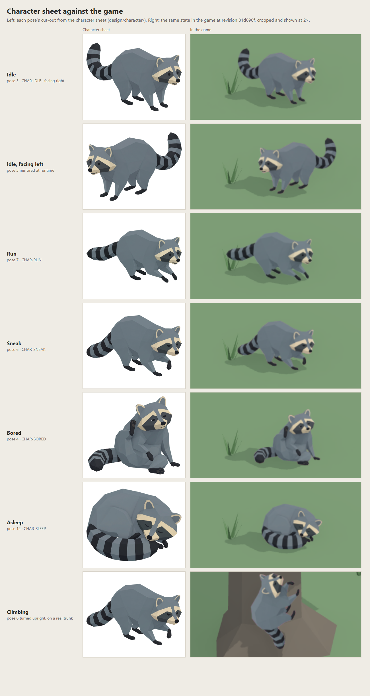
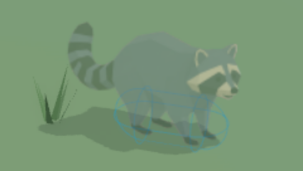
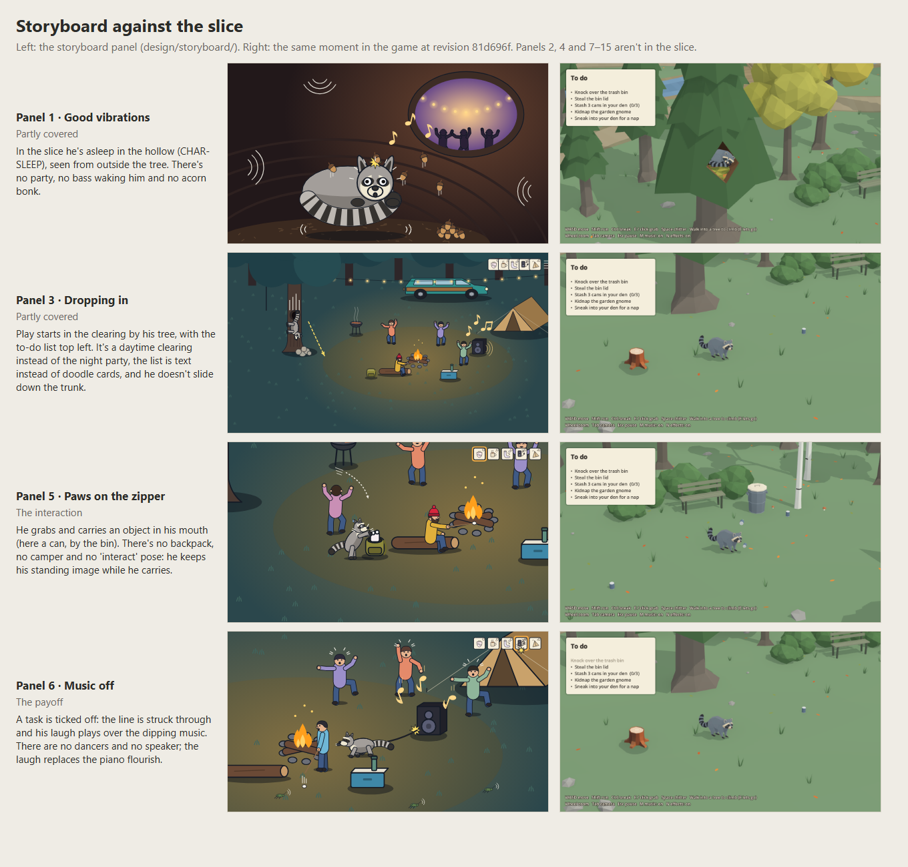

# Test report: The Noise Next Door

`the-noise-next-door` · CSYE 7270

What each assignment's work was tested for, how, and what actually happened. Each assignment's report is its own section.

| Section | Tested | Submitted as |
|---|---|---|
| [Assignment 2: the asset slice](#assignment-2-the-asset-slice) | 6 Oct 2026, at `81d696f` | tag `a2` |
| [Assignment 3: the three Blender assets](#assignment-3-the-three-blender-assets) | 14 Oct 2026 | tag `a3` |
| [Assignment 5: shaders and materials](#assignment-5-shaders-and-materials) | 25 Oct 2026 on | tag `a5` |
| [Assignment 6: particle effects, and the bigger camp](#assignment-6-particle-effects-and-the-bigger-camp) | 7 Nov 2026 on | branch `assignment-6`, not tagged yet |

---

## Assignment 2: the asset slice

`the-noise-next-door` · CSYE 7270 · Assignment 2 · 6 Oct 2026

What the slice was tested for, how, and what actually happened.

**What was tested**

| | |
|---|---|
| Source revision | `81d696f`. This report and its screenshots were committed after it and don't change the game. |
| Engine | Godot 4.7.2 stable, official build `ed1daf0bf`, Forward+ renderer, Vulkan 1.4 |
| Machine | Windows 11 Home (10.0.26300), NVIDIA GeForce RTX 4050 Laptop GPU, 16 GB RAM |
| Who tested | The author played the slice; that's the human playtest, in section 7. Claude Code ran the automated check, the fresh-copy run and the screenshots. No one else played or listened. |

### Summary

| Check | Result | Evidence |
|---|---|---|
| Startup from a fresh copy | Pass | A clone of `81d696f` imports with no errors, passes the sound check and runs (section 1) |
| Controls and state changes | Pass | Every state, shown in the game (section 2); the author played with the normal controls (section 7) |
| Character against the sheet | Matches, with the differences listed | [character-vs-sheet.png](design/test-report/character-vs-sheet.png), [collision-zoom.png](design/test-report/collision-zoom.png) |
| Storyboard against the slice | 4 panels partly covered, 11 not | [storyboard-vs-slice.png](design/test-report/storyboard-vs-slice.png) |
| Sound events, once per occurrence | Pass, automated and by ear | Section 4 |
| Music loop, pause and end | Pass, automated and by ear | Section 5 |
| Muted play | Partly readable | Section 6 |
| Automated check | 17 of 17 pass, and it fails when a rule is broken | Section 8 |

### 1. Startup and controls

**From a fresh copy.** `git clone` of `81d696f` into an empty folder, with no `.godot` import cache:
- `godot --headless --path . --import` finished with no errors in 8.7 s.
- The automated sound check then passed 17 of 17 (exit code 0).
- The game started and rendered: [fresh-copy.png](design/test-report/fresh-copy.png).
- On Windows, `Play The Noise Next Door.bat` runs the import itself the first time (README).

**Controls and states:**

| State | Input | Shown in |
|---|---|---|
| Idle | No input | [state-idle.png](design/test-report/state-idle.png) |
| Run | Shift while moving | [state-run.png](design/test-report/state-run.png); the sound check runs him with simulated keys |
| Sneak | Ctrl or C | [state-sneak.png](design/test-report/state-sneak.png) |
| Bored | 5 seconds with no input | [state-bored.png](design/test-report/state-bored.png) |
| Asleep | Sneak and keep still in the den; he hops up into the hollow | [rest.png](design/test-report/rest.png), from the real nap |
| Climbing | Walk into a trunk; W and S climb, A and D go round, E lets go | [state-climb.png](design/test-report/state-climb.png), from a real climb; the sound check climbs too |
| Facing left | Moving left on screen | [state-idle-left.png](design/test-report/state-idle-left.png) |
| Grab and carry | E or a click | [grab.png](design/test-report/grab.png) |
| Pause, mute | Esc; M for music, N for effects | The sound check (section 8) |

The idle, run, sneak, bored and asleep screenshots show the state itself, with `--pose=<state>`. The nap, the climb, the grab and the ticked-off task use the real game code, driven by `--rest-test`, `--climb-test`, `--grab-test` and `--tick-test` (see `scripts/main.gd`).

### 2. Character against the sheet



**What matches.** The game draws the character sheet's own cut-outs, so in every state the pose, proportions, palette and markings are the sheet's. All the states are scaled from one face size, so he doesn't change size when his state changes. Mirroring for the left works (row 2).

**Differences:**
- **Climbing** shows the sneak pose turned upright, because no climbing pose was generated. This is CHANGE-BRIEF.md's planned fallback.
- **There are no back views.** Walking away from the camera still shows his front, as CHANGE-BRIEF.md planned.
- **Carrying.** He keeps his current image, and the carried object sits at the hidden 3D model's mouth. Facing right it lines up with his mouth (grab.png). Walking toward or away from the camera wasn't checked.
- **Size.** The idle image covers the same screen area as the earlier 3D raccoon: 139 × 99 px at the default zoom in a 1280 × 720 window.

**Collision, in the game.** Here he's drawn half see-through, with Godot's collision shapes shown (`--debug-collisions` and `--see-collision`). `--see-collision` is a debug option added just after `81d696f` and committed with this report. It changes only how he's drawn for this screenshot.



The capsule (cyan) covers his legs and lower body. His head, back and most of his tail reach past it, as the character sheet's overlay shows ([design/character/collision.png](design/character/collision.png)). That's fair, because nothing in the slice hits those parts: he never jumps or ducks.

### 3. Storyboard against the slice



| Panel | In the slice | Differences |
|---|---|---|
| 1 Good vibrations | Partly | He's asleep in the hollow, seen from outside the tree. There's no party, no bass waking him and no acorn bonk. |
| 3 Dropping in | Partly | Play starts in the clearing by his tree, with the to-do list. It's a daytime clearing instead of the night party, the list is text instead of doodle cards, and he doesn't slide down the trunk. |
| 5 Paws on the zipper | The interaction | He grabs and carries things in his mouth. There's no backpack, no camper and no interact pose. |
| 6 Music off | The payoff | A ticked-off task is struck through, and his laugh plays over the dipping music. There are no dancers and no speaker, and the laugh replaces the piano flourish (CHANGE-BRIEF.md v2). |
| 2, 4, 7–15 | No | They need the party, humans, the beanie or the town. |

The storyboard's gameplay thumbnails were drawn for a camera about 50° down. The game uses the 27° camera the author picked; see the storyboard's legend, v6.

### 4. Sound events

| Sound | Event | Automated: scripted input | Expected | Counted |
|---|---|---|---|---|
| SFX-CHITTER | Space | 5 quick presses, then 1 press held with 8 key repeats | 6 | 6 |
| SFX-RUN | Running | 2 runs, with Shift tapped off and on 10 times during the first | 2 | 2 |
| SFX-CLIMB | Moving on a trunk | 2 climbs, clinging still between them | 2 | 2 |
| SFX-TASK-LAUGH | A task ticked off | 5 tasks over 4 frames, 2 of them in the same frame | 4 | 4 |

**By ear,** in the author's playtest at 22:59 on 6 Oct, asked whether each sound played once per action: "Yes, all fine".

**Sound never decides what happens.** Every sound plays after the game's state has already changed, and muting touches only the audio buses (`toggle_mute()` in `scripts/main.gd`). The automated check mutes and unmutes both buses mid-run, and the game carries on.

### 5. Music

| Behaviour | Planned (CHANGE-BRIEF.md) | Result |
|---|---|---|
| Seamless loop | No click or gap at the wrap | **By ear,** the author: "Yes, all fine". **Automated:** the loop marker covers the whole file, for the music and both effect loops. The cut is described in SOURCES.md (MUS-PIANO-LOOP). |
| Pause (Esc) | Muffled and about 8 dB quieter; the effects pause | **Automated:** while paused, the low-pass filter is on and the music bus is at −8 dB. After unpausing, the filter is off and the bus is back at 0 dB. |
| A task ticked off | The music dips about 4 dB under the laugh | Built as planned in `_play_task_laugh()`. Not measured by the automated check. |
| End: all tasks done | The music fades out over 3 s and stops | **Automated:** after the last task, the music has stopped. |
| Failure | Not in this slice | There are no humans, so no failure state. |

### 6. Muted play

With both buses muted (M and N), the author found the slice **partly** readable (22:59, 6 Oct). Which moments got lost wasn't noted.

Each sound has a visual partner in the slice:
- running: his run image;
- climbing: his climbing image, moving on the trunk;
- the chitter: a quick squash and hop;
- a ticked-off task: the struck-through line;
- the end: the "Mischief managed!" banner.

### 7. The author's playtest

The author played the slice on 6 Oct 2026, with sound on and then muted. These are their notes, quoted as they typed them (22:57):
> "need to make the animations smother and the gameplay feels a bit blovcky need to work on the same"
>
> "gameplay wise i need to update the game system such that i feels rewarding for the tasks to complete for the user to pursue the tasks more"
>
> "need to think abt the AI of the other NPC charaters of how pusnishing it should be to interact with them for loss"

Their answers to Claude's follow-up questions (22:59):

| Question | Answer |
|---|---|
| With sound on, did the music loop repeat without a click or gap, and did each sound play once per action? | "Yes, all fine" |
| With everything muted, could you still follow what was happening? | "Partly" |
| How loud were the sound effects against the music? | "Effects too quiet" |
| Should Claude smooth the animation now, as the documented fix? | "No, record it as a next step" |

### 8. The automated check

```bash
godot --headless --path . -- --sound-test
```

`scripts/sound_test.gd` plays a scripted input sequence:
- quick and held Space presses;
- running, with Shift tapped off and on;
- climbing, then clinging still;
- tasks ticked off, two in the same frame.

It counts how often each sound effect starts, and checks the pause, mute, loop and end behaviour. It prints a table, and its exit code is 0 only if every check passes. On `81d696f` it passed all 17 checks, both in the working copy and in the fresh clone:

```text
pass  Paused: the game stops                               expected true   got true
pass  Paused: the music is muffled                         expected true   got true
pass  Paused: the music is 8 dB quieter                    expected -8.0   got -8.0
pass  Unpaused: the game runs                              expected false  got false
pass  Unpaused: the muffling is off                        expected false  got false
pass  Unpaused: the music is back to full                  expected 0.0    got 0.0
pass  M and N: both buses muted                            expected true   got true
pass  M and N again: both unmuted                          expected false  got false
pass  SFX-CHITTER: 5 quick presses + 1 held press          expected 6      got 6
pass  SFX-RUN: 2 runs, Shift tapped during the first       expected 2      got 2
pass  SFX-CLIMB: 2 climbs, clinging still between          expected 2      got 2
pass  SFX-TASK-LAUGH: 5 tasks over 4 frames                expected 4      got 4
pass  Every task done                                      expected true   got true
pass  End: the music has stopped after its fade            expected false  got false
pass  Loop marker over the whole file: forest-loop.wav     expected true   got true
pass  Loop marker over the whole file: run-loop.wav        expected true   got true
pass  Loop marker over the whole file: climb-loop.wav      expected true   got true
RESULT: all checks passed
```

**It can fail.** To prove the check isn't hollow, the loops' hold time (`LOOP_HOLD` in `scripts/player.gd`) was set to 0 for one run. That's the rule that stops a quick Shift tap restarting the running loop. The check then reported `SFX-RUN expected 2 got 12` and exited with code 1. The setting was put back to 0.12 s. No check has been removed or weakened to get a green result.

### 9. Changes made because of what was seen or heard

| What was observed | By whom | What changed | Commit |
|---|---|---|---|
| The sound effects were too quiet against the music | The author's playtest | The effects went up 4 dB and the music down 3 dB, so the effects are 7 dB louder than the music than before. Not re-checked by ear yet. | `81d696f` |
| The generated ground texture, seen on the forest floor in the game: "i dont like the ground" | The author | The texture was switched off and the plain grass kept. A generated stump became the environment asset. | `ef1a803`, `1b300b4` |
| The planned 50° camera "still doesnt feel right" | The author | The author set the camera by eye with the Tab panel: 27° down, a 15° lens | `dcae18a` |
| On a trunk he was half hidden in the bark, and sank into the ground when turned upright | Claude, from screenshots | He's now drawn a little toward the camera and turns about his middle | `1b300b4` |
| Green gaps between the legs in two cut-outs, and the capsule drawn too far toward his head | Claude, from the sheets | The gap filling now keeps background-coloured gaps, and the capsule sits between his paws | `7296e08` |
| His fur measured as bright as the generated ground (1.0:1) | Claude's palette check | Recorded in CHARACTER-SHEET.md v5. The ground was then rejected for its look. Against the plain grass (`#7D9D76`, measured from start.png at `81d696f`), his three fur tones measure 1.3 to 2.0:1 and his charcoal markings 4.8:1. | `d89c0bb` |

### 10. Limitations

- **Static images:** one image per state, so a change of state snaps from one picture to the next. The author found the animation "a bit blovcky".
- **No back views:** walking away from the camera still shows his front.
- **No humans, so no failure state:** the slice doesn't test being caught.
- **Climbing** reuses the sneak pose, turned upright.
- **The chitter and the task laugh** are two takes of the same laugh.
- **Carried objects** follow the hidden 3D model's mouth, which was only checked facing left or right.
- **Contrast:** his fur is close in brightness to the grass (1.3 to 2.0:1). His charcoal markings (4.8:1) carry his shape.
- **Muted play** was only partly readable, and which moments were lost wasn't noted.
- **The new sound levels** haven't been re-checked by ear.

### 11. Next steps toward the full game

From the author's notes:
1. **Smoother animation and less blocky play.** For example, motion between his images, such as a bob while he moves, a softer turn than an instant mirror, and a little squash when his state changes.
2. **Tasks that feel rewarding**, so the player wants to pursue them.
3. **The other characters' behaviour, and how punishing an encounter should be.** CONCEPT.md's starting point: suspicion builds in stages, and being caught costs the item he's holding and some time, never a finished job.

---

**Provenance.**
- **The author:** played the slice, wrote the notes in section 7, and answered the four questions.
- **Claude Code:** the automated check, the fresh-copy run, the screenshots and comparison sheets, the volume change the playtest asked for, and this report's wording.
- **Generative models:** none were used for this report.

---

## Assignment 3: the three Blender assets

`the-noise-next-door` · CSYE 7270 · Assignment 3 · branch `assignment-3`

**Status (14 Oct 2026, about 18:05).**
- All three assets are built, exported to `.glb`, imported into Godot and placed in the asset room.
- The automated checks have run (below).
- My own look in Godot, the HUMAN CHECK, was done at 18:16 (below).

**What will be tested**

| | |
|---|---|
| Source revision | The commit tagged `a3`, once it exists |
| Blender | 5.2.2 LTS (build date 15 Sep 2026). The course's chapter used 5.1.2. |
| Godot | 4.7.2 stable, official build `ed1daf0bf`, as for Assignment 2 |
| Blender MCP | The mcp-for-blender server 2.1.9, run by uvx 0.12.23, and the MCP for Blender add-on 1.8 (`blender_mcp.py`) |
| Machine | Windows 11 Home (10.0.26300), NVIDIA GeForce RTX 4050 Laptop GPU, 16 GB RAM |

### Checks

| Check | Evidence to collect | Result |
|---|---|---|
| Interface notes | The six parts in my own words, and one screenshot of my own session, in [BLENDER-NOTES.md](BLENDER-NOTES.md) | My screenshot and my 3D viewport notes are mine. The elemets defination from my understanding and guidance from claude toolbar, Outliner, Properties editor, sidebar and mode selector text. |
| Size | For each asset: the dimensions in Blender's sidebar beside the brief, and Godot's bounding box beside both | **Pass**: all three within 5% of the brief on every axis. Godot's numbers match Blender's to 0.1 mm (table below). |
| Upright and scale | Each asset stands the right way up in Godot, with node scale 1, 1, 1 after export | **Pass**: height along Y for all three, and every node at scale 1, 1, 1. The pizza's crust is at −Z and its tip at +Z, and the s'more's plain marshmallows are on its +X side, as built. |
| Origin | Placed on the floor in Godot, each asset sits on it instead of floating or sinking | **Pass**: the bottom is at Y = 0.0000 for all three, and every part rests on the floor or on another part. A part sunk *into* another isn't caught (known limit, below). |
| Triangle count | Within each asset's budget, from Blender's Scene Statistics | **Pass**: s'more 402 of 420, pizza slice 144 of 200, cooler 76 of 150, counted the same in Blender and in Godot. Scene Statistics in my own screenshot confirms the cooler; the s'more and the pizza haven't been screenshotted. |
| Imports and appears | All three import with no errors and appear in the 3D scene | **Pass**: `godot --headless --path . --import` printed no errors or warnings, and all three appear in `asset_room/asset_room.tscn` (Claude's pictures below). |
| HUMAN CHECK: look | I walk the camera round each asset, from behind and below too, at game size beside the raccoon. Does each read as what it is? Any missing faces or wrong colours? | **Done (14 Oct, 18:16):** "this looks good to me the smores are fine size wise it'll work". My screenshot is 10_my-look-in-the-asset-room_by-me.png. Behind, below, missing faces and colours aren't covered in my words (see below). |
| What Claude got wrong | At least one thing, or "nothing, and here's how I checked" | Several, all logged in FRICTIONAL-EARLIER.md and listed below. |

The automated check can show that the assets arrived at the size, orientation and scale that were measured. It can't show that they look right in the game's light, read as what they are, or suit its style. Those are the human check.

### Blender-side evidence, before export

| Asset | Brief | Blender sidebar (my screenshot) | Claude's measurement of the whole asset | Triangles | Godot |
|---|---|---|---|---|---|
| S'more | v1: 0.065 × 0.065 × 0.04 m, budget 100. **v2** (after my look): about 0.13 × 0.085 × 0.035 m, budget 250. **v3** (the crackers' groove and dots): budget 420 | v1 bottom cracker: Dimensions 0.065 × 0.065 × 0.008 m, Scale 1.000, Rotation 0° ([05_finished-in-my-blender_by-me.png](design/a3/build/smore/05_finished-in-my-blender_by-me.png), 14 Oct 14:45). v2: no screenshot of mine yet. | v1: 0.065 × 0.065 × 0.04 m (14:41). **v2: 0.130 × 0.082 × 0.034 m**, bottom Z 0, centred on (0, 0); rotation 0 and scale 1 on all 6 parts (15:05). v3: size unchanged (15:55) | v1: 80. v2: 244. **v3: 402** by Claude's count. Not yet checked in Scene Statistics. | See below |
| Pizza slice | 0.15 × 0.20 × 0.02 m, budget 200 | My screenshots: before 16:17, after 16:34 (golden cheese). My hand edit then fixed the pepperoni heights (17:25 and 17:27). | 0.15 × 0.20 × 0.02 m, bottom Z 0, centred on (0, 0), tip at Y −0.10. Rotation 0 and scale 1 on all 5 parts (14 Oct, 16:12). | 144 by Claude's count. Not yet checked in Scene Statistics. | See below |
| Cooler | 0.58 × 0.36 × 0.36 m, budget 150; body blue `#3B7DBF` (v4) | My screenshot (17:42): Scene Statistics in the viewport and the status bar ([05_…_by-me.png](design/a3/build/cooler/05_finished-in-my-blender-scene-stats-76_by-me.png)) | 0.58 × 0.36 × 0.36 m, bottom Z 0, centred on (0, 0). Rotation 0 and scale 1 on all 5 parts (14 Oct, 17:33). | **76**: Claude's count, confirmed by Blender's Scene Statistics in my screenshot | See below |

### Godot: import, the headless check, and the asset room (14 Oct 2026, about 17:45–18:05)

**Export (Claude, through the MCP):**
- Each `.blend` was exported with Blender's own glTF exporter as binary `.glb`, with +Y Up and modifiers applied, and no cameras, lights or animations.
- The code is at the end of each `tools/blender/build_<asset>.py`.
- Sizes: cooler 9 KB, pizza slice 13 KB, s'more 26 KB.

**Import:** `godot --headless --path . --import` printed no errors or warnings.
- The props' imports set `meshes/generate_lods=false`, as the raccoon's import already does.
- Godot's automatic LODs would swap in simplified meshes at the game camera's 19.2 m, and could drop small parts like the pepperoni or the cracker dots.

**The check** is [tests/a3_asset_check.gd](tests/a3_asset_check.gd), written by Claude Code. The course used `timeout`; Git Bash on this machine has it.

```
timeout 120 godot --headless --path . --script res://tests/a3_asset_check.gd --fixed-fps 60
```

| Asset | Godot X × Y × Z (m) | = W × H × D, against the brief | Bottom Y | Scale | Triangles | Parts resting | Facing | Result |
|---|---|---|---|---|---|---|---|---|
| S'more | 0.1297 × 0.0335 × 0.0823 | 0.130 × 0.035 × 0.085 (v2) | +0.0000 | 1,1,1 on 7 nodes | 402 / 420 | 6 of 6 | plain marshmallows on +X | ok |
| Pizza slice | 0.1500 × 0.0200 × 0.2000 | 0.150 × 0.020 × 0.200 | +0.0000 | 1,1,1 on 6 nodes | 144 / 200 | 5 of 5 | crust −Z, tip +Z | ok |
| Cooler | 0.5800 × 0.3600 × 0.3600 | 0.580 × 0.360 × 0.360 | +0.0000 | 1,1,1 on 6 nodes | 76 / 150 | 5 of 5 | (symmetrical) | ok |

Final line: `PASS: 0 check(s) failed`, exit code 0. Blender's height (Z) arrived as Godot's Y, as the brief predicted for the +Y Up export.

**Proof that it can fail** (`... -- --mutate`): each asset is broken in memory, and the check meant to catch it must fail. **7 of 7 caught**, exit code 0:

| Break | Check that failed |
|---|---|
| Cooler 10 times too big | size |
| Cooler scale 1.02 on Z (not applied) | scale 1,1,1. Only 2% bigger, so the size check alone passes it. |
| Pizza slice lying on its side | height along Y |
| A pepperoni floating 3 mm | every part resting |
| Pizza slice turned round | facing |
| S'more floating 5 cm | bottom on the floor |
| S'more sunk 5 mm | bottom on the floor |

**What the check doesn't show:**
- **A part sunk into another part still passes.** The mutation run prints this as a known limit: "a pepperoni sunk 1.7 mm into the cheese -> every check still passes". It happened to my pizza on 14 Oct and was found by measuring each part, not by this check.
- **It measures boxes, not shapes.** A missing face, a wrong colour, or a part in the wrong place inside the box all pass.
- **It can't tell whether an asset looks right, reads as what it is at game size, or suits the game.** That's my look, below.
- **It checks the brief's numbers, not the game's needs.** A life-size s'more passes, even if it's too small to read in play.

**The check's own first bug (Claude's):**
- On its first run the check failed 9 times on assets that were fine. Its parts were measured with `global_transform`, but in `_initialize` the nodes aren't inside the scene tree yet, so that comes back as the identity. Every part was measured at its own origin; the cooler's bottom read −0.14 m.
- Claude now works out each part's transform from its parents. The run passed, and the mutation proof shows it still fails when it should.
- This is the course's warning in action: a check can prove less than, or something other than, what it claims.

**The asset room:** [asset_room/asset_room.tscn](asset_room/asset_room.tscn), opened by `Look at the A3 assets.bat`.
- A floor, the forest level's sun and haze, and an orbit camera.
- The three assets side by side at game size, beside the raccoon (`raccoon_v2.glb` at the game's size 0.8, playing its idle).
- Labels show each asset's size as Godot measures it. The raccoon measures 1.350 × 0.519 × 0.613 m.
- **G** shows the view from the game's own camera.

**Launching it as a grader would** (14 Oct, about 20:00), on a fresh copy of this folder with no `.godot` cache:
- **On Windows:** `Look at the A3 assets.bat` imported all 8 models in 8 s with no errors, skipping the `.blend` sources. The room opened with every label, and its screenshot matched picture 01.
- **`look_at_a3_assets.sh`** did the same, run from Git Bash. It isn't tested on a Mac or on Linux. With no Godot to find, it says so and exits 1.
- **The check** passed on the copy, and its mutation proof caught 7 of 7.
- **The launcher was changed:** it used to import only when the cooler, s'more, pizza or raccoon were missing. A changed camper or beanie would have shown its old model, so it now imports every time, which takes about 4 s when nothing has changed.
- **Not a clone:** this was a copy of the uncommitted folder. The fresh-clone check after the commit is still to do.

Claude's pictures of it, rendered by Godot in a window (`-- --shot=... --view=...`), in [design/a3/build/godot/](design/a3/build/godot/):

| Picture | View |
|---|---|
| [01_all_by-claude.png](design/a3/build/godot/01_all_by-claude.png) | Everything, with labels: the raccoon, the three assets, and (from 18:02) the donut |
| [02_game_by-claude.png](design/a3/build/godot/02_game_by-claude.png) | The game's camera: 27° down, 19.2 m away, 15° lens, no labels. The cooler reads clearly and the pizza is a small yellow triangle with red dots. **The s'more is a speck of about 15 px**, as my brief predicted for a life-size s'more. |
| [03_below_by-claude.png](design/a3/build/godot/03_below_by-claude.png) | From below the floor (the floor is one-sided, so the undersides show) |
| [04_raccoon_by-claude.png](design/a3/build/godot/04_raccoon_by-claude.png) … [07_pizza_by-claude.png](design/a3/build/godot/07_pizza_by-claude.png) | Close-ups of the raccoon, the cooler, the s'more and the pizza slice |
| [08_donut_by-claude.png](design/a3/build/godot/08_donut_by-claude.png) | The donut from my Blender practice, which I asked to have in the room, now life-size: 0.100 × 0.100 × 0.033 m, 35,144 triangles with its smoothing applied. I may use it in the game later. |
| [09_whole_pizza_by-claude.png](design/a3/build/godot/09_whole_pizza_by-claude.png) | The round pizza I asked for, on key 6: **5 copies of the one pizza-slice asset**, turned 45° apart with their tips at the centre, so 5 of 8 slices are left (0.275 × 0.400 m). The asset itself is unchanged and still one slice, within the limits. Each crust is straight, so the rim is a polygon, not a smooth circle. |
| [11_camper_by-claude.png](design/a3/build/godot/11_camper_by-claude.png) | The camper I asked for (key 7), v2 in the raccoon's faceted style, his head turned 9° to his right as in the reference, with its jaw, chin and neck: 0.631 × 0.342 × 1.824 m, 4,472 triangles. Beside him, the raccoon's back comes up to about his thigh, as CHARACTER-SHEET.md says. Claude's comparisons with `red-beanie-man.jpg`, through the reference's solved camera, are [v2_01](design/a3/build/camper/v2_01_reference-and-v2-lit_by-claude.png) (side by side), [v2_02](design/a3/build/camper/v2_02_reference-model-overlay_by-claude.png) (overlaid) and [v2_03](design/a3/build/camper/v2_03_head-turned-close-up_by-claude.png) (the head, close up). |
| [12_beanie_by-claude.png](design/a3/build/godot/12_beanie_by-claude.png) | His beanie, dropped and crumpled (key 8), v2 in the camper's faceted style, lying side-on in front of the raccoon: the folded cuff, the slumped crown and the pompom on the floor. 368 triangles; 0.278 × 0.291 × 0.108 m as the room measures it, turned. Its open end, with the dark inside, faces away from this camera; Claude's six views are [v2_01](design/a3/build/beanie/v2_01_six-views_by-claude.png). |

**The labels measure vertices, not boxes.** The first version took each mesh's own box and turned it with the mesh. My practice donut is turned about 17°, so it measured 0.404 × 0.405 m instead of 0.327 × 0.328 m. The labels now measure the vertices themselves. The check script still uses boxes, which is exact for the three assets, because their rotation is applied and every part's rotation is 0.

**What Claude got wrong**, all in FRICTIONAL-EARLIER.md:
1. It first took the raccoon's lying collision capsule (0.64 m) as his height. He's 0.61 m tall and 1.35 m long, as the asset room's label confirms.
2. Its first rebuild test overwrote `smore.blend`, because its `sed` path swap didn't match. The file was restored from the MCP session.
3. Its first Godot check measured every part at the origin (above).
4. Its first asset-room launcher had a real carriage return in a path, because the shell ate a backslash. Claude found it by checking the file byte by byte, and fixed it before anyone used it.
5. Its first s'more (v1) didn't read as a s'more. That was my judgement; Claude agreed and rebuilt it.
6. Its first camper (v1) didn't look like the reference: "it looks bocky and like a minecraft tree", in my words. Claude rebuilt him in the raccoon's style and fitted him to the reference (v2).

### HUMAN CHECK: my look in Godot

**Done 14 Oct 2026, 18:16,** in the running asset room (`Look at the A3 assets.bat`).

**What I said:** "this looks good to me the smores are fine size wise it'll work"

**My screenshot:** [10_my-look-in-the-asset-room_by-me.png](design/a3/build/godot/10_my-look-in-the-asset-room_by-me.png). It's my own window, from my own orbit: the raccoon, the cooler, the s'more, the single pizza slice, the round pizza (5 of 8 slices) and the donut, with their Godot-measured sizes.

**What this settles:**
- **The s'more's size.** My brief left open whether a life-size s'more, about 14–15 px at the game camera, would read at all. My judgement: it's fine size-wise and it'll work.
- **The overall look:** "looks good to me".

**Not stated in my words:**
- whether I looked from behind and below;
- whether there were any missing faces or wrong colours.

Claude's pictures from below (03) and close up (04–09) show none, but that's Claude's look, not mine.

---

## Assignment 5: shaders and materials

`the-noise-next-door` · CSYE 7270 · Assignment 5 · branch `assignment-5`

**Status (1 Nov 2026).**
- **The cone's shader is in, and driven:** my `shaders/vision_cone.gdshader` (53b0087), the `claude -p` agent's driver and test (29fd5da), and Claude's fixes from its review of them (2024a76). Its headless test passes 93 of 93 at 30, 60 and 144 fps, and the earlier checks keep their baseline (below).
- **All three mutations are done:** two on the cone's shader, whose runs exit 1, and `source_color` on the cooler's, which fails the material test (below).
- **The cone's controlled-value captures are done,** and the first two spottings in play (below).
- **The cooler's shader and its two materials are in,** behind the glb's Use External, and every check keeps its baseline (below).
- **The hint experiment is done:** its scene, with my shader, and my capture of the bands (below).
- **The material audit and its test are in** (below): 137 of 137 at 60 fps after Claude's review, and again from an empty cache, with every earlier check at its baseline.
- **Five spottings are recorded in play,** and the cooler's "one shader, two materials" check is done (below).
- **The rest of the in-play list and the cooler at the camp at night** were checked by me on 1 Nov, "looks fine", with no detail for each (below).
- **The generated shader is in,** with my annotations (below).
- **LANGUAGE-NOTES.md is written,** and Claude Code checked that every line reference in it points where I say (FRICTIONAL.md, 1 Nov).
- **The interface sweep is captured** (1 Nov, below), with my notes on `tint` and `uv_scale`. **Not done yet:** my notes on `detail`, `roughness_scale` and `normal_strength`.

**What will be tested**

| | |
|---|---|
| Source revision | The commit tagged `a5`, once it exists. Each section below says the revision it ran on. |
| Godot | 4.7.2 stable, official build, as for Assignments 2 and 3. Headless runs use `Godot_v4.7.2-stable_win64_console.exe`, which isn't on the PATH. |
| Renderer | Forward+ (`project.godot`, `config/features`). HDR 2D isn't set. |
| Machine | Windows 11 Home (10.0.26300), NVIDIA GeForce RTX 4050 Laptop GPU, 16 GB RAM; a 144 Hz display |
| Test runner | `scripts/run-test.sh`, in Git Bash (its `timeout` is GNU coreutils) |

### The test wrapper

`scripts/run-test.sh` is the course's wrapper, adapted by Claude Code on 25 Oct 2026. Like the course's, it:
- runs the test under `timeout 120` (exit status 124 means it hung);
- pins the frame rate with `--fixed-fps`;
- keeps a log in `logs/<test>_<fps>fps.log`;
- fails on any `SHADER ERROR` or `SCRIPT ERROR` line, whatever the exit code.

What's different, and why:
- **`--path .` instead of `--path godot`:** the Godot project is the repository root.
- **It finds Godot itself:** from `GODOT`, then `godot` on the PATH, then the two places the `.bat` launchers look.
- **Flag tests:** an argument starting with `--` runs the main scene with that flag (`-- --sound-test`). The earlier checks are built that way, not as scripts in `tests/`.

Run a check with `./scripts/run-test.sh <test.gd | --flag-test> <fps>`.

### Baseline: the earlier checks before Assignment 5 changed anything

Run on 25 Oct 2026, about 19:50, at 3acc103 with nothing changed, at `--fixed-fps 60`. Later runs overwrote these logs, since the wrapper names a log after its check and frame rate; the counts here come from that run's output in the chat transcript. The logs now in `logs/` are from the 26 Oct run below.

| Check | Run with | Result |
|---|---|---|
| Assignment 3's assets | `a3_asset_check.gd 60` | Pass, 20 of 20 |
| Sounds | `--sound-test 60` | Pass, 30 of 30 |
| Thought icons | `--bubble-test 60` | Pass, 87 of 87 |
| Campers' reactions | `--camp-test 60` | Pass, 31 of 31 |
| Camp tasks | `--tasks-test 60` | Pass, 43 of 43 |
| Sound waves | `--waves-test 60` | **Fail, 12 of 13**: "On the beat: a set every 2 beats (1.31 s): 4 in 5.22 s, give or take one" |
| THE PLAN | `--plan-test 60` | Pass, 19 of 19 |
| Title screen | `--title-test 60` | **Fail, 51 of 52**: "In: the party's sound waves are rolling out" |

The two failures come from the wrapper's fixed frame rate, not from anything broken.
- Run without `--fixed-fps`, both pass: 13 of 13, and all checks.
- The party's beat follows the music's playback position (`scripts/campsite.gd`, `_keep_the_beat`), which runs in real time.
- `--fixed-fps` lets a headless run's game time go faster than real time, so fewer beats come in the 5.22 s the waves check counts.
- The assignment says not to change the earlier tests, so they stay as they are and these two are recorded as known.

### After the cone behaviour and the hop fix

Run on 26 Oct 2026, about 17:25, on the uncommitted work, at `--fixed-fps 60`.

| Check | Result | Changed since the baseline? |
|---|---|---|
| Assignment 3's assets | Pass, 20 of 20 | No |
| Sounds | Pass, 30 of 30 | No |
| Thought icons | Pass, 87 of 87 | No |
| Campers' reactions | Pass, 31 of 31 | **One expectation, changed with the design:** "Gone: the men look about, then head back" now allows the new confused state, SEARCH, before they walk back. |
| Camp tasks | Pass, 43 of 43 | **One expectation, changed with the design:** the to-do list is now "investigate party marshmallows music cooler", with Rock the party as the camp tasks' main task. |
| Sound waves | Fail, 12 of 13, the same check | No. Passes without `--fixed-fps`. |
| THE PLAN | Pass, 19 of 19 | No |
| Title screen | Fail, 51 of 52, the same check | No. Passes without `--fixed-fps`. |

The baseline for the shader work has to be taken again once this behaviour is committed, from that commit.

### The cone's behaviour (`scripts/cones_test.gd`, `--cones-test`)

| Frame rate | Result |
|---|---|
| `--fixed-fps 30` | Pass, 43 of 43 |
| `--fixed-fps 60` | Pass, 43 of 43 |
| `--fixed-fps 144` | Pass, 43 of 43 |

It puts the raccoon in plain sight at the camp and checks:
- **Before the tutorial:** no cones, nobody sees him, and only the music's task on the list.
- **The tutorial:** it pauses the game, with the note to press Tab, and Esc doesn't unpause it. Tab brings up the plan with Rock the party and its three tasks, and the note to sneak. Tab again carries on, with the cones on.
- **When he's spotted:**
  - the spotter's cone is red through its 2 s, and the other cones aren't;
  - every cone shows through the red and its fade, flat on the ground, the red one 7 m long as it was;
  - then every cone goes, 2.50 s after the spotting.
- **The chase:** he's chased and shooed as before, with no cones meanwhile.
- **Once he's got away:** each of the three is confused (SEARCH) for 3.00 s. Each one's cone comes back 5.00 s after they start back. All three end up back at their routines with yellow cones.
- **The main task:** Rock the party is ticked off with its last task, and not before.

The times are measured on the game's clock, so they come out the same at all three frame rates, within a physics tick and a frame.

**Proof that the ground check catches its bug:** with the cone's old rescale line put back, which stretched it up and down too, "every cone flat on the ground" fails, and the run exits 1.

### Found by looking, not by a test

- **The red cone was missing from Claude's first picture** of the spotting (`design/level1/cones/03_spotted_red.png`, first run), though the test said it was shown.
  - The rescale stretched the cone up and down as well as across. At an alarmed camper's 14 m it sat 1.5 m under the ground; shorter, while he sneaks, it floated about 0.7 m above it.
  - The bug was in the game before Assignment 5 but never showed, because alarmed campers had no cone.
  - Fixed in `scripts/vision_cone.gd`, and the ground check above was added.
- **Two of the first pictures showed the raccoon far away instead of the campers.** The test now moves the camera to the camp for those two.
- **A test mistake, not a game bug:** the girl went on cowering because the test moved him while he was still leaping from a shoo, and the leap carried him back into her sight. The test now waits for him to land.

The pictures, from a windowed run of the cones test, are in [design/level1/cones/](design/level1/cones/):
- 01: the tutorial's "Press Tab" note;
- 02: the plan in the tutorial;
- 03: spotted, the red cone;
- 04: confused, "??";
- 05: the cones back.

They're Claude's pictures, not my look.

### The hop error from my plays

- **What happened:** I played twice on 26 Oct, at about 16:55 and 17:13. Claude read the game's log after each.
  - There was nothing from the tutorial or the cones.
  - There was one older error, 116 and 120 times: "Basis … must be normalized in order to be casted to a Quaternion", from `scripts/player.gd:486`, where a hop turns him.
- **The cause:** a turn whose flat axes had drifted to about 0.99998 long, against an up axis of 1. Godot won't blend that, and once he carries it, every later hop fails on every frame.
  - What puts the drift on him in play wasn't found. A scripted start (the title, the wake, the leap out of the hollow, a shoo, climbing, the hollow, a jump) didn't reproduce it.
- **The fix:** `_hop` tidies both ends into pure turns as each hop starts.
- **The check:** a scratch probe gave a hop ends like the error's. It logged 18 errors per 0.3 s hop before the fix and none after, with his scale back to exactly 1. Not one of the runs above logged a hop error.
- **Not done:** a lasting test for it. The probe needs the game started outside title mode, which the wrapper's script runs don't do.

### The cone's shader and its driver (`tests/cone_shader_test.gd`, `--cone-shader-test`)

Run on 29 Oct 2026, about 16:10, on the code committed as 2024a76: my shader (53b0087), driven by `scripts/cone_driver.gd`. The driver and the test are the `claude -p` agent's, from `prompt-3.txt` (29fd5da), with Claude's fixes from its review (2024a76).

| Frame rate | Result |
|---|---|
| `--fixed-fps 30` | Pass, 93 of 93 |
| `--fixed-fps 60` | Pass, 93 of 93 |
| `--fixed-fps 144` | Pass, 93 of 93 |

It checks:
- **The shader's contract:** the four uniforms' names and types, from `get_shader_uniform_list()`; their hints and defaults, the render_mode and my two lines, read from the source text.
- **One material per cone:** three cones, three materials, each with my shader.
- **Through play,** with Tab and Esc as key events and him put in a camper's view with `player.place()`. It never calls `spot()` or the driver. Over five spottings:
  - the snap, on the spotters' cones only;
  - the red, and the fade read off its slope;
  - lost early;
  - re-spotted during the red (0.12 s on) and during the fade, and spotted while the cones are hidden;
  - seen by an alarmed camper, during the red and while the cones are hidden: nothing changes;
  - paused mid-fade with Esc: held through 45 frames;
  - time scale 0.5 and 2.0;
  - the cones coming back yellow and fading in, and no fade-in when the tutorial ends.

**The timings** (game time, in the logs):
- Every time read off a fade's slope came out exact, 0.00 ms off, at every rate.
- Every first changed frame came no more than one physics tick late, the limit in the brief's 29 Oct revision: up to 16.67 ms at time scale 1, 8.33 ms at 0.5 and 33.33 ms at 2.0.
- The red lasted 2N/s frames plus one at 30 and 60 fps, and plus three at 144 (291 against 288), within the same revision's limits.
- When each cone comes back is the game's timing, so the test prints it and doesn't assert it. The girl's came back about 1.6 s later than 5 s after she started back, because the game counts her 5 s from when the cones went (the brief's second 29 Oct revision).

**What it can't show:** anything on screen (the colours, the blending, fog, sorting or culling), or that the GPU compiles the shader. Those are the human checks.

### The earlier checks after the shader and its driver

Run on 29 Oct 2026, about 16:10, on the code committed as 2024a76, at `--fixed-fps 60`; the cones check also at 30 and 144.

| Check | Result | Changed since 26 Oct? |
|---|---|---|
| Assignment 3's assets | Pass, 20 of 20 | No |
| Sounds | Pass, 30 of 30 | No |
| Thought icons | Pass, 87 of 87 | No |
| Campers' reactions | Pass, 31 of 31 | No |
| Camp tasks | Pass, 43 of 43 | No |
| Sound waves | Fail, 12 of 13, the same check | No |
| THE PLAN | Pass, 19 of 19 | No |
| Title screen | Fail, 51 of 52, the same check | No |
| The cones (`--cones-test`) | Pass, 43 of 43 at 30, 60 and 144 | No |

No earlier check's expectations changed for the shader work. Some logs end with "ObjectDB instances were leaked at exit" and "resources still in use at exit". Those lines come and go between runs of unchanged code (the 26 Oct logs had them too), and they don't fail a run.

### The two shader mutations

Done by me on 29 Oct 2026 on my cone shader, one at a time. Each was run with `bash scripts/run-test.sh --cone-shader-test 60`, then undone with `git checkout`.

| Mutation | What I changed | Exit | `SHADER ERROR` | Result | Log |
|---|---|---|---|---|---|
| Parse | Deleted the `;` at the end of the colour line | 1 | Yes: "Expected a ';'." | 85 of 93. The uniform list came back empty, so its six checks failed, and so did "Driver's names declared" and the colour-line check. | `logs/mutation-semicolon_60fps.log`, run at 16:28 |
| Rename | Renamed the uniform `alarm` to `alert` in the shader only: its declaration and both lines | 1 | No: it still parses | 87 of 93. The uniform list showed `alarm_color alert shown watch_color`, and "alarm is a float", "Driver's names declared", the source check on `alarm` and both line checks failed. | `logs/mutation-rename_60fps.log`, run at 16:53 |

- **What the rename shows:** every check on `alarm`'s values over time still passed. The driver sets `alarm` with no error, and reading it back gives the value set, though the shader no longer has it. Only the uniform-list and source checks caught it.
- **On the way** (FRICTIONAL.md, 29 Oct), each caught by Claude checking the files:
  - my first mutation run tested an unchanged shader, because the edit wasn't saved;
  - a result I first pasted for the rename was a prediction, not a run's output;
  - the first real rename run's log was undone before I kept it, so I ran it again.

### The controlled-value captures (HUMAN CHECK)

Taken by me on 29 Oct 2026, about 17:05, on the code at f7a8503, with `design/a5/captures/capture_values.gd` and F9. The window was 1280 × 720, the game paused, the driver held off, and the camera framed as for my grass captures. The captures, `values.txt` and my OS screenshot are in [design/a5/captures/values/](design/a5/captures/values/); the run's console output is in `logs/capture-window.stdout.log`.

| Pixel | `alarm` | Predicted | Captured | Off by (R, G, B) |
|---|---|---|---|---|
| Base at Camper (974, 258) | 0 | (139, 132, 93) | (142, 134, 94) | +3, +2, +1 |
| Base at Camper | 0.5 | (148, 109, 79) | (151, 111, 81) | +3, +2, +2 |
| Base at Camper | 1 | (156, 61, 56) | (159, 61, 57) | +3, 0, +1 |
| Far Edge (249, 480) | 0 | (94, 100, 89) | (94, 101, 91) | 0, +1, +2 |
| Far Edge | 0.5 | (98, 91, 85) | (99, 91, 87) | +1, 0, +2 |
| Far Edge | 1 | (102, 76, 80) | (102, 76, 81) | 0, 0, +1 |

- **The grass:** every frame with the cones hidden gives my table's grass, (34, 45, 49) and (58, 76, 82).
- **The match:** Far Edge is within 2 on every channel. At Base at Camper, R is 3 high at all three values, past my 2-step match, and G and B are within 2. That fits the known low bias in my predictions (my brief: "Base at Camper's R is 3 low in every cell"), so it's the arithmetic, not the shader.
- **`hint_range`:** with `alarm` set to 2.0 from code, Base at Camper is (174, 0, 0) and Far Edge (110, 0, 62), against (159, 61, 57) and (102, 76, 81) at 1.0. So `hint_range` doesn't clamp a value set from code, as I predicted.
- **Fog (failure 5):** fog on and fog off give the same values at both spots, at `alarm` 0, though the fog-off frames differ elsewhere. So the fog doesn't reach my two spots, and failure 5 didn't appear there.
- **The OS screenshot,** of the held `alarm` 1 frame: at the corresponding place it reads (159, 61, 57), matching the in-engine Base at Camper pixel. Display scaling and the window's position shift the screen coordinates, so I trust the in-engine sample for the pixel I mean; the screenshot confirms it once mapped. (Claude measured the mapping: the frame sits in the 1536 × 864 screenshot unscaled, at +320, +150, and both spots read the same there as in the capture.)

### In play with the shader (HUMAN CHECK)

Played by me on 29 Oct 2026, on the code at f7a8503. The game's own log has two windowed sessions then, from 17:08:45 and 17:10:27, about a minute and a half each, with no errors.

In my words: "I played the game when running the raccons was spoted by the girl and the boy turning their cones red and fading away the red inicator is good sign to let the player know that he has been spoted after invading the chuuby guy saw and spotted similar flow feels good in the game"

- **Spotting 1:** while he was running, the girl and the low-poly man ("the boy") spotted him. Both their cones turned red, then faded away.
- **Spotting 2:** after he got away, the camper ("the chubby guy") spotted him: the same red, then the fade.
- **What I judged:** the red tells the player he's been spotted, and the flow feels good.

**Two more spottings**, played by me on 29 Oct 2026 at about 20:06, on the code at 82365df; I sent my notes to Claude Code on 30 Oct at 20:49. The game's own log has four short windowed sessions then, between 20:06 and 20:11, with nothing logged but the engine's start-up lines.

In my words:
- "Started the game as we are drawn to the music waves if the user runs in the setting some detail casues the direct spot from the NPCs triggering the red identificatio cones red and fade away back to normal yellow tinge"
- "Slower approc where intial view points are visiable from the NPCs to make the player understnd the vision cones as the npc vision range of the yellow which also change when the player makes sneeking or increses when running or normally walking eventual spot turn red and altering mechnisum"

- **Spotting 3, running in:** following the music's waves, he ran into the camp and the campers spotted him straight away. The cones turned red, faded away, and came back to their normal yellow.
- **Spotting 4, a slower approach:** the yellow cones showed from the start how far each camper sees, and they changed length as he sneaked, walked or ran. In the end he was spotted, the cone turned red, and the alarm followed.
- **What I judged:** coming in slowly lets the player understand the yellow cones as the campers' vision range.
- **Not stated for spottings 3 and 4:** which camper spotted him, and how the fade-in looked when the cones came back. For spotting 4: the fade, and whether he was spotted again.

**Spotting 5, two red cones overlapping**, played by me on 1 Nov 2026, on 245f766. The game's own log has a windowed session from 18:15:17, with nothing logged but the engine's start-up lines. My screenshot, taken with the game paused (Esc), is [design/a5/captures/in-play/spotting5_two_red_cones_overlapping_paused.png](design/a5/captures/in-play/spotting5_two_red_cones_overlapping_paused.png). It's an OS screenshot, not an in-engine capture.

In my words: "overlapping check for the cones also is in. Both the cones overlap and turn red. And then eventually it fades away. The method seems fine."

- **What I saw:** he was spotted, two campers' cones turned red where they overlapped on him, and then they faded away.
- **What it covers of failure 7:** an overlap during a red. Both cones were red, though, and two cones of the same colour blend the same whichever is drawn first. So this overlap couldn't show the flicker failure 7 predicts, which is a red cone over a yellow one.
- **Not stated:** which campers spotted him, whether it flickered, and whether he was spotted again.

**The rest of the in-play list**, answered by me on 1 Nov. The list was:
- the cones coming back fading in, about 5 s after their campers start walking back;
- a red cone overlapping a yellow one (failure 7's case);
- all three cones appearing at the tutorial's end, with no fade-in;
- the boundaries: he moves and the campers behave as before, and only the cones and the cooler look different;
- the bubble demo's cone still turning red.

In my words: "for now it looks fine all the aspects i have checked".
- **When:** the game's log has no windowed session after the one from 18:15:17, so I checked these in that session or before it.
- **Not stated:** what I saw for each item. That includes whether a red cone over a yellow one flickered, which is what failure 7 predicts.
- **A scripted picture, not play:** the bubble test's own picture from a windowed run, `design/a5/captures/bubble-demo-check/03_alert.png` (`--bubble-test` with its pictures, 87 of 87), shows a stand-in's cone red with my shader, through the fallback for cones the camp doesn't drive.

### The textures, their import settings, and the normal-map check

**The textures** (29 Oct 2026): Poly Haven's Blue Metal Plate, by Rob Tuytel, CC0, with the licence checked by me that day. The 1k PNGs are in `assets/textures/blue_metal_plate/`, credited in `ATTRIBUTION.md` there, and their sizes and MD5s match Poly Haven's own file list.

**The import settings,** set explicitly and read back after a reimport:

| Texture | `compress/mode` | `compress/normal_map` | `mipmaps/generate` | `roughness/mode` | `detect_3d/compress_to` | Format read back |
|---|---|---|---|---|---|---|
| `blue_metal_plate_diff_1k.png` | 2, VRAM Compressed | 2, Disabled | true | 1, Disabled | 0, off | BC1 (DXT1), with mipmaps |
| `blue_metal_plate_rough_1k.png` | 2 | 2 | true | 1 | 0 | BC1 (DXT1), with mipmaps |
| `blue_metal_plate_nor_gl_1k.png` | 2 | 1, Enable | true | 1 | 0 | BC5 (RGTC_RG), with mipmaps |
| `blue_metal_plate_nor_dx_1k.png` | Skip | | | | | Not imported: only for calibrating the check |

The formats were read with `get_image().get_format()` in a headless run, and they confirm what each integer means. Whether the editor rewrites any of these settings gets checked after my first editor session with them (failure 9).

**The normal-map check** is `tests/normal_map_check.gd`, the course's code. It was calibrated on this set's own pair with `bash scripts/run-test.sh normal_map_calibration.gd 60`:

| Map | As given (df1bc6e), `directx = false` | As given, `directx = true` | `s` flipped, `directx = false` | `s` flipped, `directx = true` |
|---|---|---|---|---|
| GL | 1.573 | 0.427 | 0.427 | 1.573 |
| DX | 0.427 | 1.573 | 1.573 | 0.427 |

- **As given, it came out reversed:** the GL map, the right one for Godot, scored high under `directx = false`. As the course says to, `s` is flipped. Now the GL map is low under `directx = false` and high under `directx = true`, and the DX map is the other way round. The likely reason, in Claude's reading, is that Godot's image rows run downwards.
- **The pair separates,** 0.43 against 1.57, so it calibrates the check. It doesn't reach the ideal 0 and 2: the plate is nearly flat, and the 16-bit PNGs are decoded to 8 bits, which pulls both values toward 1.
- **The threshold** the material test will trust: below 0.7 with `directx = false`. That's about halfway between this known-good map's 0.43 and the score of about 1 that a map with no surface behind it gets. It's my pick, in the brief's 29 Oct revision on the check.

### The cooler's shader and its two materials

**My shader** (`shaders/cooler_paint.gdshader`, c45c97b), written by me from my material plan. Claude checked it against the plan, and checked in a scratch copy of the project that it parses: `get_shader_uniform_list()` lists my two groups and all eight uniforms, with their types and ranges, and there's no `SHADER ERROR`.
- Its tint line is `tint.rgb * mix(1.0, diffuse_luminance / DIFFUSE_MEAN_LUMINANCE, detail)`: the flat tint at `detail` 0, and at 1 the diffuse's brightness around its average.
- `DIFFUSE_MEAN_LUMINANCE` is 0.0452. Claude measured the diffuse's mean linear luminance as 0.0456 in the source PNG and 0.0438 in the imported BC1 texture the GPU samples. So at `detail` 1 the cooler comes out about 3% darker on average than its tint. I kept 0.0452.

**The two materials,** written by Claude Code with Godot's `ResourceSaver`, with my plan's values:

| Material | `tint` | `detail` | `roughness_scale` | `normal_strength` | `uv_scale` | Textures |
|---|---|---|---|---|---|---|
| `materials/cooler_body.tres` | `#3B7DBF` | 0.6 | 1.0 | 1.0 | 1.0 | The diffuse, roughness and GL normal maps |
| `materials/cooler_lid.tres` | `#F2F2EE` | 0.25 | 0.6 | 0.5 | 1.0 | The same three |

**Behind the importer's Use External:** `_subresources` in `assets/props/cooler.glb.import` points `Cooler_Blue` at the body material and `Cooler_White` at the lid. Godot's reimport kept `use_external/enabled` and `use_external/path`, and added `use_external/fallback_path`, which confirms the keys. A headless probe of the imported cooler found:

| Mesh | Material |
|---|---|
| `Cooler_Body` | `materials/cooler_body.tres`, with my shader |
| `Cooler_Lid` | `materials/cooler_lid.tres`, with my shader |
| `Cooler_Handle`, `Cooler_PostL`, `Cooler_PostR` | The embedded `Cooler_Grey`, `#8a8f94`, unchanged |

The camp and the asset room both instance the glb, so every cooler gets the new materials.

**After it, every check is at its baseline** (29 Oct 2026, about 18:10):
- the cone's shader test, 93 of 93 at 30, 60 and 144 fps, and the cones check, 43 at all three;
- the A3 assets 20, sounds 30, bubble 87, camp 31, tasks 43 and plan 19;
- waves 12 of 13 and title 51 of 52, failing the same checks as before;
- the normal-map calibration, unchanged.

No log has a new `SHADER ERROR` or `SCRIPT ERROR`.

**Not checked yet:** how it looks. That means my look in the asset room with SSAO off, and at the camp at night; the interface sweep; and the two materials side by side, with the shader-edit and material-edit checks.

### The hint experiment

**My shader** (`shaders/hint_experiment.gdshader`, 9d782c3) splits one quad down the middle by `UV.x`. The left half samples `with_source_color` (`source_color, filter_nearest`), and the right half `without_source_color` (`filter_nearest` only), and each half shows all three greys. The course's design has a bool picking the sampler, with two materials on two quads. I kept the split (CHANGE-BRIEF.md, "Revised 29 Oct 2026: the hint experiment, on one quad split in two").

**The PNG and the scene,** by Claude Code:
- `hint_experiment/greys_3x1.png`, written by `hint_experiment/make_greys_png.gd`, and imported lossless with no mipmaps (`compress/mode=0`, `mipmaps/generate=false`).
- `hint_experiment/split_quad.tres` binds it to both samplers. `hint_experiment/hint_experiment.tscn` puts that on one 3 × 0.6 m quad, facing an orthographic camera 2 m tall. Its WorldEnvironment has a black background, a Linear tonemap at exposure 1.0, and glow, fog and adjustments off.

**Probed headless** (29 Oct 2026, about 18:53, in the repo after my import):
- the imported texture is 3 × 1, RGB8, with no mipmaps, and reads back as exactly (64, 64, 64), (128, 128, 128) and (192, 192, 192);
- `get_shader_uniform_list()` lists both samplers, so my shader parses;
- the material binds the PNG to both samplers;
- the environment reads back with tonemap 0 (Linear), exposure 1.0, and glow, fog, volumetric fog, adjustments and SSAO all off.

No log line has `ERROR`.

**My capture (HUMAN CHECK)** (29 Oct 2026, 18:57): taken from the game's own 1280 × 720 frame with `design/a5/captures/read_bands.gd`, which prints the pixel at each band's centre. The image and the values are in [design/a5/captures/hint/](design/a5/captures/hint/) (`bands.png`, `bands.txt`).

| Grey in the file | With `source_color`: measured (predicted) | Without: measured (predicted) |
|---|---|---|
| 64 | 64 (64) | 137 (135) |
| 128 | 128 (128) | 188 (184) |
| 192 | 192 (192) | 225 (225) |

- **The quad with `source_color`** shows the file's values unchanged, as I predicted: the decode on read and the encode on display cancel out.
- **The quad without** is brighter, as I predicted. 64 and 128 come out 2 and 4 steps above my predictions, from the known power slip in them (CHANGE-BRIEF.md, "Revised 28 Oct 2026: my hint experiment predictions"). Encoding the raw values to sRGB exactly gives 137.2, 187.8 and 225.0, which round to what I measured.
- R, G and B are equal in every band.

### The material audit and its test (`tests/test_materials.gd`)

**The audit** (29 Oct 2026, 18:55 to 19:00), on 3603922:
- It was the course's prompt, adapted as `prompt-4.txt`. Claude Code ran it at my word through `claude -p` (Claude Code 2.1.289, Claude Opus 5.5).
- It could write only `MATERIALS.md` and `tests/test_materials.gd`, and it changed no shader, material, scene or `.import` file.
- It was committed unedited as 406133e, with its transcript (`session-4.jsonl`, 316 KB). Its report said 132 checks passed, but its log had 133.

**Claude's review** (the next commit), as the course says:
- **The enums,** checked against Godot 4.7.2's own option strings and constants: all right, except that `compress/normal_map` 2 is "Disabled", not "Disable".
- **The formats,** measured with `get_image().get_format()`: BC1 (17) for the diffuse and roughness maps, BC5 (21) for the normal map, and RGB8 (4) for the greys, as the audit said. The test now asserts them, in 4 new checks.
- **Numbers nobody measured,** removed or replaced:
  - a camera distance;
  - the cooler's distance from the fire, now 1.9 m, from `COOLER_AT`;
  - a claim about how Godot reads the shared PNG, now backed by my capture instead.
- **The lights and environment,** checked against the code: all right.

**After the review** (29 Oct 2026, 19:03): `bash scripts/run-test.sh test_materials.gd 60` passes 137 of 137 and exits 0, with no `SHADER ERROR` or `SCRIPT ERROR`.
- **The normal map:** its curl ratio is 0.427 with `directx = false` and 1.573 with `directx = true`, under my 0.7.
- **The audit's findings, for me to decide on** (MATERIALS.md):
  - my colour line can take `ALBEDO` to about 1.9 at the diffuse's brightest texel;
  - `DIFFUSE_MEAN_LUMINANCE` fits only this diffuse;
  - the roughness is read from BC1's 5-bit red channel.
- SSAO is on in the asset room as committed. I turn it off by hand to judge.

**What it can't establish headlessly** (the audit's list):
- how anything looks;
- what the GPU samples from the compressed copies;
- that `.godot/imported` matches the `.import` files;
- defaults and hints, except from the source text;
- that the normal map is the right surface;
- the cooler at the camp, which it covers only through the same glb scene.

**From an empty cache** (29 Oct 2026, 19:05):
- `.godot/` was moved aside, and `--import` run once. `logs/fresh-import.log` shows exit 0 and no `ERROR`. No `.import` file was rewritten; the only new file was `tests/test_materials.gd.uid`.
- Then the test: 137 of 137, exit 0.

**Then every check, from that cache** (19:06 to 19:08):
- the cones check, 43 at 30, 60 and 144 fps, and the cone's shader test, 93 of 93 at all three;
- the A3 assets (the log is identical to the committed one), sounds, bubble 87, camp 31, tasks 43 and plan 19, all passing;
- waves and title, each failing the same single check as before;
- the calibration's output, unchanged;
- the material test, 137 of 137.

No log has a `SHADER ERROR` or `SCRIPT ERROR`.

### The `source_color` mutation

Done by me on 29 Oct 2026 at 19:42, on 82365df, as in step 4 of `design/a5/MY-CHECKS.md`. I confirmed that it was my run on 1 Nov: "Yes i ran this".

| Mutation | What I changed | Result | Log |
|---|---|---|---|
| `source_color` | Deleted `source_color` from `albedo_texture` in `shaders/cooler_paint.gdshader`, the cooler's colour sampler | 136 of 137. The one failure: `albedo_texture hints are "source_color, filter_linear_mipmap, repeat_enable" (source: "filter_linear_mipmap, repeat_enable")`. The log ends `FAIL: 1 check(s) failed`. | `logs/mutation-source-color_60fps.log` |

- **Only the source-text check caught it.** The uniform list still gave `albedo_texture` as a `sampler2D`, because `get_shader_uniform_list()` reports types, not hints. Every binding and import check passed.
- **The exit status** isn't in the log. The test quits 1 whenever a check fails (`tests/test_materials.gd:104`), and the wrapper passes that on.
- **Undone** with `git checkout`, as the checklist says. `git diff -- shaders/` is empty, and `logs/test_materials_60fps.log` is the committed 137-of-137 run again.

### My first editor session with the cooler (1 Nov 2026)

In the asset room, in the editor's 3D view, on 82365df, with only the docs changed since. My six screenshots are in [design/a5/captures/editor-1nov/](design/a5/captures/editor-1nov/). They're editor views, not in-engine captures.

**The look, with SSAO off** (screenshot 02 shows it unticked). My notes, as I sent them: "With SSAO off, the cooler looks much like it did with SSAO on. The body has some subtle texture and denting, while the lid looks smooth." Asked whether that was in my own words, I answered: "previsouly i have given you the details its fine add and aatch the same along the screenshots provided" (FRICTIONAL.md, 1 Nov).

**The body's tint, changed** (screenshots 03 and 04): from the blue to a red, with `detail` 0.628 and `uv_scale` 1.441. I kept it, in the brief's "Revised 1 Nov 2026: the cooler's body, red". The material test's expected body values changed with it, and it passes 137 of 137 at 60 fps (`logs/test_materials_60fps.log`).

**What the editor rewrote** (`git status` after I closed it):

| File | What changed | Why | Kept? |
|---|---|---|---|
| `materials/cooler_body.tres` | My red values; the editor also added UIDs to its header | I saved it | Kept. Claude wrote the tint as `#B25D57` exactly, within half a step of what was saved, so the test can compare it with my table. |
| `asset_room/asset_room.tscn` | `ssao_enabled` removed (off), and the file rewritten in the editor's format: UIDs, node IDs, positions as transforms. Nothing moved. | The scene was saved while I judged with SSAO off | Restored with `git checkout`: my plan has SSAO off only while I judge, and the material test pins it on |
| `chubby_boy_cicciotto.png.import`, `lowpoly_man_OMO1.png.import`, `simple_girl_repack.png.import` (in `assets/characters/`) | `compress/mode` 0 (Lossless) → 2 (VRAM Compressed), `detect_3d/compress_to` 1 → 0, and the imported file became an `.s3tc.ctex` | The editor's 3D detection: these three had `detect_3d/compress_to=1`, VRAM Compressed, so when the editor drew them in 3D, in the asset room, it switched them and cleared the flag | Restored: they're the campers' textures, outside my change, and VRAM compression is lossy. The next editor session that draws them will do the same again, unless their `detect_3d/compress_to` is set to 0. |

- **The cooler's own textures weren't touched:** their `detect_3d/compress_to` is 0 and `roughness/mode` is Disabled, so the editor had nothing to change (failure 9 didn't happen for them).
- **After the restore,** a headless `--import` had no errors and rewrote no `.import` file (`logs/reimport-after-editor.log`).
- **Then every check** (1 Nov, 18:10 to 18:12), with the red body and the restored scene and imports:
  - the material test, 137 of 137;
  - the A3 assets 20, sounds 30, bubble 87, camp 31, tasks 43 and plan 19, all passing;
  - waves 12 of 13 and title 51 of 52, failing the same single checks as before;
  - the cones check, 43 at 30, 60 and 144 fps, and the cone's shader test, 93 of 93 at all three;
  - the calibration, unchanged.

  No log has a `SHADER ERROR` or `SCRIPT ERROR`. Each log differs from its committed one only in its timestamp and the "leaked at exit" lines, which come and go between runs.

**One shader, two materials (HUMAN CHECK)**, in the same session, with SSAO off (the scene was saved that way). I confirmed these screenshots are my check, in the answer above.
- **One value in one material:** the body's tint, blue in 03 and red in 04. Only the body changed; the lid stayed white.
- **One line of the shader:** my colour line with `* 0.5` after `tint.rgb` (05) and without it (06). The body and the lid both changed: in 05 the cooler and the lid's material preview are darker. I undid it, and `git diff -- shaders/` is empty.
- **The lid I kept:** the brighter one, without `* 0.5`, as committed.

**After this session:**
- **The camp at night:** asked about it and the interface sweep together, I answered: "I have taken a look it looks good for now".
- **The interface sweep isn't recorded.** I moved the tint, `detail` and `uv_scale` in this session, but there's no record of each uniform at its minimum, default and maximum, or of what changed.

### The generated shader (Step 4)

Converted by me in the editor on 1 Nov 2026, at about 19:32: a scratch StandardMaterial3D with Blue Metal Plate's albedo, roughness and GL normal map, made unique, then converted to a ShaderMaterial.
- **The editor's output,** unedited: `shaders/new_shader.gdshader` (e58ccb4), the name the editor gave it.
- **My annotated copy:** `shaders/standard_generated.gdshader` (92e12b8), the file LANGUAGE-NOTES.md cites.

**Checked by Claude Code,** read-only:
- **Line by line,** the annotated file has 48 lines, as the editor's does: 16 unchanged and 32 with a comment added at the end, with no other change. So every line number in it is the editor's.
- **Both parse:** headless, each lists the same 16 uniforms with `get_shader_uniform_list()`, from `albedo` to `uv2_offset`.

**After the session:**
- The editor rewrote the same three campers' `.import` files again, exactly as in the session before (above). Once I'd closed it, Claude restored them with `git checkout`. A headless `--import` afterwards had no errors and rewrote nothing (`logs/reimport-after-editor-2.log`).
- `shaders/cooler_paint.gdshader` was saved at 19:05, but its content is the committed one: `git status` shows no change.

### The material test from an empty cache, again (1 Nov 2026)

**Found** by Claude Code's grading run (1 Nov, about 21:00), which I asked for. In a fresh clone of 72558cd, imported from an empty cache, the material test failed 136 of 137 and exited 1, on "cooler.glb.import: Cooler_Blue is Use External, res://materials/cooler_body.tres". Every other check in the clone matched this report.

**Why:**
- The import rewrote one line of `assets/props/cooler.glb.import`: `Cooler_Blue`'s `use_external/path` became `uid://deu7cy0c12pgm`, the body material's own UID.
- The editor gave `materials/cooler_body.tres` that UID when I saved my red body on 1 Nov. On 29 Oct its header had none, so the empty-cache run that day passed. The 1 Nov reruns used the existing cache, which had no reason to reimport the glb, so they didn't see it.
- The test compared the path as text. `use_external/fallback_path` stays the `res://` path, and the lid, which has no UID, keeps its path.
- The game wasn't affected: the same run found the cooler drawing with both materials.

**The fix** (Claude Code, at my "Yes, fix it"):
- `assets/props/cooler.glb.import` takes Godot's own rewrite, copied from the clone, with nothing typed by hand:
  ```
  -"use_external/path": "res://materials/cooler_body.tres"
  +"use_external/path": "uid://deu7cy0c12pgm"
  ```
- `tests/test_materials.gd` (`_is_resource()`): the path may be the `res://` path, or a `uid://` that is that material's own UID (`ResourceUID.text_to_id()` against `ResourceLoader.get_resource_uid()`). Use External on and the `res://` fallback path are checked as before. No assertion was removed.

**Checked** (1 Nov, Claude Code):
- Two fresh clones with the fix, each imported from an empty cache: the import left `cooler.glb.import` exactly as committed, and the material test passed 137 of 137, exit 0. A clone without the fix was rewritten by its import to exactly the fixed file.
- The check still fails, 136 of 137 and exit 1, with `Cooler_Blue`'s path set to the lid's `res://` path, to the cooler shader's real UID, and to a UID that doesn't exist.
- In this repo, a headless `--import` reimported only `cooler.glb`, with no errors (`logs/reimport-cooler-uid.log`), and the material test passed 137 of 137 (`logs/test_materials_60fps.log`).
- Every other check, in a fixed clone from its empty cache, through `scripts/run-test.sh`:
  - the cone's shader test, 93 of 93, and the cones check, 43, at 30, 60 and 144 fps;
  - the A3 assets (the log is identical to the committed one), sounds 30, bubble 87, camp 31, tasks 43 and plan 19, all passing;
  - waves 12 of 13 and title 51 of 52, failing the same single checks as before;
  - the calibration, unchanged: 0.427 and 1.573.

  No log has a `SHADER ERROR` or `SCRIPT ERROR`.
- One empty-cache import crashed at exit (segmentation fault, exit 139) after it had finished every reimport. The next two, with and without the fix, exited 0, so it's recorded as a one-off.

### The interface sweep (HUMAN CHECK)

Taken by me on 1 Nov 2026 at 21:26, with `design/a5/captures/capture_sweep.gd` and F9, on the working tree after 72558cd (the shader and both materials as committed). The tool is Claude Code's. It opens the asset room as my brief says to judge the cooler: the Sun and the ambient light at 0.8, SSAO off, the Linear tonemap at exposure 1. It frames the cooler as key 2 does and pauses the scene, then sets each uniform of the body's material in turn, with the others at their committed values. Each setting is held on screen for 1.5 s, then saved from the game's own 1280 × 720 frame. Nothing is saved to the material or the scene.

The captures, a strip per uniform, and `sweep.txt` are in [design/a5/captures/sweep/](design/a5/captures/sweep/). Claude Code's three test runs of the tool, into a scratch folder, gave the same numbers as mine, and two captures with the same settings matched pixel for pixel.

**What I saw,** in my words, as I sent them:
- "All these settings completely give the extreme balck and white effects to the cooleer making it completley break the look all the others have varing effect these in large are the exteme of all to black and white colurs breaking the look completely"
- "Aprat from the same the best look feels from the uv_scale = 4.000 (max) setting and feels good for the game and the cooler"

My first note was about the three `tint` settings. Asked which of them broke the look, since my note listed the committed red too, I answered: black and white only. Asked what should happen with `uv_scale` 4.0, I answered: note it only, so the body keeps `uv_scale` 1.441 as committed. (Both picked from Claude Code's options.)

| Uniform | Min / shader default / max | My prediction (the brief's uniform table) | What I saw | Breaks the look? | Strip |
|---|---|---|---|---|---|
| `tint` | black / white / (the committed red) | "The part's colour, with the texture's scratches showing in it" | Black and white: "the extreme balck and white effects to the cooleer" | Black and white, "completely". The committed red, no. | `strip_tint.png` |
| `uv_scale` | 0.25 / 1 / 4 | "At 0.25 the scratches are 4 times bigger; at 4 they're 4 times smaller, and may turn into a fine pattern" | 4.0: "the best look", it "feels good for the game and the cooler" | Not stated | `strip_uv_scale.png` |
| `detail` | 0 / 0.5 / 1 | "0: the flat colour the cooler has today. 1: the plate's full scratches and scuffs", which "may clash with the game's flat low-poly look" | "varing effect"; what changed is still to come from me | Still to come | `strip_detail.png` |
| `roughness_scale` | 0 / 1 (also its max) | "0: shiny as a mirror everywhere, catching the sun. 1: the map's own roughness" | "varing effect"; what changed is still to come from me | Still to come | `strip_roughness_scale.png` |
| `normal_strength` | 0 / 1 / 2 | "0: flat, lit as it is today. 1: the scratches catch the light as the map says. 2: twice as deep, which may look wrong" | "varing effect"; what changed is still to come from me | Still to come | `strip_normal_strength.png` |

**Measured by the tool** (`sweep.txt`): the pixels in the cooler's crop with a channel at 254 or 255, against the cooler as committed. The lid isn't swept, and its own are in every capture, about 45,760.
- `tint` white: +52,055, the most of any setting. Black: −19.
- `detail` 1: +80.
- Every other setting: within 19 of the cooler as committed.

**What it can't show:** the cooler from one camera angle and one light only, so a setting whose effect depends on the angle, such as a shine from `roughness_scale` 0, may show little here.

### Claude's `hint_normal` probe, for my language notes (1 Nov 2026)

**Why:** for LANGUAGE-NOTES.md's question 4, Claude Code's check of my notes said, from its reading of Godot's source, that an unbound `hint_normal` sampler gives a flat normal and that the hint doesn't change a bound map's values. It hadn't run that. It probed it, and I asked for the probe in the repo ("Yes, add it") so my answer can cite it.

**The probe:** `design/a5/captures/hint_normal_probe.gd`, by Claude Code. In a window, in the asset room lit as for my sweep (SSAO off, paused), it changes the body's material in memory only and saves five frames:
- a: as committed;
- b: `normal_strength` 0, with the normal map bound;
- c: the normal map unbound, at `normal_strength` 1;
- d: a copy of my shader, built in memory, with `hint_normal` taken out of `normal_texture`, and the map bound. `shaders/` isn't touched;
- e: that copy with the map unbound, added at my word ("Yes, add that frame") so c against e shows what the hint does when nothing is bound.

It compares the frames inside the cooler's box on screen and writes `probe.txt`. Claude ran it four times on 1 Nov: a to d gave the same numbers every time, and the last run, at 22:13, added e. The frames and `probe.txt` are in [design/a5/captures/hint-normal/](design/a5/captures/hint-normal/).

| Frames | Pixels that differ by more than 2 steps, of 430,700 | What it shows |
|---|---|---|
| a and b | 3,730, the largest by 23 | The normal map visibly changes the cooler, so the probe can see a change. |
| b and c | 0, the largest by 1 | Unbound, the sampler gives a flat normal: the same as no map at all. Not white, which would tilt every normal. |
| a and d | 1, by 14 | Bound, taking `hint_normal` out leaves every pixel on the cooler's faces as it was. The one pixel, (814, 566), is on the body's right-hand outline against the grass: an anti-aliased edge pixel, grass in a and part covered by the body in d. In Claude's reading, the edge falls a hair differently once a different shader is compiled; that isn't proven. It isn't a change in the sampled map. |
| c and e | 99,150, the largest by 43 | Unbound, taking `hint_normal` out changes what the sampler gives: the body is shaded as if its surface tilts. Its front face comes out darker (`#ac5b54` to `#a0544f` at (600, 450)) and its right side lighter (`#ae5c55` to `#cf6f66` at (840, 450)). Every changed pixel is on the body; the lid, on its own material, is unchanged. So the flat normal in c is the hint's doing, not every unbound sampler's. What the unbound sampler gives without the hint isn't measured; Claude's reading of Godot's source is white. |

**What it can't show:** whether the hint changes the editor's import detection (Godot's docs say only "Used as normalmap"); my import sets `compress/normal_map` explicitly, so detection has nothing to change here. And it's one light and one camera angle.

### Assignment 5's checks

| Check | Result so far |
|---|---|
| Baseline | Done before any change, again after the cone's shader and its driver, again after the cooler's materials, from an empty cache after the material audit, and again after my first editor session with the red body (above): every earlier check at its baseline count. |
| Shaders parse | The cone's shader: the uniform-list assertions pass, there's no `SHADER ERROR`, and both mutations exit 1 (above). The cooler's and the hint experiment's: the material test's uniform-list assertions pass (above). |
| Driver | Done: the uniforms sampled every frame at 30, 60 and 144 fps through real events at the camp, retriggers included, with first values, last values and game-time durations in the logs (above). |
| Controlled values (HUMAN CHECK) | Done on 29 Oct (above). Every channel is within 2 except Base at Camper's R, 3 high, from the known slip in my predictions. `hint_range` doesn't clamp, there's no fog at my spots, and the OS screenshot matches once mapped. |
| In play (HUMAN CHECK) | Five spottings with the shader (above), the five the brief asks for: two on 29 Oct at about 17:08, two more at about 20:06, and one on 1 Nov at about 18:15, with two red cones overlapping. The rest of the list (the cones fading back in, a red cone over a yellow one, the tutorial's end, the boundaries and the bubble demo) I checked on 1 Nov: "for now it looks fine all the aspects i have checked", with no detail for each. Before any shader, I played twice at the camp on 26 Oct, but didn't record what I saw. |
| Hint experiment (HUMAN CHECK) | Done on 29 Oct (above). With `source_color`: 64, 128 and 192, unchanged. Without: 137, 188 and 225, against my 135, 184 and 225, from the known slip in my predictions. |
| Interface sweep (HUMAN CHECK) | Captured by me on 1 Nov at 21:26, every uniform at its minimum, shader default and maximum (above). Recorded: black and white `tint` break the look, and `uv_scale` 4.0 looks best to me. What changed for `detail`, `roughness_scale` and `normal_strength` is still to come from me. |
| One shader, two materials (HUMAN CHECK) | Done on 1 Nov (above), in the asset room with SSAO off: a change to the body's tint changed only the body, and `* 0.5` in my colour line darkened the body and the lid together. Undone, and the lid kept as committed. |
| Material wiring | The material test passes 137 of 137, and again after a fresh import (above). On 1 Nov it failed from an empty cache, 136 of 137, after the editor gave the body material a UID; fixed the same day, and 137 of 137 from an empty cache again (above). My `source_color` mutation fails it, 136 of 137, on the sampler's hints (above). |
| Texture data | The normal-map check, calibrated on the GL and DX pair, as given and with `s` flipped (above). The material test prints the cooler's normal map's under both conventions: 0.427 and 1.573 (above). |
| Import settings | Set explicitly on 29 Oct and read back after a reimport (above). The import from an empty cache rewrote none. After my first editor session with them (1 Nov), the editor had rewritten none of the cooler's, but three campers' by 3D detection; those were restored, and the rewrite is explained (above). An import from an empty cache after that session rewrote `cooler.glb.import`, writing the body's `use_external/path` as its `uid://`; that rewrite is now committed as Godot writes it, and explained (above). |
| What Claude got wrong | So far: treating the assignment's "game logic unchanged" rule as a reason not to change the cones; a test that moved him mid-leap. Claude also missed the sunken cone until a picture showed it (an older bug, now fixed). On 28 Oct, Claude found that its cone code turns any cone red whose camper starts seeing him, guards included, not just the spotter's, and that the cones check's "other cones not red" passes only because of its setup (`scripts/cones_test.gd`, line 176). The fix, a record of who spotted him, came with the driver (CHANGE-BRIEF.md, 28 Oct). On 29 Oct: the agent's re-spot during the red came only 2 ticks after the first spotting, too close to show a red that didn't restart at 30 fps, and its `main.gd` loaded the test on every run. Claude's own 29 Oct revision said the game keeps the moment a cone comes back in `_cone_back_at`, though it can draw the cone a tick later, which made a getter look necessary; and Claude's edit took CLAUDE.md to 120 lines, over the course's limit. All four were fixed in 2024a76. On 1 Nov: the material test compared the body's import path as text, so it failed from an empty cache once the editor had given the material a UID, and Claude's reruns that day used the existing cache, so they didn't catch it; found by Claude's grading run and fixed the same day. All logged in FRICTIONAL.md. |

A headless run can show that the timings, states, visibility and uniform values follow the design. It can't show that the cones read clearly in play, or that the colours and fades look right. Those are the human checks.

---

## Assignment 6: particle effects, and the bigger camp

`the-noise-next-door` · CSYE 7270 · Assignment 6 · branch `assignment-6`

Run by Claude Code with `scripts/run-test.sh`, headless, Godot 4.7.2, on Windows 11. This section covers the earlier checks before and after the camp grew, then the effects: Effect A's scene and its configuration test are built (Step 2), and it isn't in the game yet.

### Baseline: the earlier checks before Assignment 6 changed anything

At `62ee5fb` (the `a5` tag), 7 Nov 2026. Logs: [logs/a6-baseline/](logs/a6-baseline/).

| Check | Command | Result |
|---|---|---|
| Assignment 3's assets | `a3_asset_check.gd 60` | Pass, 0 failed |
| Sounds | `--sound-test 60` | Pass, all checks |
| Thought icons | `--bubble-test 60` | Pass, 87 of 87 |
| Campers' reactions | `--camp-test 60` | Pass, 31 of 31 |
| Camp tasks | `--tasks-test 60` | Pass, 43 of 43 |
| Sound waves | `--waves-test 60` | Fail, 12 of 13, the recorded `--fixed-fps` failure |
| THE PLAN | `--plan-test 60` | Pass, 19 of 19 |
| Title screen | `--title-test 60` | Fail, 51 of 52, the recorded `--fixed-fps` failure |
| The cones | `--cones-test 30`, `60`, `144` | Pass, 43 of 43 at each |
| The cones' shader | `--cone-shader-test 30`, `60`, `144` | Pass, 93 of 93 at each |
| Normal-map calibration | `normal_map_calibration.gd 60` | Ran, exit 0 |
| The material audit | `test_materials.gd 60` | Pass, 0 failed |

These match Assignment 5's recorded counts.

### After the camp grew (7 Nov 2026)

The camp's clearing went from 7.5 m round to 11, everything but the fire's circle stands about 1.6 times as far apart, and a fourth person, the fire keeper, came in (SOURCES.md, Assignment 6). Logs: [logs/a6-after-camp/](logs/a6-after-camp/).

**Every check is back at its baseline count**, after three changes, each traced to its cause:

| What failed at first | Why | What changed |
|---|---|---|
| Campers' reactions: "Gone: the men look about", "Up a tree: a man shoos" and, in a later run, "Calm again" and "they give up" | The fire keeper joined the chases and kept shooing the raccoon, and the test's move "out of the camp" is ignored while he's mid-leap. Which checks failed depended on where the keeper's routine had him. | `scripts/camp_test.gd` takes the keeper out of the camp for its run: the check is about the camper, the low-poly man and the girl. Its expectations are unchanged. |
| The cones: "Spotted: the other cones not red", at 30, 60 and 144 fps | In the bigger camp the girl, frightened, turns and sees where the test stands him. Her cone's own `red()` flag turns on, but the driver draws it yellow, as the Assignment 5 rules say. | `scripts/cones_test.gd` now reads the colour each cone is drawn (its shader's `alarm`, set by `cone_driver.gd`) for that check, not `red()`. **This changes how the check measures**; the expected value is the same. `tests/cone_shader_test.gd` already checks the case of an alarmed camper seeing him during the red. |
| (None, but the results changed from run to run) | The keeper was named after he was added, so his routine's seed (camp_person.gd seeds it from the name) came from Godot's generated name. | `scripts/campsite.gd` names him `fire_keeper` before he's added. |

The tasks check (43 of 43) and both cone checks run with the keeper in the camp.

### After the tutorial was remade (7 Nov 2026)

The tutorial at the camp now slows the game behind a dark layer instead of pausing it, THE PLAN is called TO DO, and the marshmallows are walked through step by step (README, "The tutorial, remade"). Later the same day it became a short scene: the pan, the laugh, being seen, hiding in a new bush and sneaking out, then the list, with beats that go on by themselves and few words; and the game starts with the music muted. Then the camp's bush became one he dives into, with its rustle and his peeking eyes. Last, a camper could still shoo him out of the bush; now nobody can catch him in it. The table is the run after all of it (16:03). Logs: [logs/a6-after-tutorial/](logs/a6-after-tutorial/).

| Check | Result | Changed? |
|---|---|---|
| Assignment 3's assets, sounds, materials | Pass | No |
| Thought icons | Pass, 87 of 87 | No |
| Campers' reactions | Pass, 31 of 31 | No |
| Camp tasks | Pass, 43 of 43 | No |
| THE PLAN (now TO DO) | Pass, 19 of 19 | No |
| Sound waves, title screen | 12 of 13, 51 of 52 | No: the recorded `--fixed-fps` failures |
| The cones, at 30, 60 and 144 fps | Pass, 43 of 43 at each | **Its tutorial checks were changed with the design**, one for one, so the count is the same: "the game pauses" is now "slows right down behind a dark layer", "the note says to sneak" is now "to pick one, the marshmallows marked", the second Tab is now Enter, and so on (`scripts/cones_test.gd`). The tutorial's intro and guide are turned off in it, so he arrives to the dark layer and Tab at once. |
| The cones' shader, at 30, 60 and 144 fps | Pass, 93 of 93 at each | Its staging now waits for the slowed arrival instead of a pause, and picks with Enter instead of a second Tab. Its checks are unchanged. |
| **New: the tutorial** | Pass, 20 of 20 | `--tutorial-test 60` plays it all through: the pan, the laugh, being seen, diving into the bush (his eyes peeking), a camper chasing him right up to the bush without catching him, hopping out sneaking, the pick, and each beat to taking the bag home. (16 checks before it became a scene, 18 before the dive, 19 before the hiding fix.) **The hiding check fails without the fix:** with `not VisionCone.hidden(player)` replaced by `true` in `scripts/camp_person.gd` for one run, "Chased to the bush" fails (he's shooed out); restored, it passes. It moves him with `place()`, so it checks the steps, not that sneaking out of sight works by feel. |
| The music at the start | Not checked by a test | Normal play starts with the Music bus muted. The checks run with their own flags and start with it on, as before. |

**Known:** in the runs where the tutorial slows the game (the cones, cone-shader and tutorial checks), Godot reports two or three sounds (the music loops and a task laugh) still in use when the check quits. It fails nothing, and it doesn't happen when the tutorial doesn't slow the game (tried with `SLOW` set to 1). It isn't fixed.

**Looked at in a window:** the arrival with the camp lit, the TO DO list picking with its hint, and the cones step, from the tutorial check's own pictures (`--tutorial-shots`). Two fixes came from them: the hint was hidden behind the scrap at the bottom, and the cones step lit the camper off-screen at his tent instead of whoever's nearest. After it became a scene: the pan on the campers with "The campers", and, after the laugh, a camper really spotting him (a red cone and "!"), the bush beside him. After the dive: the bush whole with him in it, the hiding z's over it; the first picture had no eyes (they were inside the leaves), and after they were moved out, two white eyes peeking from the bush.

### After the roasted marshmallows (7 Nov 2026)

The tutorial's second half remade: the campers freeze until he hides, the camera shows the spotter confused, then the camper roasts marshmallows and sets them on a plate on the log behind him, and he eats one behind the camper's back; then the TO DO list, with the guided backpack steps dropped. Logs: [logs/a6-after-roast/](logs/a6-after-roast/), run at 16:56.

| Check | Result | Changed? |
|---|---|---|
| Every earlier check | The same counts as the table above | No |
| The tutorial | Pass, 21 of 21 | Rewritten for this flow (`scripts/tutorial_test.gd`): frozen till hidden, the spotter confused, the chase that can't catch him in the bush, the roasting, and a new check that **nobody notices him eat**. |

**What the new check caught:** in the first runs everyone took fright as he ate. First the plate was on the table, in the camper's sight from the fire and behind a dancer; it moved to the log behind the camper. Then "Now!" came while the camper was still turning round from the plate, and his cone swept over the raccoon; "Now!" now waits until he faces the fire. The run before those fixes passed every other check, so without this one the problem wouldn't have shown.

**Looked at in a window:** the campers frozen with the bush lit and "Hide!"; the first roasted marshmallow on the plate, lit and sparkling, the camper beside it and the raccoon's hungry thought over the bush with his eyes in it; and him eating at the log behind the camper's back, nobody alarmed.

### Step 0: the course's wrapper, and the baseline through it (7 Nov 2026)

`scripts/run-test.sh` is now the course's Assignment 6 wrapper merged with ours (`ed05ada`): it adds `realtime` in place of a frame rate and an optional timeout, and keeps the repo-root project, the Godot finder and the flag mode. Before committing it, Claude Code tried each part: script mode at 60 fps (the Assignment 3 check passes), flag mode in realtime (below), and a 5 s timeout on the cones check, which exited 124.

**The baseline for the effects**, at `ed05ada`, through the new wrapper. Logs: [logs/a6-step0/](logs/a6-step0/).

| Check | Mode | Result |
|---|---|---|
| Assignment 3's assets, sounds, materials | 60 fps | Pass |
| Thought icons | 60 fps | Pass, 87 of 87 |
| Campers' reactions | 60 fps | Pass, 31 of 31 |
| Camp tasks | 60 fps | Pass, 43 of 43 |
| THE PLAN (TO DO) | 60 fps | Pass, 19 of 19 |
| The cones | 30, 60 and 144 fps | Pass, 43 of 43 at each |
| The cones' shader | 30, 60 and 144 fps | Pass, 93 of 93 at each |
| The tutorial | 60 fps | Pass, 21 of 21 |
| Normal-map calibration | 60 fps | Ran, exit 0 |
| Sound waves | 60 fps | Fail, 12 of 13, the recorded `--fixed-fps` failure |
| Sound waves | **realtime** | Pass, 13 of 13 |
| Title screen | 60 fps | Fail, 51 of 52, the recorded `--fixed-fps` failure |
| Title screen | **realtime** | Pass, all checks |

The same counts as the run before the wrapper changed (`logs/a6-after-roast/`). The realtime runs agree with Assignment 5's report, that both pass without `--fixed-fps`.

### Step 2: Effect A built, its configuration test, and two mutations (7 Nov 2026)

A `claude -p` session built the leaf burst (`effects/leaf_burst.tscn`), its configuration test (`tests/test_leaf_burst_config.gd`) and a preview (`previews/leaf_burst_preview.tscn`), committed unedited at `b0ca8d0` (prompt `design/a6/prompt-2.txt`, transcript `design/a6/session-2.jsonl`). Claude Code ran the checks below on it. Logs: [logs/a6-step2/](logs/a6-step2/).

| Check | Command | Result |
|---|---|---|
| **New: Effect A's configuration** | `test_leaf_burst_config.gd 60` | Pass, 110 checks, 0 failed (exit 0). The session said 112; the log has 110. |
| Mutation 1, a Godot 3 name: Leaves' `initial_velocity_min = 2.0` renamed `initial_velocity = 2.0` in the scene | the same | **Fails, as it should** (exit 1): `Leaves: initial_velocity_min = 2.0 (got 0.0)`. Godot loaded the scene without an error or a warning; the leaves would have started with no speed. |
| Mutation 2, a value changed without changing the brief: Leaves' `amount` 18 to 24 | the same | **Fails, as it should** (exit 1): `Leaves: amount = 18 (got 24)`. |
| After each mutation | | The scene restored byte for byte (checked with `cmp`); the clean rerun passes. |
| The preview, headless | `Godot_v4.7.2-stable_win64_console.exe --headless --path . --fixed-fps 30 --quit-after 60 res://previews/leaf_burst_preview.tscn -- --leaf-burst-preview` (not through the wrapper, which runs a script or a `main.tscn` flag) | The dive-in burst at frame 10 (`amount_ratio` 1.0) and the hop-out burst at frame 20 (0.5), both at the bush, (38, 0, 6.2). One alive at frames 10 to 15, two at 20 and 30, one at 50. No `SCRIPT ERROR` after the fix below. |

A headless run reads the settings and the nodes' state, not the look: the frame strip shows that (HUMAN CHECK, not taken yet). The earlier checks weren't rerun: no game file changed.

**What the review found in the preview:** the session's two tries to run it were refused by its allowlist, so it had never been run. Run here, it logged a `SCRIPT ERROR` every frame from the first burst being freed (about frame 40): the list of live bursts was filtered with a lambda whose argument was typed `Node3D`, which a freed burst no longer is. The argument is untyped now (`previews/leaf_burst_preview.gd`); the bursts, their timing and the camera are as the session wrote them. A scratch probe (not in the repo) also showed the preview's camera holding on the bush from 18.9 m, with the bush in the middle of the view.

**Known:** at exit the preview prints "4 ObjectDB instances were leaked" and "2 resources still in use". A bare `main.tscn` run with the same flags prints the same two lines, as do several earlier checks' logs, so they come from the level, not the effect.

**Untouched:** `shaders/`, `scripts/`, `project.godot` and `main.tscn` have no changes, and the effect isn't wired into the game.

### After the tutorial's steal and eat (7 Nov 2026)

A gameplay change the author asked for after Step 2, outside Effect A. In the tutorial, once he's in the bush, whoever saw him is confused where they stand, and nobody comes for him. The first roasted marshmallow on the plate stops the camp under the dark layer, with no words. E takes it, the campers are alerted, and the men chase him. Once they've all calmed, holding E, he sits up and eats it (README, "The tutorial, remade"). Logs: [logs/a6-after-steal/](logs/a6-after-steal/), run at 19:38 on the working tree over `4880462`.

| Check | Result | Changed? |
|---|---|---|
| Assignment 3's assets, sounds, materials, normal-map calibration | Pass (calibration ran, exit 0) | No |
| Thought icons | Pass, 87 of 87 | No |
| Campers' reactions | Pass, 31 of 31 | No |
| Camp tasks | Pass, 43 of 43 | No |
| TO DO | Pass, 19 of 19 | No |
| Sound waves | 12 of 13 at 60 fps, the recorded `--fixed-fps` failure; 13 of 13 in realtime | No |
| Title screen | 51 of 52 at 60 fps, the recorded `--fixed-fps` failure; all in realtime | No |
| The cones, at 30, 60 and 144 fps | Pass, 43 of 43 at each | No |
| The cones' shader, at 30, 60 and 144 fps | Pass, 93 of 93 at each | No |
| Effect A's configuration | Pass, 0 failed | No |
| **The tutorial** | Pass, 28 of 28 | **Rewritten for this flow** (`scripts/tutorial_test.gd`; 21 checks before). New checks:<br>• in the bush, the ones who saw him are confused where they stand, and nobody comes for him: from the dive until they've lost him, nobody chases, wonders, guards or shoos, and nobody moves while confused;<br>• the plate freezes the camp, with no words;<br>• taking it brings the alert and the chase;<br>• E doesn't drop it, and he can't eat while they're alarmed;<br>• once they're calm he eats it sitting up, held still, and nobody notices.<br>The roasting's word checks ("Roasted marshmallows", "Wait till he's at the fire", "Now!", the note to eat) went with the words. The chase to the bush that can't catch him stays, now while they calm down before the roasting. |

**What the new checks caught:**
- After the dive, the man who'd spotted him went straight back to guarding. While he was frozen, his cone stopped looking and still said it saw him from before the freeze, so the first tick after the dive turned his confusion back into guarding. `lose_him` (`scripts/camp_person.gd`) now clears that.
- Twice, the check itself put him back in the bush. It moved him away with `place()` on the tick his shooed leap landed him in the bush, and the dive, which starts a tick later, hopped him back from 18 m off. Only `place()` (the checks') can do that; the check now waits for the leap and any dive to settle.

**Looked at in a window** (the check's own pictures, `--tutorial-shots`, not committed): the plate lit on the log with its sparkle, and the raccoon's hungry thought over the bush, with no words; the steal, with the red cones, the camper's "!" and the others' fright; and him sitting up, eating. In the first pictures, the marshmallow in his paws was about 3 px across. It's drawn at 2.4 times its plate size now (`CARRIED` in `scripts/roast_plate.gd`).

**The effects' baseline:** Step 0's tutorial count (21) is now 28. Every other count is Step 0's.

### The eating animation (7 Nov 2026)

The author found the eating weak ("the eating animation can be way better"). It's now a skeleton modifier laid over his bored animation's sit (`scripts/raccoon_eat.gd`, wired in `scripts/raccoon_model.gd` with a `TwoBoneIK3D` for his front paws). He sits up holding the marshmallow in his paws and lifts it to his mouth for each of three bites, chomping and chewing. Logs: [logs/a6-after-eat-anim/](logs/a6-after-eat-anim/), run from 19:54 to 19:56 on the working tree over `b241fc7`.

| Check | Result | Changed? |
|---|---|---|
| Every check in the table above | The same counts (waves and title failing only their recorded `--fixed-fps` checks, passing in realtime) | No |
| The tutorial | Pass, 28 of 28 | One check now reads `eating` and the marshmallow's place in his paws, where it read the forced bored pose: "Holding E: he sits up and eats it from his paws, held still". The count is the same. |

No `SCRIPT ERROR` in any log, and no new engine errors or warnings in the tutorial's.

**Looked at, not tested:** the look was tuned by renders: him alone from the game camera and from the side, at seven points of a bite (a scratch script, not in the repo), and then the tutorial check's own picture in a game window. Holding E now takes 2.4 s (0.8 s a bite); it was 1.8 s.

### Step 3: Effect A wired, and its state test (7 Nov 2026)

**How it was made:**
- **The plan:** a read-only `claude -p` session (`design/a6/prompt-3.txt`, transcript `design/a6/session-3.jsonl`).
- **The author's decisions:** the signal's name; the wiring in `main.gd`, approved with a dated brief revision (`9bbc789`); and bursts freed by the lifetimes read from the scene.
- **The build:** the same session, resumed with the edit allowlist (`design/a6/prompt-3-approve.txt`, transcript `design/a6/session-3-build.jsonl`). Its result event lists four refused commands, all ways of running every test in one command: a script, a loop, a pipe to `tail`, and copying the logs. It ran each test on its own instead.
- **What it touched:** `scripts/hide_spot.gd` (the signal `hiding_changed`), `scripts/main.gd` (the listener's lines and the `--leaf-burst-test` flag), and the new `scripts/leaf_bursts.gd` and `tests/leaf_burst_state_test.gd`. Nothing in `shaders/`, and none of the other uncommitted work, was touched.

| Check | Mode | Result |
|---|---|---|
| **New: Effect A's state** (`bash scripts/run-test.sh --leaf-burst-test 60`) | 60 fps | Pass, 37 of 37, in the session's run and in Claude Code's own. Real move keys drive four events: in, straight out, in again, out after 1 s hidden. |
| Effect A's configuration | 60 fps | Pass, 0 failed |
| Every earlier check, before and after the change | as CLAUDE.md says | The recorded counts both times: bubbles 87, camp 31, tasks 43, plan 19, tutorial 28; cones 43 and cone shader 93 at 30, 60 and 144; waves 13 of 13 and title all in realtime; the asset, materials and calibration checks clean. Logs: [logs/a6-step3-before/](logs/a6-step3-before/), [logs/a6-step3-after/](logs/a6-step3-after/). |
| The state test against four broken listeners (the session's mutations) | 60 fps | Each fails, exit 1:<br>• one node reused (predicted failure 3): no new burst on the hop-out, overlap 1, not 2;<br>• a burst at load;<br>• no `amount_ratio` 0.5;<br>• never freed.<br>The listener was restored byte for byte. |
| The Godot 3 name again, with the effect wired (Step 2's mutation: "run the game too and note that the effect still fires") | 60 fps | The state test still passes, 37 of 37: in the real level, the burst still fires on every dive and hop. Only the configuration test fails: `Leaves: initial_velocity_min = 2.0 (got 0.0)`. This is the silent failure the configuration test is for. Restored byte for byte. |

**What the state test proves:** for the four events it drives with real keys:
- one burst per dive in or hop out, and none at load, before he lands, while he's hidden or while he stands outside;
- each burst at the bush;
- `amount_ratio` 1.0 going in and 0.5 coming out, with `emitting` set;
- in and straight out gives two different copies alive at once, and never more than two are alive;
- each copy is freed 1.00 s after it was made, give or take a tick (the scene's 0.9 s lifetime plus 0.1 s);
- the bursts, the signals and the driven events all number four.

**What it can't prove headlessly:**
- that particles appear, or how many 0.5 gives;
- the look against the frame table;
- the visibility box near the screen's edge;
- GPU cost.

Those are the frame strips, the author's eyes in play, and the Visual Profiler.

**Not driven:** the `startle()` and `place()` out paths (the same `dived()` and signal), and the tutorial's slowed `time_scale`. The tutorial check dives with the listener in, and still passes 28 of 28.

### Arriving at the camp: no laugh, no food thought (8 Nov 2026)

The author asked: "remove the food bubble when the raccoon reaches the campsite / remove the laugh as well when he reaches the camp as well". Their picks from Claude Code's options:
- **The laugh:** the recorded task laugh as "Investigate the music" is crossed off on reaching the camp is gone (`scripts/main.gd`, `_on_task_ticked`). Other tasks still laugh when ticked off. The chitter after the pan stays, since it is what makes a camper come and spot him.
- **The food thought:** it came from facing the cooler at the trail's end. While the tutorial at the camp is on, facing food shows nothing (`scripts/thought_bubbles.gd`, `food_thoughts`, set by `scripts/camp_tutorial.gd`). The plate's hungry thought, which the tutorial pops itself, still shows. In free play, facing food shows it as before.

Logs: [logs/a6-arrival/](logs/a6-arrival/), run on the working tree over `1667891`, with Effect A's r1 change in it.

| Check | Result | Changed? |
|---|---|---|
| Every check in CLAUDE.md's list | The recorded counts: bubbles 87, camp 31, tasks 43, plan 19, tutorial 28; cones 43 and cone shader 93 at 30, 60 and 144; waves 13 of 13 and title all in realtime, each failing only its recorded check at 60 fps; sound, asset, materials and calibration clean; Effect A's configuration and state (37) passing | No |

No `SCRIPT ERROR` in any log.

**Checked by a scratch probe (not in the repo), not by a test:** walking him into the camp off the trail with real move keys, toward the cooler, then the other way. Before the change the task laugh played as he entered and the hungry thought came up as he walked toward the cooler; after it, neither did, and the pan, the chitter and "Hide!" came as before. No test reads the arrival's laugh or thought, so none needed changing.

### The campfire in the open world, and the developer menu (8 Nov 2026)

This is game work, not part of an effect. The author asked for it before Effect B's brief, so that the smoke has a fire to follow:
- "we can see ... a couple of guys are working towards the campfire ... they are like getting logs ... adding logs to it so that it can stay like lit ... and then eventually ... dousing the fire";
- "naturally, rather than like forcing it ... everything with E, and like a twinkle";
- "some element of like a developer tool ... rather than me playing right from the start".

What was built:
- **The fire's strength** (`scripts/camp_fire.gd`): 0 is out and 1 is burning well. The flames, light and sparks follow it (`scripts/campsite.gd`); at full strength they look as they always did.
- **Through the tutorial** the fire burns steadily. It dies during the chase after the steal, so the open world opens on a cold pit.
- **The fire keeper** (`scripts/camp_person.gd`, the new state `TEND`) fetches logs from a woodpile about 3.4 m off, lights the fire (it flares) and builds it up. It burns down, and he feeds it again when it's low.
- **The bucket by the pit** twinkles as loot does while the fire burns. Holding E tips it: the fire goes out, the campers hear the hiss, and the keeper sets the bucket back up and relights the fire. There's no task and no note.
- **The developer menu** (`scripts/dev_menu.gd`): F1, in debug runs only. It restarts at a point (the den, arriving at the camp, the tutorial's roasting, free play with the fire out or burning), the same points as `-- --dev-start=<point>`. F9 turns vsync off and on.

Logs: [logs/a6-campfire/](logs/a6-campfire/), on the working tree over `1667891`.

| Check | Result | Changed? |
|---|---|---|
| **New: the campfire** (`bash scripts/run-test.sh --fire-test 60`) | Pass, 15 of 15. The level starts as the open world does, with the fire cold. The keeper sets off on his own, lights it (one flare), builds it up and goes back to his routine; it burns down slowly. Near the bucket it twinkles; a real held E tips it, the fire is out in 0.5 s and someone stops to wonder; the keeper sets the bucket back up and lights the fire again. For the bucket the campers' cones are off, so being seen doesn't get in the way. | New |
| Every check in CLAUDE.md's list | The recorded counts: bubbles 87, camp 31, tasks 43, plan 19, tutorial 28; cones 43 and cone shader 93 at 30, 60 and 144; waves 13 of 13 and title all in realtime, each failing only its recorded check at 60 fps; sound, asset, materials and calibration clean; Effect A's configuration and state (37) passing | No |

No `SCRIPT ERROR` in any log.

**Looked at in a window** (a scratch script, not in the repo; pictures not kept): the fire burning with the bucket beside it, then doused (bucket over, flames gone, charred logs left); the keeper carrying an armful of logs from the woodpile and bending at the pit. The bucket's twinkle first landed on the flames and read as the fire's sparks, so the bucket moved to the pit's west side and its twinkle down to its foot; now it shows just above the bucket.

**Not checked:** how it plays. The author still has to play it, with F1.

### Hidden: no z's, and no boredom (8 Nov 2026)

The author asked: "when hiding there is no need for the 'zzz' also the 'boring' state to trigger for the raccoon".
- Slipping into cover still ends the alert, but no longer floats z's up off the spot (`scripts/thought_bubbles.gd`, `_watch_hiding`).
- While he's hidden, the bored thought and its sigh don't come up (`_watch_bored`), however long he keeps still. Out of cover, standing still, he gets bored as before.
- The bubble demo's "try these" list drops its hiding item, which can't show now (`scripts/bubble_demo.gd`).

Logs: [logs/a6-hiding/](logs/a6-hiding/), on the working tree over `1667891`, with the arrival and campfire changes in it.

| Check | Result | Changed? |
|---|---|---|
| The thought bubbles (`--bubble-test 60`) | Pass, 87 of 87 | **Expected values changed, with the author's change of design.** Five checks expected the z's: they now expect nothing over him ("Hiding: into the bush while seen, no z's", "Hiding: nothing over him", "Hiding: still nothing after 1.5 s", "Hiding: still nothing after 2 s", "Hiding: from him again, no z's"). The one that measured where the z's rose now checks he's in the bush. The count is the same. |
| Every other check in CLAUDE.md's list, and the campfire's | The recorded counts, waves and title failing only their recorded check at 60 fps; Effect A's state 37, the campfire 15 | No |

No `SCRIPT ERROR` in any log.

**Checked by a scratch probe (not in the repo):** he walks into the bush and keeps still in it for 10 s, past the 5.5 s it takes to get bored: nothing shows over him.

### Dismantle the tent (8 Nov 2026)

A fourth task under Rock the party, asked for by the author. They first wrote: "Dismantle the tent: The player must sneak around the perimeter and pull out three structural tent pegs. Once the last peg is removed, the tent collapses ...". Then: "we can do 4 pegs ... an E action for our raccoon to dismantle it. So if somebody sees him then ... they shoo him away and ... the chubby guy tries to fit the tent back in ... just dismantle one tent ... don't give any additional details on it. If the user is closer to the peg, let the peg have a tinkle on it ... the tent collapses and then all the NPCs are alerted".

What was built (`scripts/camp_tent.gd`, the camper's `PITCH` in `scripts/camp_person.gd`):
- **The pegs:** the camper's tent has four pegs, one at each corner. Each twinkles within 2 m, and holding E for 1 s pulls it, a little noisily. It lies by its hole, and the tent sags a little more with each one out. The pegs can be pulled only once the TO DO list is on the page, after the tutorial.
- **The collapse:** the fourth out drops the tent flat, every camper is alerted to him (`alert`), and the task's done.
- **Re-pitching:** seen with a peg out, or with the tent down, the camper, once calm, goes round with his mallet and hammers each peg back in. Pulled unseen, they stay out.
- **The list:** it shows "Dismantle the tent" with no hint. Rock the party's hint now says "do the tasks under it" (it said "the three tasks").

Logs: [logs/a6-tent/](logs/a6-tent/), on the working tree over `1667891`, with the arrival, campfire and hiding changes in it.

| Check | Result | Changed? |
|---|---|---|
| **New: the tent** (`bash scripts/run-test.sh --tent-test 60 300`) | Pass, 16 of 16. Near a peg it twinkles; a real held E pulls it, and the tent sags; a peg pulled unseen is still out 15 s later; seen with it out, the camper calms down and hammers it back in. With all four out the tent falls flat, every camper is alerted and the task's done; calm again, the camper pitches it. While he pulls, the campers' cones are off, except where being seen is the point. | New |
| Sound (`--sound-test 60`) | Pass | **How it measures:** the tent is ticked off in the same frame as the music and the cooler, so "Every task done" still expects true. The laugh check still expects one laugh, now for 3 tasks in a frame, and its name says so. |
| Camp tasks (`--tasks-test 60`) | Pass, 43 of 43 | **Expected value changed with the design:** the list is now "investigate party marshmallows music cooler tent". **How it measures:** the tent is ticked off before "All five tasks done" (it was "All four"), which still expects true. The tent is played through in its own check. |
| Cones (`--cones-test` at 30, 60 and 144) | Pass, 43 of 43 at each | **Expected value changed with the design:** the list shown in the tutorial gains "tent". **How it measures:** the tent is ticked off before "All four done: Rock the party is ticked off" (it was "All three"), which still expects true. |
| Tutorial (`--tutorial-test 60`) | Pass, 28 of 28 | **Expected value changed with the design:** the list on Tab gains "tent". |
| Every other check in CLAUDE.md's list, and the campfire's | The recorded counts; waves and title failing only their recorded check at 60 fps; Effect A's state 37, the campfire 15 | No |

No `SCRIPT ERROR` in any log. The first run, before the checks above were updated, failed exactly those six: sound, tasks, tutorial, and cones at 30, 60 and 144, each on the fourth task.

**Looked at in a window** (a scratch script, not in the repo; pictures not kept): the tent up with its pegs, a twinkle at a peg, two pegs out, and the tent flat with the camper's "!". The pegs read small, so they're drawn half as big again as the guy ropes' pegs.

**Not checked:** how it plays, and how easy it is to do unseen. The author still has to play it: F1, "Free play: the fire burning", and the camper's tent is east of the fire.

### The firelight (8 Nov 2026)

The author, giving Effect B's job: "if he is under the fire cone's vision, when the fire is lit, the user or the raccoon has to always like crouch, or else he'll be detected more quickly if the fire is up and he goes in the camp or like near the camp". This is game work, done before Effect B's brief revision, so that the smoke has something to signal.
- While the fire burns in the open world (its `cycle` on), and he's within 0.8 of its light's reach (6.4 m at full, less as it burns down), standing, the campers see him half as far again (`in_firelight` in `scripts/campsite.gd`, `FIRELIT_SIGHT` in `scripts/camp_person.gd`). Their cones are drawn that much longer.
- Crouching (sneaking) cancels it, so they see him only as far as they always did while he sneaks.
- In the tutorial and in every check that skips it, the cycle is off, so nothing there changes.

Logs: [logs/a6-firelight/](logs/a6-firelight/), on the working tree over `1667891`, with the arrival, campfire, hiding and tent changes in it.

| Check | Result | Changed? |
|---|---|---|
| The campfire (`--fire-test 60`) | Pass, 17 of 17 | Two checks added, read off the camper's eyes: standing in the firelight he's seen half as far again (ratio 1.50); crouching in it, only as far as while sneaking (0.55). |
| Every other check in CLAUDE.md's list | The recorded counts; waves and title failing only their recorded check at 60 fps; tent 16, Effect A's state 37 | No |

No `SCRIPT ERROR` in any log.

### Effect B, Step 2: the campfire smoke built, its configuration test, and its preview (8 Nov 2026)

**How it was made:**
- **The build:** a `claude -p` session with the edit allowlist (`design/a6/prompt-5.txt`, transcript `design/a6/session-5.jsonl`), committed unedited in `9e81f79`.
- **What it reported:** its result event lists refused commands, all ways of running Godot outside the wrapper (reading ClassDB with a scratch script). It said so in its report, rather than printing made-up output, and ran the configuration test through `scripts/run-test.sh`. It didn't run the preview, which the wrapper can't start.
- **What it touched:** only its own new files. `git diff --stat shaders/` prints nothing.
- **Its own decisions, noted in its report:**
  - the scale curve's range raised to 2, so the brief's 1.6 isn't clamped to 1;
  - a midway colour at the 15% stop;
  - the defaults left for turbulence's speed and influence, `disable_fog` and `randomness`;
  - the preview keeps `emitting` on and drives only `amount_ratio`, so that lighting from cold builds up rather than a preprocessed column appearing at once.

| Check | Mode | Result |
|---|---|---|
| **New: Effect B's configuration** (`bash scripts/run-test.sh test_campfire_smoke_config.gd 60`) | 60 fps | Pass, 0 failed, in the session's run and in Claude Code's own ([logs/a6-step5/config_60fps.log](logs/a6-step5/config_60fps.log)). It checks each property exists on this build before reading it. It covers the feature Effect A doesn't use and predicted failures 5, 6 and 7. |
| Effect B's preview, headless (`--quit-after 180`, `-- --campfire-smoke-preview`) | 30 fps | As committed, a parse error: `var fire: CampFire` names a type the project doesn't declare (the fire's script has no `class_name`). Fixed in the review with one line: the type comes from a `preload`, as everywhere else. Then it runs with no `SCRIPT ERROR`. It lights the fire at frame 10 (strength 0.90, `amount_ratio` 0.90) and douses it at frame 100 (0.23 at frame 110, 0 at 160), and `amount` stays 40 ([logs/a6-step5/preview_headless_30fps.log](logs/a6-step5/preview_headless_30fps.log)). |

**Not yet:** the strip, the author's first verdict, the wiring and the state test.

### Step 7: the headless CPU price (8 Nov 2026)

**How it was made:** a `claude -p` session with the edit allowlist, barred from `effects/`, `scripts/` and `shaders/` (`design/a6/prompt-8.txt`, transcript `design/a6/session-8.jsonl`). There's no copy of the chapter's Example 09 here, so it wrote `tests/cost_effects.gd` in that manner. Its one refused command was a Python edit; it edited with its own tools instead.

**What it measures** (`bash scripts/run-test.sh cost_effects.gd 60 300`, fixed at 60 fps; it checks each frame's step is 1/60 s):
- **CPU time:** the wall time of each frame: physics, scripts and the headless renderer.
- **The cases:** each gets a fresh copy of the scene, 120 frames to settle and 300 sampled, over 5 rounds in rotated order. They are:
  - an empty scene, the control;
  - `main.tscn` with both effects' nodes removed;
  - Effect A at its peak, two bursts alive with the second at `amount_ratio` 0.5, triggered by the bush's `hiding_changed`;
  - Effect B at its heaviest, the fire at full and the smoke at `amount_ratio` 1.
- **State checks:** every sampled frame is checked to be in its stated state.
- **Caveat:** `main.tscn` opens on the title screen, so the game cases measure the opening scene with the fire's cycle off, not free play.

| Case | Mean (ms a frame) | SD | Its 5 rounds' means |
|---|---|---|---|
| Empty scene (the control) | 0.005 | 0.007 | 0.005 – 0.007 |
| The game, both effects off | 1.016 | 0.238 | 0.984 – 1.076 |
| Effect A at its peak (2 bursts) | 1.018 | 0.270 | 1.000 – 1.041 |
| Effect B at its heaviest | 1.008 | 0.261 | 0.983 – 1.057 |

Claude Code's rerun ([logs/a6-cost/claude_code_rerun_60fps.log](logs/a6-cost/claude_code_rerun_60fps.log)); the session's own run agrees within its spread ([logs/a6-cost/session_run_60fps.log](logs/a6-cost/session_run_60fps.log): 0.005, 0.990, 0.974, 0.998).

**Reading it:**
- **The script isn't measuring itself.** The control and the game are about 200 times apart, and the cases that should differ from the control do.
- **Each effect costs the same as effects off**, within the rounds' spread: A +0.002 ms and B −0.008 ms here, against round means that vary by about ±0.05 ms. Both briefs predicted exactly this. A headless run uses a dummy renderer with no GPU particle process, so a GPU effect's CPU share is near zero.
- **The real price is GPU time** from the Visual Profiler on a real GPU, compared with the budgets (A 0.2 ms, B 0.3 ms). That's the author's check, still to do.

## Assignment 6: Use It (the author's checks, 8 Nov 2026)

**Setup:**
- **Source:** branch `assignment-6` at `da498a2`, plus the uncommitted process shader.
- **Engine:** Godot 4.7.2, Forward+.
- **GPUs:** the author's laptop has two, an NVIDIA GeForce RTX 4050 Laptop GPU (6 GB) and AMD Radeon 740M Graphics (512 MB). The game runs on the RTX 4050: Godot prints "Vulkan 1.4.312 - Forward+ - Using Device #0: NVIDIA - NVIDIA GeForce RTX 4050 Laptop GPU" ([logs/a6-gpu/](logs/a6-gpu/)).
- **Window:** 1280 × 720.

The author's words, from their dictated notes; Claude Code only arranged them.

| Check | What the author saw |
|---|---|
| **In play: Effect A, normal play and rapid repeats** | "I've checked the effects of multiple. It's fine. I mean, it doesn't affect the gameplay. So repeated quick dives should be good enough." |
| **Against the background: Effect A, darkest and lightest ground** | "the first effect doesn't have a lot of difference for in the darkness, feels fine, and the lighter ground as well. I tried it" |
| **Against the background: Effect B** | Not reported separately. |
| **Edge of screen (the visibility box), both** | "it should be fine near the screen's edge as well. I mean, both I feel were good enough for the time being." |
| **Scene load, paused and hidden: Effect B** | Named as checked ("smoke on loading, pause, escape, and hidden"); no observation recorded yet. |
| **Size at 1280 × 720, both** | The verdicts in TUNING.md: A's leaves fall after the burst (r1); B reads as grey haze (r1), with its column's top now too faint to see. |
| **The boundaries holding** | Not reported separately. Every earlier suite holds its recorded counts (logs/a6-firelight/, logs/a6-step6-build/). |
| **GPU price** | Measured by Claude Code at the author's request ("can u check for me"), not read off the Visual Profiler: see below. |

**Claude against me:** "I don't think the second effects has been created or designed well. I will need to rework on the same for some time." This is where the author and Claude differ. Claude's readings of Effect B's strips found r1 close to the intent (the glow gone, the column short at the top), while the author's view in play is that the smoke as designed isn't right yet and needs reworking. Their verdict in the running game decides.

**Other strip readings beside the verdicts** (TUNING.md):
- **Effect A r0:** Claude agreed with the author on the confetti look, the pale colours, the weak first beat, the small size and no tumble. It differed on the white shapes near the fire: the author read them as the fire's sparks, Claude as the loot's sparkle icons.
- **Effect A r1 and Effect B r1:** both kept; the author's reason is "it just felt right".

### The GPU price (8 Nov 2026)

**How:** the author asked Claude Code to take it ("what do needs can ucheck for me ?"). It's a windowed run on the RTX 4050 at 1280 × 720 (`tools/gpu_time_effects.gd`, which says how to run it). It reads each frame's GPU render time from the GPU's own timer (`RenderingServer.viewport_get_measured_render_time_gpu`), the timer the Visual Profiler shows, but it isn't the Visual Profiler. The raccoon stands between the bush and the fire, so both effects are on screen, and vsync stays on (GPU time isn't capped by it).

The states run in rounds, each followed by "off", so the GPU's clocks and warm-up even out:
- **off:** no bursts; the smoke hidden and not emitting.
- **Effect A at its peak:** a dive-in burst, then a hop-out 0.33 s later, kept going; only frames with two bursts alive count.
- **Effect B at its heaviest:** the fire burning, smoke `amount_ratio` about 1.

Each block is 200 frames.

| State | Blocks | Mean GPU time a frame | Median | The blocks' means |
|---|---|---|---|---|
| Both effects off | 7 | 3.494 ms | 3.330 ms | 3.355 – 3.559 |
| Effect A at its peak (2 bursts) | 3 | 3.543 ms | 3.326 ms | 3.494 – 3.600 |
| Effect B at its heaviest | 3 | 3.525 ms | 3.332 ms | 3.505 – 3.539 |

**Against the budgets:**
- **Effect A:** +0.05 ms over off. The budget is 0.2 ms and the prediction was under 0.05 ms.
- **Effect B:** +0.03 ms. The budget is 0.3 ms and the prediction was under 0.1 ms.
- **Both are inside the noise:** the off blocks alone vary by 0.2 ms. Neither effect's cost can be told apart from it here, so each is under its budget, and the predictions aren't contradicted.

**A first try**, without rounds ([logs/a6-gpu/gpu_time_first_try_rtx4050_windowed.log](logs/a6-gpu/gpu_time_first_try_rtx4050_windowed.log)), put Effect B 0.1 ms *below* off. It was measured first, so the GPU's clock state, not the smoke, set the difference. That's why the run above alternates.

**Not measured:**
- the Visual Profiler itself, if the course wants its readout;
- FPS with vsync off (F9);
- the AMD Radeon 740M.

### The fire's circle of sight, and the woodpile further off (8 Nov 2026)

This is game work. The author asked: "make the logs further away from the pit it should take the npc around 8 seconds to put the logs in", and "the firepit and the surrounding campsite when the fire is lit should have the vision cone in circle like i mentioned where if the raccon runs or walks he gets spotted".
- **The woodpile** moved from 3.4 m to about 4.7 m from the pit (`WOODPILE` in `scripts/camp_fire.gd`). The keeper now puts a log on every 8.0 s while he builds the fire, read off the fire's strength in the fire check.
  - The pile is now walk-through. At its farther place, solid, it rerouted the campers' walks round the camp, and the camp check failed two timing checks ("Calm again: all three back at their routines", and the men reaching a tree's foot). Without a collider it passes 31 of 31 again.
- **The circle of sight** (`_watch` in `scripts/camp_fire.gd`): while the fire burns in the open world, a vision cone all the way round (`scripts/vision_cone.gd` at angle 360, drawn in the cones' own shader, unchanged) covers the firelight's reach, 6.4 m at full and shrinking as it burns down.
  - **Moving upright inside it** (walking or running): he's spotted. The circle turns red for the cones' red time, and the nearest calm camper is alerted to him.
  - **Crouching, or keeping still:** he isn't.
  - **Hidden in the bush, or behind something solid:** it can't see him.
  - **The alert bubble:** it isn't one of the watchers the "!" follows, so seeing him crouched doesn't pop it.
  - **The tutorial:** the cycle is off there, so the circle doesn't show.

Logs: [logs/a6-fire-circle/](logs/a6-fire-circle/), on the working tree over `cf9b7c3`.

| Check | Result | Changed? |
|---|---|---|
| The campfire (`--fire-test 60`) | Pass, 23 of 23 | Six checks added: no circle with the fire out; "A log takes him about 8 s (between the 2nd and 3rd)", 7.97 s; the circle shown as far as the firelight while it burns; in the circle, crouching and moving, not spotted; standing still, not spotted; walking upright, spotted, with the nearest camper alerted. For the circle the campers are frozen, as the tutorial does, so only the circle can spot him. |
| Every other check in CLAUDE.md's list, and Effect B's | The recorded counts, waves and title failing only their recorded check at 60 fps; tent 16, Effect A's state 37, the smoke 20 and 8 | No |

**Looked at in a window** (a scratch script, not in the repo): the circle reads clearly, a pale yellow disc of firelight round the pit like the campers' cones, turning red as he walks upright in it. At full size it washes most of the camp in yellow.

### The props by the home pine, and a plainer TO DO list (8 Nov 2026)

This is game work. The author asked: "remove all the bins and the small boxes near the house tree", and "in the tab plan there is too much words in the hints remove them also remove the rock the party section just normal listing of the tasks also reduce the font size for them".
- **By the home pine:** the trash bin, its lid and the seven cans round it are gone (`scripts/main.gd`, `_build_props`). The gnome and the stump stay. Only the bubble demo's yard still builds them, because its check has him face the bin for the hungry thought. A window picture there shows the bench and bushes with no bin or cans, and the game counts 0 of each.
- **The TO DO list on Tab** (`scripts/plan_note.gd`):
  - no hints under the list (hovering still marks a task in chalk);
  - no main task, Rock the party, on the page or on a scrap at the bottom;
  - its tasks listed plainly, without an indent;
  - the writing at 40 (it was 50), with the paw by the key task at 38 (it was 48).

  The tasks themselves (`scripts/camp_tasks.gd`) are unchanged, so the checks that read the list keep their expected values. A window picture shows the five tasks, one per line.

Logs: [logs/a6-props-todo/](logs/a6-props-todo/), on the working tree over `a12f234`.

| Check | Result | Changed? |
|---|---|---|
| Every check in CLAUDE.md's list | The recorded counts: bubbles 87, camp 31, tasks 43, plan 19, tutorial 28; cones 43 and cone shader 93 at 30, 60 and 144; fire 23, tent 16, Effect A's state 37, the smoke 20 and 8; both configuration tests clean; waves and title failing only their recorded check at 60 fps. No `SCRIPT ERROR`. | No |

A first full run, started between the two changes, caught the tutorial check in the minute between two edits to `plan_note.gd`: one removed a constant before the next removed its last use, so it hit a parse error. That run was discarded; the run above is on the finished files.

### The tutorial's pan and chase, hints of 5 words, and dropping what he's caught with (8 Nov 2026)

This is game work. The author asked:
- "for the campsites phase starting for things to pan on the humans and then just the food and then the laugh ... 1. Humans 2. Food 3. Food";
- "after he has been caught stealing the marshmallows force the chase";
- "for the hints it should be concise not more than 5 words remember anywhere";
- "when caught if he has anything in the mouth he drops it and the humans pick it back and get it back to the camp reseting the thing".

What changed:
- **The pan** (`PAN` in `scripts/camp_tutorial.gd`): "Humans" on the campers, "Food" on the marshmallows, "Food" on the cooler; then the laugh, and the rest as before.
- **The chase:** as he takes the roasted marshmallow, every man goes straight after him, with no flinch first, having spotted him. The girl takes fright (`chase_now` in `scripts/camp_person.gd`).
- **Hints of 5 words at most, everywhere:**
  - the task hints (`scripts/camp_tasks.gd`, which the list no longer shows), e.g. "Pull the plug, get away.";
  - the wake prompt, "Move to wake up" (it was "Press W, A, S or D to wake up");
  - the camera panel's "Copied." and a developer-menu label.

  Every tutorial note was already 5 words or fewer. Claude Code keeps it as a standing rule.
- **Caught with something in his mouth:** he drops it. If it's theirs (the marshmallow bag, the sausages), the one who caught him walks to it, picks it up, carries it home and puts it back, and only then does its puzzle reset (`_take` in `scripts/camp_person.gd`; `home_of` in `scripts/camp_puzzles.gd`). If he grabs it again first, they're after him. Before, they snatched it from his mouth and it went home at once. The tutorial's roasted marshmallow is held differently (`scripts/roast_plate.gd`), and he still keeps it when caught, as the tutorial's eating beat needs.

Logs: [logs/a6-chase-drop/](logs/a6-chase-drop/), on the working tree over `a12f234`.

| Check | Result | Changed? |
|---|---|---|
| Camp tasks (`--tasks-test 60`) | Pass, 43 of 43 | **How it measures:** after he's caught with the bag, it waits until the backpack's zipped up again, rather than a fixed 2.3 s, since the bag is now carried home first. The expected values are the same. |
| Tutorial (`--tutorial-test 60`) | Pass, 28 of 28 | No: the pan's first word and the chase are read from the code's own constants and states |
| Every other check in CLAUDE.md's list | The recorded counts: bubbles 87, camp 31, plan 19; cones 43 and cone shader 93 at 30, 60 and 144; fire 23, tent 16, Effect A's state 37, the smoke 20 and 8; sound and both configuration tests clean; waves and title failing only their recorded check at 60 fps. No `SCRIPT ERROR`. | No |

### The tutorial's pan: a slow glide round the camp, with no words (8 Nov 2026)

This is game work. The author: "remove the the word hints humans and food looks werid just do a slow pan around the camp its looking werid to me".
- **The pan** (`scripts/camp_tutorial.gd`, `PAN`, `PAN_TIME`, `_pan_at`): the camera glides from him past the cooler, the campers and the camper's tent to the fire, 8 s of real time, eased on each leg. Then it's back on him for the laugh.
- **What's gone:** the words, the lit circles and the dark layer. Before, it stopped on the campers, the marshmallows and the cooler, a word on each.
- **Unchanged:** the game stays slowed and he's held while it pans; any key still skips it.
- **Looked at in a window** (a scratch script, not in the repo): four frames through it showed him by the bush, the cooler and the campers, the dancers under the string lights, and the camper at his tent.

Logs: [logs/a6-slow-pan/](logs/a6-slow-pan/), on the working tree over `a2328b6`.

| Check | Result | Changed? |
|---|---|---|
| Tutorial (`--tutorial-test 60`) | Pass, 28 of 28 | **Expected value changed with the design:** "The pan: slowed, the camera panning, no words" now expects no line on screen. It was "two words", the first stop's word. |
| Every other check in CLAUDE.md's list | The recorded counts: bubbles 87, camp 31, tasks 43, plan 19; cones 43 and cone shader 93 at 30, 60 and 144; fire 23, tent 16, Effect A's state 37, the smoke 20 and 8; sound and both configuration tests clean; waves and title failing only their recorded check at 60 fps. No `SCRIPT ERROR`. | No |

### The fire out at the tutorial's start, and "You've been caught!" (8 Nov 2026)

This is game work. The author: "from the start of the tutorial the fire should be off its on in the tutorial", then "the alerting in the tutorial after stealing should be a bit slower like the blackout thing explaing in conicse 5 or less words 'u have been caught!' 'runnn!'".

**The fire:**
- **Out from the start:** with the tutorial to come, the fire is out as the level loads, under the title too (`start_out` in `scripts/camp_fire.gd`, from `scripts/main.gd`).
- **Built during the pan:** as the tutorial's pan starts, the keeper sets about building it (`start_building`). The roasting waits until it's lit. It no longer dies out at the steal.
- **Tending counts as routine:** the tutorial's "all back at work" (`_all_calm`) counts the keeper tending the fire.
- **The open world's parts wait for the tutorial's end** (`open`): the circle of sight, the firelight and the bucket.

**The steal:** he's caught first. The campers stay frozen under the dark layer with "You've been caught!" (1.4 s), then "Runnn!" (1 s), and then the chase starts (`CAUGHT_LINE`, `RUN_LINE`, stage `caught` in `scripts/camp_tutorial.gd`). He's held still while it shows.

Logs: [logs/a6-fire-off-caught/](logs/a6-fire-off-caught/), on the working tree over `a2328b6`, with the slow pan in it.

| Check | Result | Changed? |
|---|---|---|
| Tutorial (`--tutorial-test 60`) | Pass, 28 of 28 | **How it measures:** "alarmed" and "calm" don't count the keeper tending the fire as alarm (it's his work), with the same expected values. **Expected values changed with the design:** right after the steal, "caught, frozen, under the dark layer" with "You've been caught!" (it was "the campers come to, the dark layer gone"); then "Then 'Runnn!': they come to, the camper spots him, the men chase him". |
| Every other check in CLAUDE.md's list | The recorded counts: bubbles 87, camp 31, tasks 43, plan 19; cones 43 and cone shader 93 at 30, 60 and 144 (the fire out there now, the intro being off); fire 23, tent 16, Effect A's state 37, the smoke 20 and 8; waves 13/13 and title all in realtime (the title over a cold fire), each failing only its recorded check at 60 fps. No `SCRIPT ERROR`. | No |
